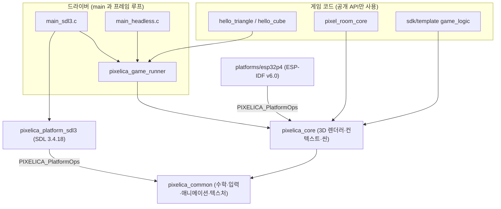
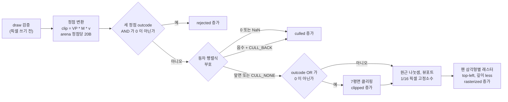

# Pixelica 개발 문서

> **구현 기준일 2026-10-09** · 라이브러리 버전 0.1.0 (`project(Pixelica VERSION 0.1.0 LANGUAGES C)`) · 언어 C11 ·
> 이 문서는 기준일의 작업 트리에 있는 소스를 읽고 정리한 개발자 핸드북입니다. 아직 첫 커밋, 푸시, GitHub Actions 실행은 없고,
> 라이선스는 정해지지 않았습니다. 실제 ESP32-P4/Raspberry Pi 보드는 사용한 적이 없습니다.

> **2026-10-10 추가 (2D / 2.5D 분리).** 1–26장은 위 기준일의 **3D 전용 트리**를 설명하며, 그 서술(타깃 표, 소스 목록, SDK 구성)은 이력으로 남겨 두었습니다.
> 2D 렌더러, 2.5D 하이브리드, 2D/3D SDK 분리, 새 데모는 [27장](#27-2d--25d-확장-2026-10-10)이 현재 구조를 설명하고 해당 부분에서는 그쪽이 우선합니다.
> 이 추가분의 빌드·테스트·캡처·패키징 결과는 `DIMENSIONS_AUDIT.md` (local-only record)가 기준 기록입니다.

> **2026-10-10 추가 (입력 매니저).** 1–26장의 입력 서술(11장: 논리 버튼 7비트, SDL3 키보드, `P3IN` v1)은 기준선으로 그대로 보존합니다. 기본값이 `OFF`인 **선택 모듈**
> `Pixelica::input_manager`(키보드·컨트롤러·사용자 정의 하드웨어 → 액션, 2D·3D 공통)와 빌드 전용 SDL3 어댑터는 [28장](#28-입력-매니저-2026-10-10)과
> [`input_manager.md`](input_manager.md)가 설명하고 검증 기록은 `INPUT_MANAGER_AUDIT.md` (local-only record)입니다. 기본 PAL과 예제의 키 경로는 바뀌지 않았고,
> 이미 만든 2D/3D SDK 압축 파일은 다시 빌드하지 않아 이 모듈을 포함하지 않습니다.

## 이 문서를 읽는 법

> **2026-10-10 추가 (온라인).** 방 코드 협동·실시간 대전·영구 최고 점수/기록 공유는 기본 `OFF`인
> `Pixelica::online` 선택 모듈입니다. [29장](#29-온라인-2026-10-10), [`online.md`](online.md),
> `ONLINE_AUDIT.md` (local-only record)를 참조하세요. 기존 2D/3D 압축 파일은 이 모듈을 포함하지 않습니다.

> **2026-10-10 추가 (오디오).** 선택 모듈 `Pixelica::audio`와 PC 출력 `Pixelica::audio_sdl3`는
> [30장](#30-오디오-2026-10-10), [`audio.md`](audio.md)를 참조하세요. 이전 장의 "오디오 없음"은 당시 기준선입니다.
> 기본 SDK ZIP에는 오디오가 포함되지 않으며 소스 빌드에서 `PIXELICA_BUILD_AUDIO=ON`으로 선택합니다.

- **확인 기준**: 공개 헤더(`include/pixelica/*.h`)로 API 계약을, 대응하는 `src/` 구현과 테스트로 현재 동작을 확인합니다.
  헤더와 구현이 어긋나면 재현 결과를 확인해 주석·코드·문서를 함께 바로잡습니다. `Pixelica_Plan.md`는 미래 의도를 담은 기획서입니다.
- **코드 블록 규칙**: ` ```c ` 블록은 이 문서 전체에서 [17장 "실행 가능한 최소 예제"](#17-실행-가능한-최소-예제) 하나뿐이며 그대로 컴파일됩니다.
  다른 C/CMake 조각은 ` ```text ` 블록에 담고 첫 줄에 `조각(fragment)`라고 표시했습니다. 조각은 단독으로 컴파일되지 않습니다.
- **수치의 출처**: 성능·테스트 수치는 [`benchmarks/`](../benchmarks/)의 원본 JSON과 `REMAINING_AUDIT.md` (local-only record)에서 인용했습니다.
  성능·안정성 표는 기존 검증 기록이며, "계산"이라고 적은 값은 소스의 식으로 직접 계산한 값입니다. 17장의 문서 예제는 별도로 Windows/Linux 빌드·실행을 확인했습니다.
- 링크는 모두 `docs/` 기준 상대 경로입니다.

## 목차

1. [구현 기준선과 지원 범위](#1-구현-기준선과-지원-범위)
2. [사전 요구사항과 고정 버전](#2-사전-요구사항과-고정-버전)
3. [빌드 재현](#3-빌드-재현)
4. [저장소 구조와 CMake 타깃](#4-저장소-구조와-cmake-타깃)
5. [모듈 경계와 소스 탐색](#5-모듈-경계와-소스-탐색)
6. [코딩 규약과 좌표계](#6-코딩-규약과-좌표계)
7. [엔진 수명주기와 상태 및 에러](#7-엔진-수명주기와-상태-및-에러)
8. [소유권과 메모리](#8-소유권과-메모리)
9. [렌더 파이프라인](#9-렌더-파이프라인)
10. [고정 타임스텝](#10-고정-타임스텝)
11. [입력과 기록 재생](#11-입력과-기록-재생)
12. [씬과 충돌](#12-씬과-충돌)
13. [에셋 포맷과 로더](#13-에셋-포맷과-로더)
14. [에셋 도구 pixelica_pack](#14-에셋-도구-pixelica_pack)
15. [예제 게임 러너와 Pixel Room](#15-예제-게임-러너와-pixel-room)
16. [SDK 설치와 사용](#16-sdk-설치와-사용)
17. [실행 가능한 최소 예제](#17-실행-가능한-최소-예제)
18. [새 요소 추가하기](#18-새-요소-추가하기)
19. [플랫폼 계층과 SDL3](#19-플랫폼-계층과-sdl3)
20. [ESP32-P4 포트](#20-esp32-p4-포트)
21. [테스트 지도](#21-테스트-지도)
22. [성능과 안정성 측정값](#22-성능과-안정성-측정값)
23. [문제 해결](#23-문제-해결)
24. [개발 워크플로와 변경 체크리스트](#24-개발-워크플로와-변경-체크리스트)
25. [알려진 한계와 다음 단계](#25-알려진-한계와-다음-단계)
26. [참고 자료와 용어집](#26-참고-자료와-용어집)
27. [2D / 2.5D 확장 (2026-10-10)](#27-2d--25d-확장-2026-10-10)
28. [입력 매니저 (2026-10-10)](#28-입력-매니저-2026-10-10)
29. [온라인 (2026-10-10)](#29-온라인-2026-10-10)
30. [오디오 (2026-10-10)](#30-오디오-2026-10-10)
31. [선택 파티클 모듈 (2026-10-10)](#31-선택-파티클-모듈-2026-10-10)
32. [선택 CPU 쉐이더 (2026-10-10)](#32-선택-cpu-쉐이더-2026-10-10)

---

## 1. 구현 기준선과 지원 범위

### 1.1 문서들의 성격

| 문서 | 성격 | 이 문서와의 관계 |
|---|---|---|
| `Pixelica_Plan.md` (로컬 검증 자료) | 기획서 v0.1.0, "설계 확정 초안 / 구현 전" 상태로 작성. **변경하지 않음** | 의도와 로드맵. 구현 사실의 근거로 쓰지 않습니다 |
| `G0_AUDIT.md` (local-only record) | G0 시점의 역사적 감사 기록. 그 안의 개수·수치는 G0 트리 기준 | 읽기 전용 이력 |
| `REMAINING_AUDIT.md` (local-only record) | 2026-10-09 잔여 게이트(G1–G5) 감사 기록 | 테스트·성능 수치의 출처 |
| [`README.md`](../README.md) | 현재 상태 요약, 빌드·실행 명령 | 명령의 1차 출처 |
| [`api.md`](api.md) / [`architecture.md`](architecture.md) / [`sdk.md`](sdk.md) / [`porting.md`](porting.md) / [`asset_format.md`](asset_format.md) / [`art_style.md`](art_style.md) | 영역별 레퍼런스 | 이 문서는 이들을 대체하지 않고 연결합니다 |
| **이 문서** | 2026-10-09 구현을 기준으로 한 개발자 핸드북 | 처음 합류하는 개발자의 단일 진입점 |

### 1.2 기획서와 달라진 점

기획서의 문장을 구현 사실로 인용하면 안 되는 대표 사례입니다.

| 항목 | 기획서 | 구현 (2026-10-09) |
|---|---|---|
| `pixelica_begin_frame` | `(ctx)` | `(ctx, clear_color)` — 클리어 색을 받음 |
| 그리기 | `pixelica_draw_mesh(ctx, mesh, texture, model)` | `pixelica_draw_mesh(ctx, mesh, model)` + `pixelica_draw_mesh_ex(ctx, mesh, model, material)`; 텍스처는 `PIXELICA_Material`로 전달 |
| `PIXELICA_Status` | 6개 코드 | `PIXELICA_ERR_NOT_FOUND`가 추가된 7개 ([`status.h`](../include/pixelica/status.h)) |
| 렌더 프로파일 | `PIXELICA_TINY`/`PIXELICA_STANDARD`/`PIXELICA_ENHANCED`(320x240) | 코드에 이런 상수는 없습니다. 해상도는 `PIXELICA_Config`로 자유롭게 정하고, Pixel Room만 `PIXEL_ROOM_TINY_*`(160x120)/`PIXEL_ROOM_STANDARD_*`(256x192)를 가짐. 320x240 프로파일 없음 |
| 조명 | "unlit → ambient + 방향광" 확장 계획 | 렌더러는 **unlit만** 지원. Pixel Room은 빌드 시점에 면 색에 조명을 구워 넣음 |
| 파이프라인 순서 | 클리핑 → 투영 → 컬링 | **컬링을 동차(homogeneous) 좌표에서 클리핑 전에** 수행 (9장) |
| 오브젝트 단위 프러스텀 컬링 | G1 계획 | 구현 없음. 삼각형 단위 reject/cull만 있음 |
| `AssetIO` 인터페이스 | G1부터 도입 | 없음. 엔진은 파일 I/O를 하지 않고, 호출자가 바이트를 넘김 |
| MCU 20–30 FPS 목표 | 가정인 목표 | 측정한 적 없음 (보드 없음) |

### 1.3 게이트 현황

[`README.md`](../README.md)와 감사 기록의 표를 요약했습니다. "통과"는 **소프트웨어 범위** 안에서 관찰된 결과입니다.

| 게이트 | 상태 | 증거의 한계 |
|---|---|---|
| G0 코어, SDL3, 첫 삼각형/큐브 | 통과 (2026-10-09) | 역사 기록 `G0_AUDIT.md` (local-only record) |
| G1 텍스처, VOX 메시, Pixel Room 정적 장면 | 통과 | 실제 VOX 내보내기 파일로는 검증하지 않음 (14장) |
| G2 이식 가능한 게임 계층 | Windows/Linux 통과, ARM64는 QEMU | 실제 Raspberry Pi 미시험 |
| G3 ESP32-P4 bring-up | **열림(open)**. ESP-IDF v6.0 컴파일만 성공 | 플래시·실행 안 함 |
| G4 성능과 품질 | 데스크톱 CPU 측정·30분 소크 통과 | MCU 성능·하드웨어 소크 없음 |
| G5 SDK 프리뷰 | 통과 | 설치된 SDK와 복사한 템플릿이 Windows/Linux에서 빌드·실행 |

### 1.4 지원 범위

| 대상 | 상태 |
|---|---|
| Windows x64 (MSVC), SDL3 또는 HEADLESS | 빌드·테스트 관찰됨 |
| Linux x64 (GCC 13.3, Ubuntu 24.04 WSL2), SDL3 또는 HEADLESS | 관찰됨 |
| Linux ARM64 (교차 빌드 + QEMU 8.2.2) | HEADLESS 테스트가 QEMU에서 통과 |
| ESP32-P4, ESP-IDF v6.0 | 컴파일(ELF/bin 생성)만. 실행 안 함 |
| Raspberry Pi | 시험하지 않음 |
| 물리 키보드로 직접 플레이 | 수행하지 않음 (SDL 창 실행은 60프레임 완주·종료 코드 0까지만 확인) |
| GitHub Actions | 실행하지 않음 ([`ci.yml`](../.github/workflows/ci.yml)은 제공만) |

**범위 밖**: 오디오, 에디터, ECS, glTF 가져오기, GPU 3D 파이프라인, 스크립팅/동적 로딩, 씬 계층, 스윕 AABB 이상의 물리,
텍스처 필터링·밉맵·알파, 런타임 조명, 게임패드, ESP32-P4의 RGB/MIPI-DSI 패널.

### 1.5 실물 보드가 없다는 뜻

LCD, GPIO, PSRAM 배치, 캐시/DMA 동작, 보드 성능, 하드웨어 소크는 **전부 미검증**입니다. 펌웨어가 컴파일된다는 사실과 호스트용 모의(mock) 테스트
통과는 이를 대신하지 않습니다. 보드 관련 항목(핀, LCD 모델, 클럭, PSRAM 크기)은 저장소 어디에도 정해져 있지 않으며 문서에서는 `N/A`로 표기합니다 (20장).

---

## 2. 사전 요구사항과 고정 버전

| 항목 | 요구 | 비고 |
|---|---|---|
| CMake | 데스크톱 **3.21 이상** | 루트 `cmake_minimum_required(VERSION 3.21)`; 펌웨어 프로젝트는 ESP-IDF 규칙에 따라 **3.22 이상** |
| C 컴파일러 | C11 (MSVC: Visual Studio 2019 16.8+ / 2022, GCC, Clang) | MSVC는 "Desktop development with C++" 워크로드(Windows SDK 포함). 이식 기준은 C11 |
| Python | **3.8 이상**, 표준 라이브러리만 | 에셋 도구와 Python 테스트용. 없으면 해당 테스트는 건너뜀 (`-DPIXELICA_REQUIRE_PYTHON=ON`이면 오류) |
| SDL | **3.4.18 고정** (SDL3 플랫폼에서만) | 설치된 정확한 버전을 먼저 찾고, 없으면 `-DPIXELICA_FETCH_SDL3=ON`으로 공식 릴리스 아카이브를 내려받아 정적 빌드 |
| ESP-IDF | **v6.0**, 타깃 **esp32p4만** | v6.0.x 패치는 경고, 그 밖은 거부(`-DPIXELICA_ALLOW_OTHER_IDF=ON`으로 우회할 수 있으나 미지원). IDF는 C를 자체 `gnu23`으로 컴파일하며 코어는 C11 그대로 컴파일됨 |
| QEMU | 선택 (ARM64 교차 테스트) | `gcc-aarch64-linux-gnu`, `qemu-user`, `ninja-build` |

SDL 고정 세부:

- URL `https://github.com/libsdl-org/SDL/releases/download/release-3.4.18/SDL3-3.4.18.tar.gz`,
  SHA256 `9c75cf16330322c217dedd2e0609f1124f1b54b8633e763467b4684d0f4334a3` (CMake `FetchContent`가 검증).
- `-DSDL3_DIR=...` 또는 `-DCMAKE_PREFIX_PATH=...`로 설치본을 가리킬 수 있고, `-DPIXELICA_ALLOW_NEWER_SDL3=ON`은 더 새 버전을 허용합니다(검증된 버전이 아님).
- 가져온 SDL 소스에는 sanitizer가 적용되지 않습니다.
- Linux에서 SDL을 직접 빌드하려면 X11/Wayland 개발 패키지가 필요합니다 (3.2절의 apt 목록).

감사에 쓴 환경(참고): Windows 11 Home 10.0.26300 x64, VS2022 MSVC 19.44.35215, CMake 3.31.6 / Ubuntu 24.04 x86_64(WSL2), GCC 13.3.0, CMake 3.28.3, Ninja /
aarch64-linux-gnu GCC 13.3 + QEMU 8.2.2 / ESP-IDF v6.0 + RISC-V GCC 15.2. 이는 "그 환경에서 관찰됨"일 뿐 다른 조합을 금지하는 것이 아닙니다.

---

## 3. 빌드 재현

모든 명령은 저장소 루트에서 실행합니다. `Debug`는 `Release`로 바꿀 수 있습니다. 최상위 프로젝트로 빌드하고 `CMAKE_BUILD_TYPE`이 비어 있으면
단일 구성 생성기에서는 `Debug`가 기본값입니다.

### 3.1 Windows PowerShell (Visual Studio 생성기, SDL3)

```powershell
cmake -S . -B build -G "Visual Studio 17 2022" -A x64 `
  -DPIXELICA_PLATFORM=SDL3 -DPIXELICA_FETCH_SDL3=ON `
  -DPIXELICA_WARNINGS_AS_ERRORS=ON -DPIXELICA_REQUIRE_PYTHON=ON
cmake --build build --config Debug --parallel
ctest --test-dir build -C Debug --output-on-failure
.\build\Debug\hello_cube.exe
.\build\Debug\pixel_room.exe
```

- SDL 3.4.18이 설치되어 있으면 `-DPIXELICA_FETCH_SDL3=ON`을 생략합니다.
- 다중 구성 생성기(Visual Studio)는 `--config`와 `ctest -C`로 구성을 고르고, 예제 실행 파일은 `build\<Config>\`에 놓입니다.
- Ninja 같은 단일 구성 생성기는 configure 때 `-G Ninja -DCMAKE_BUILD_TYPE=Debug`를 주고, 실행 파일은 `build\` 바로 아래입니다.
  이때는 `cl.exe`가 PATH에 있도록 **Developer PowerShell for VS**에서 실행하세요.
- 창 없이 스모크만 돌리려면 `.\build\Debug\pixel_room.exe --frames 60 --hidden`.

### 3.2 Linux (GCC/Clang, SDL3)

```sh
# Debian/Ubuntu 예시. 배포판에 맞게 조정하세요.
sudo apt-get install build-essential cmake pkg-config libx11-dev libxext-dev \
  libxrandr-dev libxcursor-dev libxfixes-dev libxi-dev libxss-dev libxtst-dev libxkbcommon-dev \
  libwayland-dev wayland-protocols libdrm-dev libgbm-dev libgl1-mesa-dev \
  libegl1-mesa-dev libasound2-dev libudev-dev libdbus-1-dev

cmake -S . -B build -DCMAKE_BUILD_TYPE=Debug -DPIXELICA_PLATFORM=SDL3 -DPIXELICA_FETCH_SDL3=ON \
  -DPIXELICA_WARNINGS_AS_ERRORS=ON -DPIXELICA_REQUIRE_PYTHON=ON
cmake --build build --parallel
ctest --test-dir build --output-on-failure
./build/pixel_room
```

### 3.3 Headless (SDL 없음, 창 없음)

```powershell
# Windows PowerShell
cmake -S . -B build-headless -G "Visual Studio 17 2022" -A x64 -DPIXELICA_PLATFORM=HEADLESS -DPIXELICA_WARNINGS_AS_ERRORS=ON -DPIXELICA_REQUIRE_PYTHON=ON
cmake --build build-headless --config Debug --parallel
ctest --test-dir build-headless -C Debug --output-on-failure
.\build-headless\Debug\hello_cube.exe --frames 10
```

```sh
# Linux
cmake -S . -B build-headless -DCMAKE_BUILD_TYPE=Debug -DPIXELICA_PLATFORM=HEADLESS
cmake --build build-headless
ctest --test-dir build-headless --output-on-failure
./build-headless/hello_cube --frames 10
```

HEADLESS는 `platforms/sdl3`를 추가하지 않으므로 SDL을 찾지도 요구하지도 않습니다. 예제는 마지막 프레임의 FNV-1a 해시를 계산하는 작은 PAL을 쓰고
`headless: presented=10 last_frame_fnv1a=XXXXXXXX`를 출력합니다. 이는 렌더링이 돌았다는 증거이지 화면이 어떻게 보이는지의 증거가 아닙니다.
`--frames`가 없으면 120프레임을 돌고 끝납니다(종료 요청을 보낼 방법이 없기 때문).

### 3.4 Sanitizer

```sh
# Linux GCC/Clang: ASan + UBSan (UB는 복구 불가로 설정됨)
cmake -S . -B build-asan -DCMAKE_BUILD_TYPE=Debug -DPIXELICA_PLATFORM=HEADLESS -DPIXELICA_SANITIZE=ON \
  -DPIXELICA_WARNINGS_AS_ERRORS=ON -DPIXELICA_REQUIRE_PYTHON=ON
cmake --build build-asan --parallel
ASAN_OPTIONS=detect_stack_use_after_return=1:detect_leaks=1 ctest --test-dir build-asan --output-on-failure
```

```powershell
# Windows MSVC: AddressSanitizer만. "Developer PowerShell for VS 2022"에서 실행 (ASan 런타임 DLL 탐색)
cmake -S . -B build-win-asan -G "Visual Studio 17 2022" -A x64 -DPIXELICA_PLATFORM=HEADLESS -DPIXELICA_SANITIZE=ON -DPIXELICA_WARNINGS_AS_ERRORS=ON -DPIXELICA_REQUIRE_PYTHON=ON
cmake --build build-win-asan --config Debug --parallel
ctest --test-dir build-win-asan -C Debug --output-on-failure
```

- GCC/Clang: `-fsanitize=address,undefined -fno-sanitize-recover=undefined -fno-omit-frame-pointer`.
- MSVC(VS 2019 16.9+): `/fsanitize=address`, `/RTC*`를 제거하고 `/INCREMENTAL:NO`를 사용합니다. **MSVC에는 UBSan이 없고 leak 검출을 주장하지 않습니다.**
- MinGW에서는 `PIXELICA_SANITIZE`가 즉시 거부됩니다.
- `PIXELICA_SANITIZE=ON`이면 `sdk_installed_template` 테스트가 등록되지 않습니다 (템플릿이 sanitizer 런타임 없이 빌드되므로).

### 3.5 ARM64 교차 빌드 (Linux 호스트, QEMU 실행)

```sh
sudo apt-get install gcc-aarch64-linux-gnu qemu-user ninja-build
cmake -S . -B build-arm64 -G Ninja -DCMAKE_TOOLCHAIN_FILE=cmake/toolchains/aarch64-linux-gnu.cmake \
  -DPIXELICA_PLATFORM=HEADLESS -DCMAKE_BUILD_TYPE=Release
cmake --build build-arm64 && ctest --test-dir build-arm64 --output-on-failure
```

[`aarch64-linux-gnu.cmake`](../cmake/toolchains/aarch64-linux-gnu.cmake)가 `CMAKE_CROSSCOMPILING_EMULATOR`로 `qemu-aarch64 -L /usr/aarch64-linux-gnu`를 지정합니다.
교차 컴파일에서는 `sdk_installed_template`도 등록되지 않습니다. 이 결과는 실제 Raspberry Pi에 대해 아무것도 말해주지 않습니다.

### 3.6 CMake 옵션 기본값

| 옵션 | 최상위 | `add_subdirectory` 하위 | 설명 |
|---|---|---|---|
| `PIXELICA_PLATFORM` | `SDL3` | `HEADLESS` | `SDL3` 또는 `HEADLESS`. 그 외 값은 FATAL_ERROR |
| `PIXELICA_BUILD_EXAMPLES` | `ON` | `OFF` | 예제 빌드 |
| `PIXELICA_BUILD_BENCHMARKS` | `ON` | `ON` | `pixel_room_capture` 빌드 (예제가 켜져 있을 때만 의미) |
| `PIXELICA_BUILD_TESTS` | `ON` | `OFF` | 테스트 등록. 최상위에서는 `BUILD_TESTING`도 켜져 있어야 함 |
| `PIXELICA_INSTALL` | `ON` | `OFF` | install 규칙과 `Pixelica` 패키지 |
| `PIXELICA_REQUIRE_PYTHON` | `OFF` | `OFF` | Python 3.8 없음을 오류로 만듦 |
| `PIXELICA_SANITIZE` | `OFF` | `OFF` | 3.4절 |
| `PIXELICA_WARNINGS_AS_ERRORS` | `OFF` | `OFF` | GCC/Clang `-Werror`, MSVC `/WX` (저장소 타깃에만) |
| `PIXELICA_FETCH_SDL3` | `OFF` | — | SDL3 플랫폼에서만 정의됨 |
| `PIXELICA_ALLOW_NEWER_SDL3` | `OFF` | — | SDL3 플랫폼에서만 정의됨 |
| `PIXELICA_PY_TEST_DIR` | 빈 값(자동 탐색) | — | 캐시 변수. `tools/pixelica_pack/tests` → `tests/python` 순으로 탐색 |
| `BUILD_TESTING` | `ON` | 상위 프로젝트 설정 | `include(CTest)`는 최상위에서만. 저장소 안에서는 `PIXELICA_BUILD_TESTS`와 결합되어 덮어씀 |
| `CMAKE_BUILD_TYPE` | 비어 있으면 `Debug` | 상위 설정 | 단일 구성 생성기에서만 강제 |
| `PIXELICA_ALLOW_OTHER_IDF` | — | — | **펌웨어 전용**(`firmware/esp32p4`), 미지원 IDF 허용 |
| `PIXELICA_ROOT` (환경변수) | — | — | **펌웨어 전용**, 컴포넌트가 저장소 루트를 못 찾을 때 지정 |

Debug 구성의 `pixelica_core` 라이브러리 파일명에는 `d`가 붙습니다(`pixelica_cored.lib`/`libpixelica_cored.a`). 경고 플래그는 `pixelica_options`(INTERFACE)에서 옵니다:
GCC/Clang `-Wall -Wextra -Wpedantic -Wshadow -Wconversion -Wstrict-prototypes -Wmissing-prototypes`, MSVC `/W4 /permissive-`.
`CMAKE_C_STANDARD 11`, `CMAKE_C_EXTENSIONS OFF`입니다.

---

## 4. 저장소 구조와 CMake 타깃

### 4.1 디렉터리

| 경로 | 역할 |
|---|---|
| [`include/pixelica/`](../include/pixelica/) | 공용·3D 공개 헤더. `pixelica.h`는 기존 3D API의 진입점 |
| [`src/`](../src/) | `pixelica_common` 5개 소스 + `pixelica_core` 7개 소스, 명시 목록은 `cmake/PixelicaSources.cmake` |
| [`modules/`](../modules/) | `renderer2d/`, `hybrid/`, 선택 모듈 `skeleton/`, `ik/` (리깅 두 모듈은 기본 `OFF`; [`rigging.md`](rigging.md)) |
| [`platforms/sdl3/`](../platforms/sdl3/) | SDL3 PAL, 레터박스 계산, 예제 공통 `main()` |
| [`platforms/esp32p4/`](../platforms/esp32p4/) | ESP-IDF PAL, LCD 전송 계층, 호스트 테스트 |
| [`firmware/esp32p4/`](../firmware/esp32p4/) | ESP-IDF 프로젝트, `pixelica` 컴포넌트, 보드 훅 |
| [`examples/`](../examples/) | `hello_triangle`, `hello_cube`, `hello_animation`, `hello_rig`(두 선택 모듈이 모두 `ON`일 때만), `pixel_room`, `common/`(러너·헤드리스 드라이버) |
| [`sdk/template/`](../sdk/template/) | 복사해서 쓰는 시작 프로젝트 |
| [`cmake/`](../cmake/) | 패키지 설정 템플릿, `cmake -P` 테스트 드라이버, 툴체인 |
| [`tools/pixelica_pack/`](../tools/pixelica_pack/) | 오프라인 에셋 도구(Python) 와 그 테스트 |
| [`assets/`](../assets/) | VOX/PPM 원본과 컴파일 산출물(재현 가능) |
| [`tests/`](../tests/) | 헤드리스 C 테스트 `test_*.c` |
| [`benchmarks/`](../benchmarks/) | 측정 원본 JSON, 환경 기록 |
| [`docs/`](.) | 문서 |

### 4.2 타깃 관계

| 타깃 | 내용 | 의존 |
|---|---|---|
| `pixelica_options` (INTERFACE) | 경고/sanitizer 플래그 | — |
| `pixelica_common` (STATIC, `Pixelica::common`) | 수학·입력·애니메이션·컨테이너·텍스처 로더 5개 명시 소스 | Unix에서 `m`; 빌드 전용 `pixelica_options` |
| `pixelica_core` (STATIC, `Pixelica::core` = `Pixelica::renderer3d`) | 컨텍스트·3D 렌더러·씬·메시/카트 로더 7개 명시 소스 | `pixelica_common`; 빌드 전용 `pixelica_options` |
| `pixelica_renderer2d` (`Pixelica::renderer2d`) | `modules/renderer2d/renderer2d.c` | `pixelica_common` |
| `pixelica_hybrid` (`Pixelica::hybrid`) | `modules/hybrid/hybrid.c` | `pixelica_core`, `pixelica_renderer2d` |
| `pixelica_platform_sdl3` | `platform_sdl3.c`, `letterbox.c` | `pixelica_common`, SDL3 |
| `pixelica_game_runner` | `examples/common/game_runner.c` | `pixelica_core` |
| `pixelica_example_driver` (OBJECT) | SDL3: `platforms/sdl3/main_sdl3.c` / HEADLESS: `examples/common/main_headless.c` | 러너, (SDL3면) 플랫폼 |
| `hello_triangle`, `hello_cube` | `pixelica_add_example(name)` | 드라이버 |
| `pixel_room_core` | `pixel_room.c`, `pixel_room_world.c` (플랫폼·내장 데이터 없음) | `pixelica_core` |
| `pixel_room_embedded` | `room_embedded.c` + 생성된 `pixel_room_assets.h` | `pixel_room_core` |
| `pixel_room`, `pixel_room_tiny` | `pixel_room_game.c` + `PIXEL_ROOM_WIDTH/HEIGHT` 정의 | 드라이버, 내장 에셋 |
| `pixel_room_capture` | 헤드리스 스크린샷/통계/벤치 도구(자체 `main`) | `pixel_room_embedded` |
| `test_*` | 활성 프로파일의 `tests/test_*.c` 하나당 실행 파일 | 검사 대상에 따라 공용·2D·3D·선택 모듈 |
| `test_esp32p4_lcd_transport` | 모의 포트로 `lcd_transport.c` 검증 (ESP-IDF 불필요) | 없음 |
| `pixelica_letterbox_test` | 레터박스 계산 단위 테스트 (SDL3 빌드) | 없음 |

설계 포인트:

- 공용·2D·3D·하이브리드·선택 모듈을 각각 설치·요청할 수 있습니다 (27장). 기존 `core` 설치 컴포넌트는 공용까지 포함한 완전한 3D SDK입니다. 경고 플래그는 설치 패키지에 새지 않습니다.
- 루트는 `add_subdirectory(examples)` **전에** 테스트를 등록해야 합니다. `examples/CMakeLists.txt`가 `cmake_language(DEFER ...)`로 `test_pixel_room`에
  `pixel_room_core`를 링크하기 때문입니다. `PIXELICA_BUILD_EXAMPLES=OFF`이면 이 테스트 하나만 생략됩니다(`PIXELICA_EXAMPLE_TESTS` 목록).
- Pixel Room 실행 파일은 `assets/compiled/pixel_room_assets.h`가 있어야 만들어집니다. 없으면 경고만 내고 건너뜁니다 (생성 방법은 14.6절).



---

## 5. 모듈 경계와 소스 탐색

### 5.1 경계 규칙 ([`architecture.md`](architecture.md))

1. `src/`는 공개 헤더, 코어 내부의 비공개 헤더, 표준 C 헤더를 포함합니다. SDL/ESP-IDF 헤더를 포함하지 않습니다.
2. SDL3 의존은 `platforms/sdl3/`와 SDK의 `main_sdl3.c` 드라이버에, ESP-IDF 의존은 `platforms/esp32p4/`와 `firmware/esp32p4/`에 둡니다.
   `lcd_transport.c`는 ESP-IDF 헤더가 없는 순수 C이므로 호스트에서도 검증할 수 있습니다.
3. 예제와 SDK 템플릿은 공개 API(와 예제용 [`pixelica_game.h`](../examples/common/pixelica_game.h))만 호출하며, 게임 코드 안에 플랫폼 `#ifdef`가 없습니다.
4. 게임은 논리 버튼(`PIXELICA_BTN_*`)만 읽고 키나 핀을 알지 못합니다.
5. Python 에셋 도구는 데스크톱 전용이며 펌웨어에 포함되지 않습니다.

### 5.2 `src/` 모듈

| 모듈 | 파일 | 책임 | 공개 헤더 |
|---|---|---|---|
| core | [`context.c`](../src/core/context.c), [`context_internal.h`](../src/core/context_internal.h) | 컨텍스트 생성/파괴, 메모리 레이아웃·가드, 프레임 프로토콜, 고정 타임스텝 | [`pixelica.h`](../include/pixelica/pixelica.h) |
| renderer | [`pipeline.c`](../src/renderer/pipeline.c), [`rasterizer.c`](../src/renderer/rasterizer.c), [`raster.h`](../src/renderer/raster.h), [`draw_internal.h`](../src/renderer/draw_internal.h) | 검증, 변환, reject/cull, 클리핑, 투영, 삼각형 채우기, 깊이, 텍스처 샘플 | [`renderer.h`](../include/pixelica/renderer.h) |
| math | [`mat4.c`](../src/math/mat4.c) | 열 우선 4x4 행렬 | [`math.h`](../include/pixelica/math.h) |
| input | [`input.c`](../src/input/input.c) | RLE 기록, 재생, `P3IN` 직렬화 | [`input.h`](../include/pixelica/input.h) |
| assets | [`container.c/.h`](../src/assets/container.c), [`mesh_asset.c`](../src/assets/mesh_asset.c), [`texture_asset.c`](../src/assets/texture_asset.c), [`cart.c`](../src/assets/cart.c) | v1 컨테이너 파싱, CRC-32, 메시/텍스처/카트 로더 | [`assets.h`](../include/pixelica/assets.h) |
| scene | [`scene.c`](../src/scene/scene.c), [`aabb.c`](../src/scene/aabb.c) | 고정 용량 씬 목록, 스윕 AABB 이동 | [`scene.h`](../include/pixelica/scene.h) |
| animation | [`animation.c`](../src/animation/animation.c) | 이징, 스칼라 tween, 키프레임 샘플링, 재생 플레이어, 피벗 변환 행렬 ([`animation.md`](animation.md), 12.4절) | [`animation.h`](../include/pixelica/animation.h) |
| *(선택)* skeleton | [`modules/skeleton/skeleton.c`](../modules/skeleton/skeleton.c) | `PIXELICA_BUILD_SKELETON=ON`일 때만. 계층 포즈·팔레트·위치 전용 선형 블렌드 스키닝 ([`rigging.md`](rigging.md) 3절) | [`skeleton.h`](../modules/skeleton/include/pixelica/skeleton.h) |
| *(선택)* ik | [`modules/ik/ik.c`](../modules/ik/ik.c) | `PIXELICA_BUILD_IK=ON`일 때만. 해석적 두 본 IK ([`rigging.md`](rigging.md) 4절) | [`ik.h`](../modules/ik/include/pixelica/ik.h) |
| (PAL 계약) | — | 구현은 플랫폼 쪽 | [`platform.h`](../include/pixelica/platform.h), [`status.h`](../include/pixelica/status.h) |

`scene.c`는 같은 코어 안의 비공개 헤더(`core/context_internal.h`, `renderer/draw_internal.h`)를 포함해 노드 검증과 렌더 사전 검사를 렌더러와 공유합니다.
코어 밖에서는 이 비공개 헤더에 의존하지 마세요 (`tests/`만 `src/`를 include 경로에 가짐).

### 5.3 "이 동작은 어디서?"

| 알고 싶은 것 | 시작점 |
|---|---|
| 단일 블록 레이아웃, 가드 바이트 | `context.c`의 `pixelica_compute_layout`, `pixelica_memory_guards_intact` |
| 60 Hz 누산기 | `context.c`의 `pixelica_update` |
| draw 검증 순서와 상태 코드 | `pipeline.c`의 `pixelica_draw_mesh_ex`, `pixelica_check_mesh_structure/data` |
| reject → cull → clip → 투영 | `pipeline.c`의 `pixelica_draw_triangle` |
| 7평면 클리핑 | `pipeline.c`의 `pixelica_clip_polygon`, `pixelica_intersect` |
| top-left 규칙, 깊이 보간, UV 샘플 | `rasterizer.c`의 `pixelica_raster_triangle`, `pixelica_sample`, `pixelica_texel_index` |
| 행렬 인덱싱, 원근 투영 | `mat4.c` |
| 축 순서 스윕 | `aabb.c`의 `pixelica_aabb_move`, `pixelica_sweep_axis`, `pixelica_clamp_to_contact` |
| 씬 검증과 부분 실패 | `scene.c`의 `pixelica_check_node`, `pixelica_scene_render` |
| 컨테이너 규칙 | `container.c`의 `pixelica_container_parse` |
| 카트 디렉터리 규칙 | `cart.c`의 `pixelica_cart_open` |
| P3IN 인코딩/디코딩 | `input.c`의 `pixelica_input_encode`, `pixelica_input_decode_count` |
| 예제 프레임 루프 | [`game_runner.c`](../examples/common/game_runner.c)의 `pixelica_game_run` |
| Pixel Room 시뮬레이션 | [`pixel_room.c`](../examples/pixel_room/pixel_room.c)의 `pixel_room_update`, [`pixel_room_world.c`](../examples/pixel_room/pixel_room_world.c)의 `pr_build_world` |

---

## 6. 코딩 규약과 좌표계

### 6.1 C11 규약

- 공개 함수/타입은 `pixelica_`/`PIXELICA_` 접두어, 비공개 정적 함수는 모듈 접두어(`pixelica_`, `pr_`)를 씁니다. 공개 헤더는 `extern "C"`로 감쌉니다.
- 실패 가능한 코어 함수는 `PIXELICA_Status`를 돌려줍니다. `void` 함수의 잘못된 인자 처리는 각 API 계약을 따릅니다:
  잘못된 cull 값은 무시하지만 `pixelica_set_view_projection`에 NULL/비유한 행렬을 주면 카메라가 무효화됩니다.
- **검증 먼저, 쓰기는 나중**(transactional): 실패한 draw/로드/인코딩은 버퍼·저장소를 바꾸지 않습니다.
- 프레임 중 힙 할당 금지. 힙 할당은 `pixelica_create` 한 번이며 `pixelica_create_in_buffer`는 할당하지 않습니다.
- 컴파일 타임 검사는 C11 `_Static_assert` 대신 `typedef char name[(cond) ? 1 : -1]` 관용구를 코어에서 사용합니다 (`pipeline.c`, `input.c`, `container.c`).
- 테스트는 `assert()`에 의존하지 않습니다 (Release의 `NDEBUG`에서도 돌아야 함). [`test_util.h`](../tests/test_util.h)의 `CHECK`류를 쓰세요.
- 새 코드는 지정 초기화(`.width = ...`)를 쓰는 편이 안전합니다. 예제의 위치 기반 초기화(`{256u, 192u, 16u, 64u, 65536u}`)는 `PIXELICA_Config`에 필드가 추가되면 깨집니다.

### 6.2 좌표·수학 규약 ([`math.h`](../include/pixelica/math.h), [`renderer.h`](../include/pixelica/renderer.h))

| 항목 | 규약 |
|---|---|
| 좌표계 | 오른손, +X 오른쪽, +Y 위, 카메라는 -Z를 봄 |
| 각도 | 라디안. 회전은 "+축에서 원점을 볼 때 반시계" |
| 행렬 | `float[16]` **열 우선(column-major)**, 열 벡터에 작용. 원소 (행 r, 열 c) = `m[c*4 + r]`, 이동은 `m[12], m[13], m[14]` |
| 곱셈 | `pixelica_mat4_multiply(out, a, b)` = `out = a * b` (b가 먼저 적용). `clip = P * V * M * p`. `out`이 입력과 겹쳐도 안전 |
| `pixelica_set_view_projection` | **P·V를 미리 곱한** 행렬. 모델 행렬은 draw마다 넘김 |
| 원근 투영 | OpenGL 방식. 뷰 공간 깊이 -near..-far → NDC z -1..+1, clip `w = -z_view`. `0 < fov_y < pi`, `aspect > 0`, `near > 0`, `far > near` 아니면 `PIXELICA_ERR_INVALID_ARG`이고 `out`은 그대로 |
| 클립 평면 | `w >= PIXELICA_CLIP_W_EPSILON`(1e-5) 와 `-w <= x,y,z <= w` |
| 화면 | NDC (-1,-1)이 왼쪽 아래, 버퍼 **행 0이 위**. 픽셀 (px,py)는 중심 (px+0.5, py+0.5)에서 표본 |
| 깊이 | NDC z를 [0, 65534]로 선형 매핑(0=near). 클리어 값 `65535`(`PIXELICA_DEPTH_CLEAR`). 비교는 **strictly less** |
| 와인딩 | 화면에서 **반시계 = 앞면**. 기본 `PIXELICA_CULL_BACK` |
| 색 | RGB565. `PIXELICA_RGB565(r,g,b)`는 8비트 채널의 하위 비트를 **버림(truncate)** |
| 텍스처 | 행 0이 위. UV (0,0) = 왼쪽 위 텍셀, (1,1) = 오른쪽 아래 |
| NaN/Inf | `void` 변환 행렬 빌더는 진단하지 않고 비유한 행렬을 만들 수 있음 → draw에서 `INVALID_ARG`. `pixelica_mat4_perspective`는 직접 검사하고 실패 시 출력 보존 |

조각 — 행렬 인덱싱과 합성 순서:

```text
/* 조각(fragment): 단독 컴파일 불가 */
float t[16], r[16], m[16];
pixelica_mat4_translation(t, 1.0f, 2.0f, 3.0f);   /* t[12]=1, t[13]=2, t[14]=3 */
pixelica_mat4_rotation_y(r, 0.5f);                /* 라디안 */
pixelica_mat4_multiply(m, t, r);                  /* m = t * r : 회전 먼저, 이동 나중 */
```

---

## 7. 엔진 수명주기와 상태 및 에러

### 7.1 설정과 검증 ([`pixelica.h`](../include/pixelica/pixelica.h))

`PIXELICA_Config { uint16 width, height; uint16 max_draw_commands; uint16 max_vertices_per_mesh; uint32 frame_arena_bytes; }`

다음을 어기면 `PIXELICA_ERR_INVALID_ARG`입니다.

- `1 <= width, height <= PIXELICA_MAX_DIMENSION`(4096)
- `max_draw_commands >= 1`, `max_vertices_per_mesh >= 1`
- `frame_arena_bytes >= max_vertices_per_mesh * PIXELICA_ARENA_BYTES_PER_VERTEX` (리터럴 대신 매크로로 계산하세요)
- 플랫폼 테이블을 준 경우 `time_us`, `read_buttons`, `present_rgb565`는 NULL이면 안 됨 (`log`는 선택). 플랫폼 `NULL`은 헤드리스.

### 7.2 생성 경로

| 함수 | 메모리 | 실패 시 |
|---|---|---|
| `pixelica_create(cfg, platform, &ctx)` | `malloc` 한 번 (유일한 힙 할당) | `*out_ctx == NULL`, 누수 없음 (`INVALID_ARG`/`NO_MEMORY`) |
| `pixelica_memory_requirement(cfg, &bytes)` | — | 잘못된 설정이나 크기 오버플로는 `INVALID_ARG`, `*bytes = 0` |
| `pixelica_create_in_buffer(cfg, platform, mem, bytes, &ctx)` | 호출자 메모리, 할당 없음, **정렬 임의** | 작으면 `NO_MEMORY` |
| `pixelica_destroy(ctx)` | `pixelica_create` 블록만 `free`; 호출자 블록은 무효화만 | NULL은 no-op |

플랫폼 테이블은 **값으로 복사**되므로 테이블 자체는 수명이 필요 없지만 `userdata`는 `pixelica_destroy`까지 살아 있어야 합니다.

`pixelica_destroy` 후 컨텍스트 포인터는 쓰지 마세요. 힙 컨텍스트는 해제되었고, 호출자 버퍼 컨텍스트는 매직 값이 지워져 이후 호출이 무시되지만
이중 `pixelica_destroy(heap_ctx)`는 해제된 메모리를 읽는 미정의 동작입니다.

### 7.3 상태와 호출 순서

| 상태 | 허용 호출 | 결과 |
|---|---|---|
| 생존, 프레임 밖 | `pixelica_begin_frame` | 색=clear_color, 깊이=65535, 그리기 횟수·arena·통계 초기화 후 프레임 시작 |
| 생존, 프레임 밖 | `pixelica_draw_mesh*` / `pixelica_scene_render` | `PIXELICA_ERR_INVALID_ARG` (`stats.last_error` 기록) |
| 생존, 프레임 밖 | `pixelica_end_frame` | `PIXELICA_ERR_INVALID_ARG`, **present 호출 안 함** |
| 프레임 중 | `pixelica_begin_frame` | 프레임 재시작(이전 내용 버림) |
| 프레임 중 | `pixelica_draw_mesh*` | 즉시 래스터라이즈. 최대 `max_draw_commands`번 |
| 프레임 중 | `pixelica_end_frame` | 프레임 종료, 플랫폼이 있으면 `present_rgb565` **정확히 한 번**(동기). false면 `PIXELICA_ERR_PLATFORM` |
| 아무 때나 | `pixelica_set_view_projection`, `pixelica_set_cull_mode` | 이후 draw에 적용. 행렬이 NULL/비유한이면 **카메라 무효** → 유효한 행렬을 다시 넣을 때까지 모든 draw가 `INVALID_ARG` |
| 아무 때나 | `pixelica_update` | 10장. 프레임 상태와 무관 |

- `end_frame`이 `INVALID_ARG`나 `PLATFORM`을 돌려줘도 프레임은 닫히고 다음 `begin_frame`은 정상 동작합니다.
- 초기 내용: 색 0(검정), 깊이 65535, 카메라 항등, `PIXELICA_CULL_BACK`.
- 프레임이 끝난 뒤에도 `pixelica_color_buffer`와 `pixelica_frame_stats`는 직전 프레임의 값을 보여줍니다 (다음 `begin_frame`까지).
- 빈 메시(`index_count == 0`)는 성공하고 아무것도 그리지 않지만 **그리기 횟수와 `draw_calls`에는 포함**됩니다.

### 7.4 `PIXELICA_Status` ([`status.h`](../include/pixelica/status.h), 코드는 추가만 됨)

| 코드 | 의미 | 대표 발생 위치 |
|---|---|---|
| `PIXELICA_OK` (0) | 성공 | — |
| `PIXELICA_ERR_INVALID_ARG` | NULL/비유한/범위 밖 입력, 잘못된 호출 순서 | 설정 검증, 프레임 밖 draw, 무효 카메라, 인덱스 ≥ 정점 수, 텍스처에 UV 없음, 중복 씬 id, 겹치는 `data`/`storage` |
| `PIXELICA_ERR_NO_MEMORY` | 할당 실패 또는 호출자 메모리가 작음 | `pixelica_create*`, 로더 `storage_size` 부족, `pixelica_input_encode/decode` 버퍼 부족 |
| `PIXELICA_ERR_CAPACITY` | 설정된 한도 초과 | `max_draw_commands`, `max_vertices_per_mesh`, 씬 가득 참, 입력 기록 저장소 가득 참, 에셋 한도(`PIXELICA_ASSET_MAX_*`, 카트 1024개) |
| `PIXELICA_ERR_BAD_ASSET` | 손상/규격 위반 데이터 | 로더, `P3IN` 디코딩 (CRC 불일치 포함) |
| `PIXELICA_ERR_PLATFORM` | PAL 콜백 실패 | `present_rgb565`가 false |
| `PIXELICA_ERR_NOT_FOUND` | 조회 실패 | `pixelica_cart_find` 없는 id, `pixelica_cart_entry` 범위 밖 |

`pixelica_draw_mesh_ex`의 검사 순서(픽셀에 쓰기 전): 컨텍스트/인자/프레임/카메라/모델 행렬 → 메시 구조(인덱스 3의 배수, NULL 배열, 텍스처 치수·UV 존재) →
**용량(CAPACITY)** → 데이터(인덱스 범위, UV 유한성) → 변환(비유한 정점·오버플로). 따라서 정점 수 초과와 인덱스 오류가 동시에 있으면 `CAPACITY`가 먼저 보고됩니다.

`PIXELICA_FrameStats.last_error`는 **현재 프레임 중 가장 최근 실패**이며 `begin_frame`에서 `PIXELICA_OK`로 리셋됩니다. 프레임 밖 호출의 실패도 기록되므로
다음 `begin_frame` 전에 읽으세요.

### 7.5 스레딩

컨텍스트는 단일 스레드이고 전역 상태가 없습니다. 한 컨텍스트를 동시에 두 스레드에서 호출하면 안 됩니다. 서로 다른 컨텍스트를 여러 스레드에서 쓰는 경우는
시험한 적이 없습니다(테스트는 한 스레드에서 여러 컨텍스트/방을 번갈아 씀). ESP32-P4에서 ISR이 만지는 것은 LCD 전송 계층의 완료 카운터뿐입니다 (20장).

---

## 8. 소유권과 메모리

### 8.1 단일 블록 레이아웃 ([`context.c`](../src/core/context.c))

```text
[PIXELICA_Context][guard0][color W*H*2][guard1][depth W*H*2][guard2][arena A][guard3][coverage ceil(W*H/8)][guard4]
```

- `guard`는 `0xA5` 16바이트 5개입니다. `pixelica_memory_guards_intact(ctx)`가 1/0을 돌려줍니다 (NULL이면 0).
  가드는 색 버퍼 앞(`guard0`), 색 뒤(`guard1`), 깊이 뒤(`guard2`), arena 뒤(`guard3`), 커버리지 비트맵 뒤(`guard4`)에 있어 버퍼 언더런/오버런 쓰기를 잡습니다.
- 크기 식 (P = 2·W·H, A = `frame_arena_bytes`): 오프셋을 컨텍스트 크기에서 시작해 16바이트로 올림하고 `+16(guard0) +P +16 +P +16`, 다시 16바이트 올림,
  `+A +16`이 전체이며, `pixelica_memory_requirement`는 임의 정렬을 허용하려고 **15바이트를 더 얹은 값**입니다.
- 색+깊이만 따지면 160x120 = 76,800 B (75 KiB), 256x192 = 196,608 B (192 KiB) (계산). 컨텍스트 구조체, 가드, arena는 별도입니다.
- 색/깊이는 행 우선, 행 0이 위, stride = width, 요소는 `uint16_t`. 시작 주소는 컨텍스트가 소유하며 `pixelica_destroy`까지 유효합니다.

### 8.2 프레임 arena는 draw마다 재사용되는 스크래치입니다

- draw마다 정점 하나당 `sizeof(PIXELICA_ClipVertex)`(x,y,z,w float + outcode u32 = 20 B, `PIXELICA_ARENA_BYTES_PER_VERTEX`가 상한)를 arena **앞에서부터 덮어씁니다**.
  여러 메시의 정점 수를 **합산하지 않습니다.** 필요한 크기는 "그린 메시 중 가장 큰 것" 기준입니다.
- `PIXELICA_FrameStats.arena_high_water`는 프레임 중 한 번의 draw가 쓴 최대 바이트입니다. Pixel Room 마지막 프레임은 25,180 B = 1,259 정점 x 20 B(계산)이며
  draw 13번의 합이 아닙니다.
- 클립된 다각형(최대 3+7 = 10 정점)과 화면 정점은 arena가 아니라 **스택**의 고정 배열입니다 (`PIXELICA_PolyVertex`·`PIXELICA_ScreenVertex`는 24 B씩, 지역 배열 합계 약 1.1 KiB).
  스택이 작은 MCU 태스크에서는 이 값을 고려하세요 (펌웨어 기본 8192 B는 측정 전 출발점일 뿐).
- 큰 메시를 쓰려면 `max_vertices_per_mesh`와 `frame_arena_bytes`를 함께 키웁니다 (Pixel Room: 4096 정점, 81,920 B).

### 8.3 호출자 버퍼 API

조각 — 정적 버퍼에 컨텍스트 만들기:

```text
/* 조각(fragment): 단독 컴파일 불가. 정적 크기는 개발 중에 pixelica_memory_requirement로 확인한 값 이상이어야 한다. */
static uint8_t g_engine_memory[ENGINE_BYTES];           /* 정렬 임의 가능 (내부에서 16B 정렬) */
PIXELICA_Context *ctx = NULL;
PIXELICA_Status st = pixelica_create_in_buffer(&cfg, &ops, g_engine_memory, sizeof g_engine_memory, &ctx);
if (st == PIXELICA_ERR_NO_MEMORY) { /* ENGINE_BYTES 가 pixelica_memory_requirement 보다 작음 */ }
/* g_engine_memory 는 pixelica_destroy(ctx) 까지 건드리지 말 것 */
```

ESP32-P4 포트는 `heap_caps_malloc`으로 잡은 PSRAM(기본) 또는 내부 RAM 블록을 이 경로로 넘깁니다 (20장).

### 8.4 수명 함정 표

| 대상 | 소유자 | 유효해야 하는 기간 | 흔한 실수 |
|---|---|---|---|
| `PIXELICA_Mesh`와 정점/인덱스 배열 | 호출자 | **draw 호출 동안**. 씬 노드에 넣었다면 노드가 쓰이는 동안 | 스택 배열의 주소를 씬 노드에 저장하고 함수 반환 |
| `PIXELICA_Texture.pixels`, `PIXELICA_Material` | 호출자 | draw 동안. 씬 노드에 넣었다면 노드가 쓰이는 동안 | 자기 자신을 가리키는 구조체를 복사/이동 (예: `TemplateGame`의 `floor_material`은 같은 구조체 안 텍셀을 가리킴. 초기화 후 복사 금지) |
| 로드된 `PIXELICA_MeshAsset`/`PIXELICA_Texture` | 호출자 `storage` | 에셋을 쓰는 동안. 로드 후 입력 `data`는 **참조하지 않음** | `storage`를 먼저 해제 |
| `material.texture` | 호출자 | 해당 에셋을 그리는 동안 | 메시 에셋의 `material.texture`는 `NULL`로 시작 — 직접 바인딩해야 함 (13장) |
| `PIXELICA_Cart`와 `pixelica_cart_find/entry`가 준 포인터 | 호출자의 카트 바이트 | **카트 바이트가 살아 있는 동안** (제로 카피, 수정 금지) | 파일 버퍼를 `free`한 뒤 카트 사용; 중첩 리소스 주소는 비정렬 가능 |
| 카트 리소스 id | `pixelica_pack bundle` | **그 카트 빌드에서만** 유효 (이름 오름차순으로 1..N 부여 → 리소스를 추가/삭제하면 번호가 밀림) | id 숫자를 코드에 하드코딩. 생성된 `PIXELICA_ROOM_CART_ID_*` 매크로를 쓰고 카트와 함께 재생성 |
| 색/깊이 버퍼 포인터 | 컨텍스트 | `pixelica_destroy`까지. 내용은 `begin_frame`마다 바뀜 | PAL이 `present_rgb565`의 `pixels`를 보관하거나 해제 — **금지** |
| `PIXELICA_PlatformOps.userdata` | 호출자 | `pixelica_destroy`까지 | 스택 객체 주소를 넘기고 반환 |
| `PIXELICA_Scene.nodes`, `pixelica_scene_find` 포인터 | 호출자 | 노드 배열을 재초기화(`pixelica_scene_init`)하기 전까지 | 노드를 고친 뒤 비유한 값 저장 (검증은 add 때 한 번) |
| `PIXELICA_InputRecorder.spans` | 호출자 | 기록/인코딩이 끝날 때까지 | 용량 초과를 무시 (`PIXELICA_ERR_CAPACITY`) |
| 텍스처 로더 (과거 결함) | — | — | 로컬 청크 뷰 포인터를 보관해 stack-use-after-return이 있었고 수정됨. 회귀 테스트 [`test_asset_lifetime.c`](../tests/test_asset_lifetime.c) |

---

## 9. 렌더 파이프라인

구현은 [`pipeline.c`](../src/renderer/pipeline.c)(검증~투영)와 [`rasterizer.c`](../src/renderer/rasterizer.c)(채우기)입니다. **순서가 중요합니다**: 기획서와 달리
앞뒤 판정은 투영 후가 아니라 클리핑 전에 동차 좌표로 합니다.



### 9.1 단계

| 단계 | 내용 |
|---|---|
| 1. 검증 | 7.4절의 순서. 하나라도 실패하면 어떤 픽셀도 바뀌지 않음 |
| 2. 변환 | draw마다 `mvp = view_projection * model` 한 번, 각 정점 `(x,y,z,1)`을 변환해 arena에 저장. 입력 정점이나 결과 중 비유한 값이 있으면 `INVALID_ARG` |
| 3. outcode (7비트) | bit0 `w < 1e-5`, bit1 `x < -w`, bit2 `x > w`, bit3 `y < -w`, bit4 `y > w`, bit5 `z < -w`, bit6 `z > w`. 평면 거리는 `double`로 계산해 FLT_MAX 근처에서도 부호가 정확 |
| 4. reject | 세 outcode의 **AND ≠ 0** → `triangles_rejected`. 뒷면 판정보다 **먼저** 하므로 "화면 밖 + 뒷면"은 culled가 아니라 rejected |
| 5. 앞뒤 판정 | 세 정점 `(x, y, w)`로 만든 동차 3x3 행렬식 `det[a, b, c]`(double). `>0` 앞면(화면에서 반시계), `<0` 뒷면, `0`/NaN은 edge-on. edge-on과, `PIXELICA_CULL_BACK`일 때의 뒷면은 `triangles_culled`. `w`의 부호와 무관하게 유효하므로 near 평면을 가로지르는 삼각형도 올바름 |
| 6. 클리핑 | outcode OR ≠ 0이면 `triangles_clipped`를 올리고 해당 평면들에 **Sutherland–Hodgman**. 다각형은 최대 3+7 = 10 정점(스택 배열 16칸). 교점은 항상 inside→outside 방향으로 계산하므로 공유 모서리는 두 삼각형에서 비트 단위로 같은 점이 됨. 결과가 3 정점 미만이면 버림(이때도 `clipped`는 이미 증가) |
| 7. 투영 | `inv_w = 1/w`; `sx = (nx+1)/2 * W * 16`, `sy = (1-ny)/2 * H * 16`(행 0이 위); [0, W·16]×[0, H·16]으로 clamp한 뒤 반올림해 **4비트 서브픽셀 고정소수**로 스냅. 깊이 `z = (nz+1)/2 * 65534`를 [0, 65534]로 clamp |
| 8. 팬 | 클립 다각형을 `(0,i,i+1)` 삼각형들로 나눠 각각 래스터. **`triangles_rasterized`는 팬 삼각형 수**이므로 `submitted − culled − rejected`보다 클 수 있음 (예: 아래 벤치 2956 − 1454 − 2 = 1500 ≠ 1508) |
| 9. 채우기 | 9.2절 |

### 9.2 래스터라이저 규칙

- **좌표 범위**: `width, height ≤ 4096`이므로 서브픽셀 좌표는 17비트(≤ 2^16)이고 에지 함수 곱은 2^34 미만이라 `int64`에서 안전.
- **커버리지**: 정수(int64) 에지 함수. 방향을 정규화한 뒤 픽셀 중심 `(i·16 + 8)`에서 판정. 중심이 에지 위(E == 0)면 **top-left 에지만** 채움(그 외 에지에 -1 bias).
  공유 에지에서는 틈도 이중 커버도 없음. 스냅 후 면적 0이거나 방향이 뒤집힌 sliver는 아무것도 그리지 않음.
- **깊이**: 화면 공간에서 선형 보간(NDC z는 화면 공간에서 아핀)하고 세 정점 깊이의 [min, max]로 clamp, `(uint16)(z + 0.5)`로 반올림.
  테스트는 **strictly less** — 같은 깊이의 나중 조각은 덮어쓰지 못합니다. 따라서 **동일 평면 겹침은 그린 순서가 결과를 정함**(Pixel Room은 러그를 높이 0.03/0.06/0.09로 띄워 z-fighting을 피함).
  클리어 값 65535는 그려진 조각이 만들 수 없으므로 "깊이가 65535 = 이 프레임에서 처음 덮인 픽셀"로 판정할 수 있음.
- **원근 보정 UV**: 클립 공간에서 위치와 같은 파라미터로 선형 클리핑한 UV를 `q = w_min / w`(= 1/w에 공통 상수를 곱한 값, (0,1])와 함께 정점에 실어,
  픽셀마다 `u = Σ Eᵢ·uqᵢ / Σ Eᵢ·qᵢ`(Eᵢ = 치우침 없는 정수 에지 값)로 계산합니다. 삼각형별 기울기를 쓰지 않아 sliver에서도 오버플로가 없습니다.
- **UV 클램프와 샘플**: 텍셀 `(floor(u·w), floor(v·h))`, `u,v`는 조각마다 [0,1]로 clamp(1은 마지막 텍셀), NaN은 0, 분모가 0 이하이면 텍셀 (0,0). 랩핑·필터·밉맵 없음, 불투명.
- **색 우선순위**: `texture != NULL`이면 텍셀(**UV 필수**) > `triangle_colors[삼각형]` > `mesh->color`. 텍스처 없이 `uvs`만 있으면 UV는 검증만 하고 무시.
  텍스처와 `triangle_colors`를 같이 주면 텍스처가 이깁니다.
- 로드한 메시의 `mesh.color`는 `0xFFFF`이고 실제 색은 `material.triangle_colors`에 있습니다.

### 9.3 통계 ([`renderer.h`](../include/pixelica/renderer.h), 모든 카운터는 UINT32_MAX에서 포화, `begin_frame`에서 리셋)

| 필드 | 정의 |
|---|---|
| `draw_calls` | 받아들여진 draw 수 (빈 메시 포함) |
| `triangles_submitted` | 받아들여진 메시의 삼각형 수 |
| `triangles_rejected` | 세 정점이 같은 평면 바깥 (화면 밖) |
| `triangles_culled` | 뒷면 또는 edge-on (rejected가 아닌 것 중) |
| `triangles_clipped` | 다각형 클리핑이 필요했던 삼각형 |
| `triangles_rasterized` | 래스터러로 보낸 화면 삼각형(팬 조각) 수 |
| `fragments_covered` | 깊이 테스트 **전**에 덮은 픽셀 중심 수 (지는 조각 포함) |
| `pixels_covered` | 프레임에서 서로 다른 덮인 픽셀 수 |
| `pixels_written` | 깊이 테스트를 통과해 쓴 조각 수 |
| `arena_high_water` | 한 draw가 쓴 arena 바이트의 최대 |
| `last_error` | 이 프레임의 가장 최근 실패 |

파생 지표: 화면 점유율 = `pixels_covered / (W·H)`, 기하 overdraw = `fragments_covered / pixels_covered` (≥ 1), 셰이딩 overdraw = `pixels_written / pixels_covered`.
두 overdraw는 `pixels_covered > 0`일 때만 나눗셈하며, 0이면 캡처 도구처럼 지표도 0으로 처리합니다.
삼각형 수만으로 성능을 판단하지 마세요 (기획서의 원칙). 측정값은 22장.

### 9.4 하지 않는 것

텍스처 반복·알파 테스트·블렌딩은 [texture_options.md](texture_options.md)의 선택적 그리기 옵션으로 제공합니다.
조명, 텍스처 필터링, 밉맵, 안티앨리어싱, 자동 투명 정렬, 오브젝트 단위 프러스텀 컬링, 가드밴드, 비정사각 스케일 보정 등은 없습니다.
화면 밖 삼각형은 outcode로 싸게 버리지만 메시 전체를 미리 거르지는 않습니다 (정점은 항상 전부 변환).
작은 방 장면의 조명은 `pixel_room_world.c`가 면 색에 미리 곱해 둔 값입니다.

### 9.5 결정성에 대한 정직한 범위

같은 빌드에서 같은 입력은 같은 결과를 냅니다. 그러나 `sinf/cosf/tanf`(카메라, 회전, 원근 투영)는 libm 구현에 따라 달라질 수 있어 **모든 libm에서 비트 단위로 같다고 약속하지 않습니다.**
관찰된 증거는 다음뿐입니다 (`cross-platform-replay.json` (로컬 검증 자료), `cross-architecture-images.json` (로컬 검증 자료)):

- 554틱 스크립트(`UP:120,LEFT:90,A:2,NONE:20,START+RIGHT:45,DOWN:120,RIGHT:90,A:2,NONE:20,START+LEFT:45`)를 Windows x64 MSVC Release, Linux x64, Linux ARM64(QEMU)에서 재생 →
  TINY·STANDARD 모두 최종 상태 해시 `0xcede57559f1626da`, 다른 픽셀 0개.
- 초기 상태 캡처: x64와 ARM64가 TINY·STANDARD 모두 다른 픽셀 0개, 상태 해시 `0x7999acba3197d452`.

이는 그 장면·빌드·시퀀스에 대한 증거이고, 다른 컴파일러/최적화/ESP32-P4에서의 일치는 **확인되지 않았습니다** (`porting.md`: 데스크톱 해시와 같은지 미검증).

---

## 10. 고정 타임스텝

`pixelica_update(ctx, elapsed_us, update, userdata)`의 계약 ([`pixelica.h`](../include/pixelica/pixelica.h), 구현 `context.c`):

1. 콜백이 NULL이거나 컨텍스트가 무효면 **아무것도 하지 않음** (입력도 읽지 않고 시간도 쌓지 않음).
2. PAL이 있으면 `read_buttons`를 **호출당 정확히 한 번**, 실행할 스텝이 0개여도 샘플링하고, 그 마스크를 이번 호출의 **모든 스텝에 동일하게** 전달 (헤드리스는 0).
3. `elapsed_us`를 `PIXELICA_MAX_ELAPSED_US`(1,000,000 = 1초)로 clamp (UINT64_MAX도 오버플로 없음).
4. 시간은 **1/60 마이크로초 단위 정수 누산기**: 1 µs = 60 단위, 한 스텝 = 1,000,000 단위. 드리프트가 없어 시간을 버리지 않는 한 총 T µs에서 `floor(T·60/10⁶)` 스텝.
5. 한 호출에서 최대 `PIXELICA_MAX_UPDATES_PER_CALL`(4) 스텝. 그 이상의 **정수 스텝은 버리고**(spiral of death 방지) 한 스텝 미만의 나머지만 유지.
6. 각 스텝은 `update(userdata, 1.0f/60.0f, buttons)`.

[`test_core.c`](../tests/test_core.c)가 확인하는 예:

| 호출 | 결과 |
|---|---|
| 16667 µs x 60회 | 60스텝 (호출당 1) |
| 16666 µs x 60회 / x 600회 | 59 / 599스텝 (정수 계산이라 오차가 쌓이지 않음) |
| 1,000,000 µs 1회, 이어서 0 µs | 첫 호출 4스텝, 다음 호출 0스텝 (**누적 4**; 초과분 버림) |
| UINT64_MAX 1회, 이어서 16667 µs | 첫 호출 4스텝, 다음 호출 1스텝 (**누적 5**) |
| 83334 µs, 이어서 16666 µs | 첫 호출 4스텝(1스텝 버림, 나머지 40단위 유지), 다음 호출 1스텝 (**누적 5**) |
| 60 Hz 렌더 120회 vs 20 Hz 렌더 40회 (같은 총시간·입력) | 둘 다 120스텝, 게임 상태 비트 동일 |

조각 — 드라이버 루프의 핵심 (렌더 속도는 시뮬레이션 속도를 바꾸지 않음):

```text
/* 조각(fragment): 단독 컴파일 불가. examples/common/game_runner.c 를 줄인 것 */
for (;;) {
    uint64_t now = ops.time_us(ops.userdata);
    uint64_t elapsed = now >= prev ? now - prev : 0u;   /* 거꾸로 가는 시계는 0 으로 */
    prev = now;
    pixelica_update(ctx, elapsed, game_update, state);       /* 0..4 스텝 */
    if (game_render(state, ctx) != PIXELICA_OK) { break; }   /* begin_frame ... end_frame */
}
```

실무 규칙:

- 엣지 판정은 업데이트 안에서 이전 마스크와 비교합니다 (`pixelica_buttons_pressed(prev, cur)`). 한 호출의 여러 스텝이 같은 마스크를 받으므로 "눌림" 엣지는 첫 스텝에서만 보입니다.
- 누적 시간이 **5스텝 이상**이면 4스텝만 실행하고 초과한 정수 스텝을 버립니다. 누산기가 0일 때 66.7 ms 한 번은 약 4스텝이므로 아직 버리지 않습니다.
  한 호출이 약 83.334 ms이거나 이전 나머지와 합쳐 5스텝이 되면 시간이 버려집니다. 지속적으로 4스텝 처리량을 넘는 경과 시간이 들어오면 게임 시간이 느려집니다.
- `dt`는 항상 1/60 s이므로 게임은 상수로 취급해도 됩니다. Pixel Room은 `dt ≤ 0`, 비유한 값을 무시하고 `dt > 1.0`은 clamp합니다.
- `--frames N` 모드의 드라이버는 프레임마다 `PIXELICA_GAME_FRAMES_MODE_STEP_US`(16667 µs)를 먹여 짧은 실행을 재현 가능하게 만듭니다.
  16667 µs는 정확한 1/60초보다 길어 50,000프레임마다 업데이트가 한 번 더 실행됩니다. 장기 기록의 틱 수를 렌더 프레임 수와 같다고 가정하지 마세요.
- 렌더링 속도와 페이싱(vsync, sleep)은 코어가 아니라 드라이버/PAL의 몫입니다.

---

## 11. 입력과 기록 재생

### 11.1 논리 버튼과 물리 매핑

| 논리 비트 | 값 | SDL3 키 ([`platform_sdl3.c`](../platforms/sdl3/platform_sdl3.c)) | ESP32-P4 |
|---|---|---|---|
| `PIXELICA_BTN_LEFT` | `1<<0` | ← 또는 **A** | 사용자가 정한 GPIO |
| `PIXELICA_BTN_RIGHT` | `1<<1` | → 또는 D | 〃 |
| `PIXELICA_BTN_UP` | `1<<2` | ↑ 또는 W | 〃 |
| `PIXELICA_BTN_DOWN` | `1<<3` | ↓ 또는 S | 〃 |
| `PIXELICA_BTN_A` | `1<<4` | Space | 〃 |
| `PIXELICA_BTN_START` | `1<<5` | Return 또는 Keypad Enter | 〃 |
| `PIXELICA_BTN_QUIT` | `1<<6` | Escape (창 닫기도 종료 요청으로 QUIT 비트 설정) | 〃 |
| `PIXELICA_BTN_ALL` | `0x7F` | — | — |

키보드의 **A 키는 LEFT**이고 논리 버튼 A는 Space입니다. ESP32-P4 쪽은 어떤 핀도 정해져 있지 않으며 보드 훅에서 채웁니다 (20장).
`pixelica_buttons_pressed(prev, cur) = cur & ~prev`, `pixelica_buttons_released(prev, cur) = prev & ~cur`.
이 두 헬퍼는 `PIXELICA_BTN_ALL` 밖 비트를 자동으로 지우지 않습니다.

### 11.2 기록과 재생

- `PIXELICA_InputRecorder`는 호출자 저장소에 `(buttons, ticks)` 구간을 쌓는 **RLE 기록기**입니다. `pixelica_input_record(rec, mask)`는 한 틱을 추가하고, `PIXELICA_BTN_ALL` 밖의 비트는 버립니다.
  새 구간이 필요한데 저장소가 가득 차면 `PIXELICA_ERR_CAPACITY`(기록은 그대로), NULL이면 `PIXELICA_ERR_INVALID_ARG`.
- **정규(canonical) 형태**: 모든 구간 `ticks ≥ 1`, `PIXELICA_BTN_ALL` 비트만, 직전 구간과 마스크가 같으면 안 됨(직전이 `ticks == UINT32_MAX`로 가득 찬 경우 제외).
- 재생: `PIXELICA_InputPlayer`/`pixelica_input_player_next`(0틱 구간은 건너뜀, 끝나면 false·마스크 0), 또는 `pixelica_input_replay(spans, n, tick_fn, ud)` — 틱마다 `tick(ud, 1/60, mask)`를 순서대로 호출하고 실행한 틱 수를 돌려줌.
- 재현성의 열쇠는 **틱 콜백 안에서 기록**하는 것입니다. `pixelica_update`는 한 호출의 모든 스텝에 같은 마스크를 주지만, 콜백에서 스텝마다 기록하면 렌더 속도와 무관한 틱 단위 기록이 됩니다.
- 기록 실패 시 그 틱은 저장되지 않으므로 이후 기록을 완전한 세션으로 취급하면 안 됩니다. 아래 조각의 `recording_valid`는 초기화할 때 true로 두고 실패하면 저장·재생을 거부하는 게임 상태입니다.
- player/replay는 정규성을 검사하지 않고 0틱 구간을 건너뛰며 마스크를 그대로 전달합니다. 외부 입력은 엄격한 decode를 먼저 통과시키세요.
  업데이트가 0회인 호출에서 읽힌 짧은 눌림은 코어에 보관되지 않으므로, 그런 입력까지 보존하려면 드라이버가 틱까지 눌림을 유지하는 정책을 구현해야 합니다.

```text
/* 조각(fragment): 단독 컴파일 불가 */
static void on_tick(void *ud, float dt, uint32_t buttons)
{
    Game *g = (Game *)ud;
    if (g->recording_valid &&
        pixelica_input_record(&g->recorder, buttons) != PIXELICA_OK) {
        g->recording_valid = false; /* 불완전한 기록을 완전한 세션으로 저장하지 않는다 */
    }
    game_step(g, dt, buttons);
}
/* 재생은 같은 game_step 을 부르는 틱 함수로: pixelica_input_replay(spans, count, replay_tick, &g2); */
```

[`test_input.c`](../tests/test_input.c)는 30/60/120 Hz 렌더 스케줄에서 틱 입력이 같으면 게임 상태가 비트 동일하고, 기록 재생이 실시간 세션을 정확히 재현함을 확인합니다.

### 11.3 `P3IN` v1 직렬화 (리틀 엔디언, 크기 정확히 `16 + 8·span_count`)

| 오프셋 | 크기 | 필드 |
|---|---|---|
| 0 | 4 | 매직 `"P3IN"` |
| 4 | 2 | version = 1 |
| 6 | 2 | reserved = 0 |
| 8 | 4 | span_count (u32) |
| 12 | 4 | span 바이트(헤더 이후 전부)의 CRC-32 |
| 16 + 8i | 4 + 4 | `buttons` u32, `ticks` u32 |

| 함수 | 실패 코드 |
|---|---|
| `pixelica_input_encoded_size(n, &bytes)` | 출력 포인터 NULL이면 `INVALID_ARG`; 형식(u32)이나 `size_t`에 안 맞으면 `CAPACITY` |
| `pixelica_input_encode(spans, n, out, size, &written)` | `out`/`written` NULL 또는 `n > 0`인데 `spans` NULL → `INVALID_ARG`; **비정규 구간 → `INVALID_ARG`**; 버퍼 작음 → `NO_MEMORY`. 실패 시 바이트를 쓰지 않고 `*written = 0` |
| `pixelica_input_decode_count(data, size, &n)` | 입력/출력 포인터 NULL → `INVALID_ARG`; 매직/버전/reserved/정확한 크기/CRC/정규성 위반 → `BAD_ASSET`. 실패 시 `*n = 0` |
| `pixelica_input_decode(data, size, out, cap, &n)` | `out == NULL && cap > 0` 등 잘못된 인자 → `INVALID_ARG`. 형식 전체 검증 후 `cap < n`이면 `NO_MEMORY`. 실패 시 `out`을 쓰지 않고 `*n = 0` |

디코더는 **엄격**합니다: 크기가 1바이트라도 다르거나, CRC가 틀리거나, 인접 구간이 병합 가능하면 거부합니다. 입력 정렬은 임의여도 됩니다.
0구간 기록도 유효하며 헤더만 16바이트, CRC는 0입니다. encode는 이 경우에도 16바이트 출력 버퍼가 필요합니다. 입출력 버퍼는 별도로 마련하세요.
파일 입출력은 엔진이 하지 않으므로 바이트를 어디에 저장할지는 호출자 몫입니다.

---

## 12. 씬과 충돌

### 12.1 씬 목록 ([`scene.h`](../include/pixelica/scene.h), [`scene.c`](../src/scene/scene.c))

`PIXELICA_Scene { PIXELICA_SceneNode *nodes; size_t count, capacity; }` — 호출자가 가진 고정 배열, **삽입 순서대로** 그립니다. 계층도 ECS도 없습니다.
`PIXELICA_SceneNode { mesh, material, model[16], bounds, id, solid }`.

- `pixelica_scene_init(scene, nodes, capacity)`; `nodes == NULL`이면 용량 0.
- `pixelica_scene_add`는 노드를 **복사**하며 `id` 중복, 비유한 `model`, 유효하지 않은 `bounds`(비유한이거나 min > max; 두께 0은 허용),
  메시/재질 구조 오류(`pixelica_draw_mesh_ex`와 같은 규칙, 모든 정점 유한성 포함)를 `INVALID_ARG`로 거부하고, 가득 차면 `CAPACITY`. 실패 시 씬은 그대로입니다.
  `mesh == NULL`이면 보이지 않는 충돌체이고 재질은 무시됩니다. **`bounds`는 월드 공간이며 비솔리드 노드도 유효해야 합니다.**
- 검증은 **add 때 한 번**입니다. `pixelica_scene_find`가 돌려준 노드는 제자리에서 고칠 수 있습니다(헤더가 명시한 것은 `model`/`bounds`이고 Pixel Room은 마커 노드의 `mesh`/`material`도 바꿈).
  다만 유한/유효를 직접 지켜야 하고, `model`을 바꿔도 `bounds`는 **자동으로 갱신되지 않습니다** (Pixel Room은 `pr_sync_scene`에서 둘 다 직접 갱신하고, 마커 노드는 `mesh = NULL`로 숨김).
- `pixelica_scene_solid_bounds(scene, skip, out, cap)`는 솔리드 노드의 `bounds`를 삽입 순서로 `skip` 제외하고 복사합니다.
  **`cap`보다 많으면 조용히 잘립니다** — 충돌 구멍이 생기므로 `cap`을 충분히 잡거나 개수를 미리 세세요 (Pixel Room은 `PR_OBSTACLE_CAP` 초과를 `CAPACITY`로 처리).

### 12.2 렌더와 부분 실패

`pixelica_scene_render(scene, ctx)`는 현재 프레임 안에서 메시가 있는 노드를 `pixelica_draw_mesh_ex`로 그립니다. `begin_frame`/`end_frame`/카메라는 호출자 몫입니다.

- 그리기 **전에** 검사: 무효 씬/컨텍스트, 프레임 밖, 무효 카메라 → `INVALID_ARG`; 그릴 노드 수가 남은 draw 용량을 넘거나 메시가 `max_vertices_per_mesh`를 넘으면 `CAPACITY`.
  이 경우 색·깊이 버퍼는 그대로이며 `stats.last_error`에는 실패가 기록됩니다.
- 사전 검사를 통과한 뒤 어떤 노드의 draw가 실패하면(노드 추가 후 데이터를 망가뜨렸거나 변환 오버플로) **첫 실패의 상태를 돌려주지만 앞서 그린 노드는 이미 프레임에 남습니다.** 롤백은 없습니다.
- 즉 "씬 한 번 그리기"가 원자적이라고 가정하지 마세요. 실패하면 `begin_frame`부터 다시 하는 것이 안전합니다.

### 12.3 스윕 AABB ([`aabb.c`](../src/scene/aabb.c))

`pixelica_aabb_move(&box, delta, obstacles, n, &applied)`:

- 축을 **X → Y → Z 고정 순서**로 따로 움직입니다. 각 축에서 가장 가까운 장애물의 접촉 경계까지 이동량을 제한합니다.
  반올림 때문에 침투할 가능성이 있으면 경계보다 앞에서 보수적으로 멈출 수 있습니다. 유효한 입력과 표현 가능한 결과에 대해 터널링을 막습니다.
  옆면만 닿는 장애물은 막지 않아 벽·바닥을 따라 미끄러집니다.
- 겹침 판정은 열린 구간 (`a.min < b.max && b.min < a.max`) — 면·모서리만 닿으면 겹침이 아닙니다 (`pixelica_aabb_overlaps`).
- `INVALID_ARG`(**박스는 변하지 않고, `out_applied`가 있으면 (0,0,0)으로 초기화됨**): NULL 박스, 장애물 NULL인데 `count > 0`, 유효하지 않은 박스/장애물, 비유한 `delta`,
  **처음부터 장애물과 겹친 박스**, float 범위를 넘는 결과. 성공하면 결과 박스는 어떤 장애물과도 겹치지 않고, `applied`에 축별 실제 이동량이 담깁니다.

하지 않는 것: 회전, 경사/계단 오르기, 움직이는 장애물 간 연속 충돌, 중력·마찰, 트리거, 브로드페이즈(장애물 수에 선형), 충돌 응답(미끄러짐 외). 대각선 이동의 결과는 축 순서(X 먼저)에 의존합니다.
튕김, 점프, 중력 같은 것은 게임 코드가 `delta`를 정하는 방식으로 구현해야 합니다.

조각 — 플레이어 이동:

```text
/* 조각(fragment): 단독 컴파일 불가 */
PIXELICA_AABB obstacles[16];
size_t n = pixelica_scene_solid_bounds(&scene, player_node, obstacles, 16);   /* 16 초과분은 조용히 잘림 */
PIXELICA_Vec3 applied;
PIXELICA_Status st = pixelica_aabb_move(&player_box, delta, obstacles, n, &applied);
if (st != PIXELICA_OK) { /* 시작부터 겹쳤거나 입력이 잘못됨: 박스는 움직이지 않았다 */ }
```

### 12.4 애니메이션 부품 ([`animation.h`](../include/pixelica/animation.h), [`animation.c`](../src/animation/animation.c))

씬 목록에는 계층이 없으므로, 움직이는 부품은 `animation.h`로 pose를 계산해 **호출자가** 행렬을 만들고 그립니다. 전체 계약과 예는 [`animation.md`](animation.md)입니다. 요약:

- 시간은 정수 **틱**입니다. 10장의 고정 업데이트 콜백마다 `pixelica_anim_player_advance(&player, 1)`로 1틱 전진하고, `pixelica_anim_player_tick` → `pixelica_anim_sample`/`pixelica_anim_tween`으로 값을 구해 상태에 저장한 뒤 렌더에서 씁니다. 컨텍스트·시계·힙이 필요 없습니다.
- 모든 상태 함수는 NULL·알 수 없는 열거값·비유한 float·잘못된 플레이어 상태에 `INVALID_ARG`를 돌려주고 **출력과 플레이어를 바이트 단위로 그대로** 둡니다.
- `pixelica_transform_matrix`: `out = T(translation)·T(pivot)·Rz·Ry·Rx·S·T(-pivot)` (열 우선, 오일러 XYZ 라디안, 피벗은 스케일 전의 메시 로컬 좌표). 피벗 점은 `translation + pivot`에 남습니다.
  자식은 `pixelica_mat4_multiply(world, parent_world, local)`로 부모 월드 행렬에 합성합니다. 부모 스케일은 자식에게 전달됩니다.
- **`PIXELICA_SceneNode.model`과 `bounds`는 자동으로 갱신되지 않습니다.** 움직이는 노드는 행렬을 `model`에 복사하고 월드 `bounds`를 직접 다시 계산하세요 (12.1절). AABB는 축 정렬이라 회전 부품은 근사 상자가 필요합니다.
- 비용: `sample`은 호출마다 키 전체를 검증하는 O(`count`), 나머지는 O(1), 할당 없음. LOOP는 틱 `duration`을 보여주지 않고 0으로 되감깁니다.
- 데모: [`hello_animation`](../examples/hello_animation/hello_animation.c) (A 일시정지/재개, START 재시작). 테스트: `test_animation` (21.1절).
- **범위 정정:** 위 코어 애니메이션에는 여전히 스켈레톤·스키닝·IK가 없습니다. 그것은 코어와 분리된 선택 모듈이며(기본 `OFF`, 별도 설치
  컴포넌트 `skeleton`/`ik`, 별도 export) [`rigging.md`](rigging.md)에 정리했습니다. 코어 헤더·소스·export·ESP32 코어 소스 목록은 바뀌지 않았고, 선택
  모듈의 실제 빌드·실행 감사는 별도 기록으로 추가됩니다(이 항목은 실행 결과를 주장하지 않음).

---

## 13. 에셋 포맷과 로더

규범은 [`asset_format.md`](asset_format.md)와 [`assets.h`](../include/pixelica/assets.h) 주석입니다. 아래는 이를 **복사한 요약**이므로 어긋나면 그쪽이 맞습니다.
C 로더와 [`pixelica_format.py`](../tools/pixelica_pack/pixelica_format.py)는 서로 독립적으로 같은 규격을 구현하며 바이트 단위로 일치해야 합니다.

### 13.1 공통 컨테이너 (모든 수치 리틀 엔디언, 패딩 없음, float은 IEEE-754 binary32)

| 위치 | 내용 |
|---|---|
| 헤더 16 B | 매직(4) · `version:u16 = 1` · `header_size:u16 = 16 + 16·n` · `file_size:u32`(정확히 파일 크기) · `chunk_count:u32` (1..16) |
| 청크 표 16 B x n | `type[4]` · `offset:u32`(절대) · `length:u32` · `crc32:u32`(IEEE/zlib, 페이로드) |
| 페이로드 | 표 순서대로 빈틈·겹침·꼬리 바이트 없이 이어 붙임. 첫 오프셋 = `header_size`, 마지막 끝 = `file_size` |

중복 청크와 해당 포맷에 없는 청크는 거부됩니다 (v1에는 선택 청크 개념이 없고, 새 청크는 새 버전이 필요). 쓰기는 규정 순서로, 읽기는 규칙만 지키면 어떤 순서든 허용.
기본 한도: 파일 16 MiB, 정점 65,535, 인덱스 196,608(삼각형 65,536), 텍스처 한 변 4,096, 카트 항목 1,024.

| 포맷 | 매직 | 청크 | 규칙 요약 |
|---|---|---|---|
| `.p3mesh` | `P3MS` | `VTX0` `IDX0` `COL0` [`UV00`] | 정점 ≥ 1·유한, 인덱스 ≥ 3·3의 배수·모두 `< vertex_count`, `COL0` = 삼각형당 RGB565 1개, `UV00`은 정점당 (u,v) 유한이며 **[0,1]** |
| `.p3tex` | `P3TX` | `INFO` `DATA` | `INFO` = `width:u16, height:u16, reserved:u32 = 0`; `DATA` = `w·h` RGB565, 윗 행부터; 한 변 1..4096 |
| `.p3cart` | `P3CT` | `ENTR` `DATA` | `ENTR` = `count:u32` + 48 B 레코드(`id:u32≠0`, `kind[4]`("P3MS"/"P3TX"), `name[32]`(1..31자 `[A-Za-z0-9_.-]`+NUL+0패딩), `offset:u32`(DATA 기준), `length:u32≠0`). id 엄격 오름차순, 이름 유일, `DATA` = 중첩 파일 전체를 순서대로 빈틈없이 |

메시 파일에는 텍스처 경로가 없습니다. 텍스처는 호출자가 묶습니다.

### 13.2 로더 단계별 사용

모든 로더는 **전체를 먼저 검증**(구조, CRC, 기하)한 뒤에만 호출자 저장소를 건드립니다. 실패하면 `*out`은 0으로 채워지고 저장소는 그대로입니다. 힙 사용·파일 I/O 없음,
입력 `data`와 `storage`는 임의 정렬 가능, 둘이 겹치면 `PIXELICA_ERR_INVALID_ARG`입니다.

1. 바이트를 구합니다 (내장 배열이든 직접 읽은 파일이든). 엔진은 파일을 열지 않습니다.
2. `pixelica_mesh_asset_memory_required(data, size, &need)` — 파일 전체를 검증하고 필요한 저장소 크기를 돌려줍니다 (정렬 여유 15 B 포함, 실패 시 0).
3. `need` 바이트의 저장소를 마련합니다 (정렬 무관). **에셋을 쓰는 동안 살려 둡니다.**
4. `pixelica_mesh_asset_load(&asset, data, size, storage, need)`.
5. `asset.material.texture`는 `NULL`입니다 — **직접 묶어야 합니다.** 메시에 `UV00`이 없으면 `asset.material.uvs == NULL`이므로 텍스처를 묶으면 draw가 `INVALID_ARG`입니다.
6. `pixelica_draw_mesh_ex(ctx, &asset.mesh, model, &asset.material)`.

```text
/* 조각(fragment): 단독 컴파일 불가. mesh_bytes/tex_bytes 와 각각의 크기는 호출자가 제공 */
size_t mesh_need = 0, tex_need = 0;
PIXELICA_MeshAsset mesh;  PIXELICA_Texture tex;
if (pixelica_mesh_asset_memory_required(mesh_bytes, mesh_size, &mesh_need) != PIXELICA_OK) { /* BAD_ASSET / CAPACITY */ }
if (pixelica_texture_asset_memory_required(tex_bytes, tex_size, &tex_need) != PIXELICA_OK) { /* ... */ }
void *mesh_storage = malloc(mesh_need);   /* 호출자가 소유, 에셋보다 오래 살아야 함 */
void *tex_storage  = malloc(tex_need);
if (pixelica_mesh_asset_load(&mesh, mesh_bytes, mesh_size, mesh_storage, mesh_need) != PIXELICA_OK) { /* ... */ }
if (pixelica_texture_asset_load(&tex, tex_bytes, tex_size, tex_storage, tex_need) != PIXELICA_OK) { /* ... */ }
mesh.material.texture = &tex;             /* 명시적 바인딩. tex 구조체도 mesh 보다 오래 살아야 함 */
/* 이후: pixelica_draw_mesh_ex(ctx, &mesh.mesh, model, &mesh.material); */
```

카트:

1. `pixelica_cart_open(&cart, bytes, size)` — 컨테이너, 디렉터리, **중첩된 모든 리소스**를 완전히 검증. 카트는 제로 카피 뷰이므로 `bytes`가 카트와 거기서 얻은 모든 포인터보다 오래 살아야 하고 수정하면 안 됩니다.
2. id를 알면 `pixelica_cart_find(&cart, id, &data, &size)`(이분 탐색, 없으면 `NOT_FOUND`·출력은 NULL/0), 목록은 `pixelica_cart_entry(&cart, index, &entry)`(`id`, `kind`, 이름 문자열, `data`, `size`; 범위 밖은 `NOT_FOUND`).
3. 돌려받은 `data`는 카트 안 **비정렬 주소일 수 있는 완전한 중첩 파일**입니다. `kind`에 맞는 로더(메시/텍스처)에 그대로 넘기고, 위 2~6단계를 따릅니다.
   로드한 결과는 `data`를 참조하지 않지만 카트 바이트 자체는 계속 살려 두는 편이 단순합니다.
4. **id는 카트 빌드마다 달라질 수 있습니다** (8.4절). Pixel Room 생성 헤더에는 `PIXELICA_ROOM_CART_ID_BOOK 1u … PLANT 6u`가 있고(이름 오름차순), 카트와 함께 재생성됩니다.
   현재 Pixel Room 실행은 카트가 아니라 개별 `pixelica_asset_*` 배열을 쓰고, 테스트(`test_embedded_assets`)가 카트가 같은 리소스를 담고 있음을 확인합니다.

| 로더 상태 | 의미 |
|---|---|
| `INVALID_ARG` | NULL 인자, `data`와 `storage` 겹침 |
| `BAD_ASSET` | 규격 위반 (CRC 불일치, 알 수 없거나 중복된 청크, 틈/겹침/꼬리 바이트, 범위 밖 인덱스 …) |
| `CAPACITY` | 크기/개수가 설정 한도 초과 (`PIXELICA_ASSET_MAX_*`, `PIXELICA_CART_MAX_ENTRIES`). 이 상태만으로 형식 전체가 유효하다고 판단하면 안 됨 |
| `NO_MEMORY` | `storage_size`가 `*_memory_required`보다 작음 |
| `NOT_FOUND` | `pixelica_cart_find`에 해당 id 없음, `pixelica_cart_entry` 범위 밖 |

**한도 매크로 함정**: `PIXELICA_ASSET_MAX_FILE_BYTES` 등은 `assets.h`를 포함하기 *전에* 모든 번역 단위에서 똑같이 정의해야 바뀝니다. 로더는 `pixelica_core` 라이브러리 안에서 컴파일되므로
게임 쪽에서만 정의해서는 효과가 없고, 라이브러리를 같은 정의로 다시 빌드해야 합니다. Python 도구의 한도는 고정값이라 C 쪽만 바꾸면 도구와 어긋납니다.
여러 오류가 겹치면 먼저 검사한 오류가 보고됩니다. 예를 들어 파일 크기 한도 초과는 매직 검사보다 먼저 `CAPACITY`를 반환합니다.
디코딩은 IEEE-754 binary32가 아닌 호스트에서는 컴파일 오류로 거부됩니다.

---

## 14. 에셋 도구 pixelica_pack

[`tools/pixelica_pack/pixelica_pack.py`](../tools/pixelica_pack/pixelica_pack.py) — Python 3.8+ 표준 라이브러리만, 데스크톱 전용. 모듈: [`vox.py`](../tools/pixelica_pack/vox.py)(VOX 읽기·메싱), [`ppm.py`](../tools/pixelica_pack/ppm.py),
[`pixelica_format.py`](../tools/pixelica_pack/pixelica_format.py)(인코더/디코더, `inspect`), [`demo_models.py`](../tools/pixelica_pack/demo_models.py), [`generate_demo_assets.py`](../tools/pixelica_pack/generate_demo_assets.py).

### 14.1 명령

저장소의 원본 에셋으로 따라 할 수 있는 예입니다. 먼저 출력 폴더를 만듭니다.

```powershell
# Windows PowerShell
New-Item -ItemType Directory -Path out/development-doc-assets -Force | Out-Null
```

```sh
# Linux
mkdir -p out/development-doc-assets
```

다음 네 명령은 두 환경에서 동일합니다. 자기 모델은 입력 파일을 바꾸고, 중심 피벗이 필요하면 `--pivot center`를 씁니다.

```sh
python tools/pixelica_pack/pixelica_pack.py import vox assets/source/vox/book.vox -o out/development-doc-assets/book.p3mesh --scale 0.0625 --pivot floor
python tools/pixelica_pack/pixelica_pack.py texture assets/source/textures/checker.ppm -o out/development-doc-assets/floor.p3tex
python tools/pixelica_pack/pixelica_pack.py bundle -o out/development-doc-assets/game.p3cart book=out/development-doc-assets/book.p3mesh floor=out/development-doc-assets/floor.p3tex
python tools/pixelica_pack/pixelica_pack.py inspect out/development-doc-assets/game.p3cart
```

- 종료 코드: `0` 성공, `1` 입력/한도/형식 오류(stderr에 `pixelica_pack: error: …`), `2` 사용법 오류.
- **출력 디렉터리는 미리 존재해야 합니다** (`output directory does not exist`). 출력 파일이 입력과 같으면 거부합니다.
- 쓰기는 **원자적**입니다: 모든 입력을 먼저 전부 검증하고, 대상 디렉터리의 임시 파일(`.pixelica_pack-*.tmp`)에 쓴 뒤 `os.replace`. 실패해도 손상된 파일이나 반쯤 쓴 파일이 남지 않고 기존 출력도 건드리지 않습니다.
- 출력은 **결정적**입니다 (같은 입력 → 같은 바이트). `bundle`은 id를 이름의 바이트 오름차순으로 1..N 부여하므로 명령행 순서와 무관합니다.
- `inspect`는 키 정렬된 JSON(파일 크기, SHA-256, 청크 표, 개수, 경계, 카트 항목)을 출력하고 `.vox`도 받습니다. 중첩 리소스까지 모두 검증합니다.

### 14.2 VOX 가져오기

- 지원: `VOX ` 버전 **150 또는 200**, 모델 **정확히 1개** (`MAIN` 아래 `[PACK=1] SIZE XYZI [RGBA]`). `SIZE` 각 축 1..128, 복셀 1..1,000,000, 파일 ≤ 16 MiB.
- **엄격 거부**: 씬 그래프(`nTRN` `nGRP` `nSHP`), `LAYR`, `MATL`, `MATT`, `rOBJ`, `rCAM`, `NOTE`, `IMAP`, 알 수 없는 청크, 다중 모델, 자식 청크는 "unsupported" 오류로 거부하며 **조용히 버리지 않습니다.**
  최신 MagicaVoxel은 모델 하나여도 씬 그래프·레이어·재질 청크를 쓰는 경우가 많아 그런 파일은 현재 거부됩니다 (실제 내보내기 파일로는 시험하지 않음). 저장소의 `.vox` 샘플은 도구가 직접 쓴 것입니다.
- 추가 거부: 중복 복셀, 색 인덱스 0, 빈 모델, `SIZE` 밖 좌표, 길이 불일치, 사용된 색의 alpha ≠ 255.
- 팔레트: `XYZI`의 색 인덱스 `i`(1..255)는 `RGBA` 항목 `i − 1`. `RGBA`가 없으면 작성자의 기본 팔레트 사용.
- **RGB565**: `((r&0xF8)<<8)|((g&0xFC)<<3)|(b>>3)`로 **버림**. 5/6/5비트 단계 안에서 구분이 되는지 색을 확인하세요 (채널 차 ~16 이상 권장, [`art_style.md`](art_style.md)).
- **축**: VOX `(x,y,z)` → 엔진 `(x, z, −y)` (순수 회전이라 오른손·반시계 바깥 방향 유지). VOX +Z = 엔진 위, VOX **−Y가 앞**이며 엔진 +Z(기본 카메라 쪽)를 봅니다.
- **스케일/피벗**: 위치 = `(격자 − 피벗) · scale`. `--scale`은 복셀당 월드 단위(기본 1/16, 양의 유한수). `--pivot floor`(기본)는 X·Z를 **선언된 SIZE** 중앙에, Y=0을 SIZE 바닥에 두고,
  `center`는 SIZE 중심을 원점으로 합니다. 점유 영역이 아니라 `SIZE`를 기준으로 하므로 `SIZE`를 모양에 딱 맞추세요.
- **메싱**: 복셀 사이 면 제거(색이 달라도), 방향(±X ±Y ±Z)·평면·**원본 팔레트 인덱스**별로 탐욕 병합(같은 RGB565로 양자화돼도 인덱스가 다르면 병합 안 함), 정점은 격자 위치로 공유.
  결과는 파일 안 복셀 순서와 무관합니다. 정점 65,535 또는 인덱스 196,608을 넘는 모델은 오류입니다. 알려진 한계: 평면별 독립 병합 때문에 T-접합이 남아 드물게 한 픽셀 균열이 생길 수 있음(측정하지 않음).

### 14.3 PPM → `.p3tex`

P6와 P3, 주석 허용, `maxval` 1..65535(8비트로 반올림 환산 후 RGB565 버림 패킹), 한 변 1..4096, 읽기 한도 64 MiB(결과는 16 MiB 이내), 윗 행 = 텍스처 윗 행.
P6에서 `maxval` 뒤에는 공백 1바이트가 와야 하고 **CR LF 두 바이트는 그 하나의 구분자로 인정**됩니다(Windows 줄바꿈). 래스터 길이는 정확히 맞아야 하며 모자라거나 남으면 거부합니다.
단, 헤더가 단독 CR로 끝나고 래스터가 `0x0A`로 시작하는 파일은 지원하지 않습니다.

### 14.4 파일 이름과 디렉터리 함정

`pixel_room_capture`의 `--ppm`/`--json FILE`과 `pixelica_pack`의 출력은 **디렉터리를 만들어 주지 않습니다.** 먼저 `mkdir` 하세요. 반면 `generate_demo_assets.py`는 `--output-root` 아래 하위 디렉터리를 스스로 만듭니다.

### 14.5 데모 에셋 재생성

```sh
python tools/pixelica_pack/generate_demo_assets.py --check                  # 디스크와 비교만, 쓰지 않음 (차이가 있으면 종료 코드 1)
python tools/pixelica_pack/generate_demo_assets.py --output-root <임시 폴더>  # 감사용으로 다른 곳에 생성
python tools/pixelica_pack/generate_demo_assets.py                          # 주의: 기본 출력 루트는 저장소 루트 — assets/ 를 덮어씀
```

`assets/source/vox/{desk,chair,book,cup,plant}.vox`, `assets/source/textures/checker.ppm`, `assets/compiled/*.p3mesh|p3tex|p3cart`, `assets/compiled/pixel_room_assets.h`
(`pixelica_asset_<이름>`/`_size` 배열과 `PIXELICA_ROOM_CART_ID_<이름>` 매크로)를 실제 가져오기/묶기 코드 경로로 만들며 바이트 단위로 재현됩니다. CTest `asset_reproducibility`가 이를 두 번 생성해 서로, 그리고 저장소의 `assets/`와 비교합니다.

### 14.6 Pixel Room이 요구하는 헤더

`pixel_room_assets.h`가 없으면 Pixel Room 실행 파일/캡처 도구가 빌드에서 빠지고 경고가 나옵니다. 위 생성기를 실행하면 CMake가 다시 구성될 때 나타납니다(`CONFIGURE_DEPENDS` glob).

---

## 15. 예제 게임 러너와 Pixel Room

### 15.1 `PIXELICA_Game`과 러너 ([`pixelica_game.h`](../examples/common/pixelica_game.h), [`game_runner.c`](../examples/common/game_runner.c))

예제 하나가 `const PIXELICA_Game pixelica_example_game`을 정의합니다.

```text
/* 조각(fragment): 단독 컴파일 불가. pixelica_game.h 의 구조체 */
typedef struct PIXELICA_Game {
    const char *title;
    PIXELICA_Config config;
    bool (*init)(void **out_state, PIXELICA_Context *ctx);        /* 실패하면 상태를 남기지 않음 */
    void (*update)(void *state, float dt, uint32_t buttons); /* PIXELICA_UpdateFn 과 같은 시그니처 */
    PIXELICA_Status (*render)(void *state, PIXELICA_Context *ctx);     /* begin_frame ... end_frame */
    void (*shutdown)(void *state);                           /* init 이 성공한 뒤에만 호출 */
} PIXELICA_Game;
```

`pixelica_game_run`의 순서: 인자 검사 → `pixelica_create` → `init` → 루프 { `pump`(SDL 이벤트) → PAL `read_buttons`의 QUIT 확인 → 경과 시간(`--frames`면 16667 µs 고정, 아니면 시계 차이) → `pixelica_update` → `render` } →
`shutdown` → `pixelica_destroy`. 실패는 stderr 메시지와 종료 코드 1이며(잘못된 설명, create 실패, init 실패, render 실패) 컨텍스트가 만들어진 뒤의 모든 경로에서 `pixelica_destroy`가 호출됩니다.
러너는 QUIT 확인을 위해 `read_buttons`를 `pixelica_update`와 별도로 한 번 더 부르므로 **PAL의 `read_buttons`는 가볍고 부작용이 없어야 합니다.**

옵션: `--frames N`(1..UINT32_MAX, 정확히 N프레임 후 종료), `--hidden`(SDL 더미 비디오 + 소프트웨어 렌더러, 헤드리스에서는 무시), `--help`. 잘못된 인자는 종료 코드 2.
SDL 드라이버([`main_sdl3.c`](../platforms/sdl3/main_sdl3.c))는 창을 만들어 러너를 호출하고, 헤드리스 드라이버([`main_headless.c`](../examples/common/main_headless.c))는 FNV-1a 해시 PAL을 쓰며 `--frames`가 없으면 120프레임을 돌립니다.

`hello_triangle`/`hello_cube`는 256x192, `{16 draws, 64 vertices, 65536 arena}` 설정의 최소 예제입니다.

### 15.2 Pixel Room 파일

| 파일 | 내용 |
|---|---|
| [`pixel_room.h`](../examples/pixel_room/pixel_room.h) | 공개 API, 상수, 스냅샷 구조체 |
| [`pixel_room_internal.h`](../examples/pixel_room/pixel_room_internal.h) | `struct PixelRoom` 레이아웃, 풀 크기(`PR_VERT_POOL` 1536 등), 노드 id |
| [`pixel_room.c`](../examples/pixel_room/pixel_room.c) | 생성/파괴, 고정 스텝 시뮬레이션, 포커스, 렌더, 스냅샷·해시 |
| [`pixel_room_world.c`](../examples/pixel_room/pixel_room_world.c) | 방·창·문·러그·큐브·마커·HUD 지오메트리, 소품 배치와 조명 굽기, 씬·충돌 월드, 카메라 |
| [`pixel_room_game.c`](../examples/pixel_room/pixel_room_game.c) | `PIXELICA_Game` 어댑터. `PIXEL_ROOM_WIDTH/HEIGHT`로 TINY/STANDARD 선택 |
| [`room_embedded.c/.h`](../examples/pixel_room/room_embedded.h) | 생성된 `pixel_room_assets.h`를 `PixelRoomAssets`로 포장 (런타임 파일 의존 없음) |
| [`pixel_room_capture.c`](../examples/pixel_room/pixel_room_capture.c) | 헤드리스 스크린샷/통계/벤치 CLI |

### 15.3 게임 콜백과 소스 프로파일

같은 `pixel_room_game.c`를 두 번 컴파일합니다: `pixel_room`(`PIXEL_ROOM_WIDTH=256 PIXEL_ROOM_HEIGHT=192`, STANDARD), `pixel_room_tiny`(`160x120`, TINY). 게임 로직은 한 벌입니다.
엔진 설정은 `pixel_room_context_config(w, h)` — `max_draw_commands 64`, `max_vertices_per_mesh 4096`, `frame_arena_bytes 4096 x 20 = 81,920`. 콜백 연결: `init` → `pixel_room_create`(내장 에셋), `update` → `pixel_room_update`,
`render` → `pixel_room_render`, `shutdown` → `pixel_room_destroy`. 임의 크기도 16..4096이면 만들 수 있지만 검증된 목표는 두 가지입니다.

### 15.4 조작과 상호작용

| 입력 | 동작 |
|---|---|
| 방향키 / WASD | 큐브를 **카메라 기준**으로 이동 (속도 3.0 단위/초, UP = 카메라에서 멀어지는 쪽) |
| START(Enter) + LEFT/RIGHT | 카메라 궤도 회전 (1.6 rad/s). START를 누르는 동안 방향 이동과 A는 무시 |
| A(Space) | **누른 순간의 엣지**에서만, 포커스된 소품을 조사. 닿는 소품이 없으면 miss로 집계. 계속 누른다고 반복되지 않음 |
| Escape / 창 닫기 | 종료 |

- **포커스**: 큐브 중심에서 소품 바닥 사각형까지의 거리가 `reach` 이하(포함)이고 바라보는 방향(`facing`)과의 코사인이 0.34 이상인 소품. 우선순위가 높은 소품(book, cup: 책상 위) → 더 가까운 것 → 인덱스가 낮은 것 순.
- 시각 피드백: 소품 위 마커(노랑 = 닿음, 초록 = 조사됨, 청록 = 둘 다, 조사 직후 30틱 동안 흰색 점멸)와 HUD 띠(소품당 점 1개 + 결과 칸, 성공 초록/miss 빨강).
- 큐브 반폭 0.35, 높이 0.7, 방 내부 [−4,4]x[−4,4]. 이동은 `pixelica_aabb_move`이며 크기가 부동소수 오차로 변하지 않도록 겹치지 않을 때 박스를 재정규화합니다.

### 15.5 소품 5개 ([`pixel_room_world.c`](../examples/pixel_room/pixel_room_world.c)의 `k_props`)

| 소품 | 최대 치수 | 위치(x, z) | reach | 우선순위 | solid |
|---|---|---|---|---|---|
| desk | 3.0 | (−1.6, −3.0) | 1.1 | 0 | 예 |
| chair | 1.35 | (−1.5, −1.45), yaw π+0.2 | 1.1 | 0 | 예 |
| book | 0.6 | 책상 위 (책상 면적의 0.30, 0.76) | 0.8 | 1 | 아니오 |
| cup | 0.34 | 책상 위 (0.80, 0.80) | 0.8 | 1 | 아니오 |
| plant | 1.8 | (3.0, −3.0) | 1.1 | 0 | 예 |

소품은 에셋의 실제 경계로 계산한 배율로 지정된 최대 치수에 맞추고, 바닥 소품은 벽 안(±3.98)에 들어오도록 보정하며, 로드된 `triangle_colors`에 방향광을 **제자리에서 구워 넣습니다**.
카메라는 `view = T(0,0,-13.5) · Rx(0.62) · Ry(-yaw) · T(0,-1,0)`, 투영 `fov 0.8 rad, near 1, far 40, aspect = W/H`, 시작 yaw `π/4`. HUD는 NDC 좌표 메시를 항등 카메라로 마지막에 그립니다.

### 15.6 할당과 결정성

- `pixel_room_create`는 **할당자 훅을 통해 정확히 한 번** 할당합니다 (`PixelRoomAllocator{user, alloc, release}`, NULL이면 `malloc/free`; `alloc`은 `malloc`처럼 정렬되어야 함).
  디코드된 에셋, 생성 지오메트리, 씬, 충돌 월드가 모두 이 블록 안에 있고 `pixel_room_destroy`가 해제합니다. `update`/`render`/`snapshot`/`hash`는 할당하지 않습니다. 64비트 빌드에서 76,928 B.
- 실패 상태: `INVALID_ARG`(잘못된 파라미터/빈 blob), `BAD_ASSET`·`CAPACITY`(로더 오류, 정점 4096 초과), `NO_MEMORY`. 실패 시 누수 없음(`test_failed_load_cleanup`).
- `pixel_room_snapshot`/`pixel_room_snapshot_hash`/`pixel_room_state_hash`: 시뮬레이션을 정의하는 모든 필드의 FNV-1a 64 해시(float은 비트 패턴, −0 == +0).
  같은 `(dt, buttons)` 시퀀스는 같은 빌드에서 같은 해시를 내지만 libm이 다르면 일치를 약속하지 않습니다 (9.5절).
- 사진/테스트용 보조: `pixel_room_teleport_player`(방 안, 장애물과 안 겹쳐야 함), `pixel_room_set_camera_yaw`. 둘 다 실패하면 방은 변하지 않습니다.

### 15.7 `pixel_room_capture` CLI

사용법 표기(대괄호는 선택 옵션이며 그대로 실행하는 명령이 아닙니다):

```text
pixel_room_capture [--profile tiny|standard] [--script SPEC] [--yaw RAD] [--teleport X,Z]
                   [--ppm FILE] [--scale N] [--json FILE|-] [--bench FRAMES] [--warmup FRAMES]
```

- `SPEC` = `NAME[+NAME...]:TICKS` 쉼표 나열, `NAME` ∈ `LEFT RIGHT UP DOWN A START NONE`(대소문자 무관, `IDLE`도 허용). 예: `UP:90,A:2,NONE:30,START+RIGHT:60`.
  구간 최대 4096개, 구간당 틱 1..1,000,000, 총 100,000,000틱 이하, 끝 쉼표 불가.
- 스크립트를 60 Hz 고정 스텝으로 한 번 재생한 뒤 한 프레임을 렌더합니다. `--ppm`은 실제 RGB565 버퍼를 8비트로 확장해 P6로 저장(`--scale` 1..16 정수 확대), `--json`은 상태·프레임 통계를 출력합니다.
  JSON은 `--json FILE`이 없고 `--ppm`만 쓴 경우를 제외하면 표준 출력으로 나가며(`--json -`도 표준 출력), `--bench`는 항상 보고합니다.
- `--bench N`(1..5,000,000)은 `--warmup`(기본 10, 최대 1,000,000)번 워밍업 후 N프레임의 갱신+렌더 시간을 단조 시계(Windows QPC, 그 외 `CLOCK_MONOTONIC`)로 잰 p50/p95/p99/평균/최대를 보고합니다. `--bench`에 `--script`를 주지 않으면 내장 투어(`UP:60,RIGHT:60,A:2,…`)를 반복 재생하고, `--bench` 없이 `--script`도 없으면 시뮬레이션을 돌리지 않고 초기 상태를 그립니다.
- 종료 코드: `0` 성공, `1` 실행 실패(파일 열기, 시계 역행 …), `2` 인자 오류. **`--ppm`/`--json` 출력 폴더는 미리 있어야 합니다.**

```powershell
# Windows: 3.1절의 Debug 빌드
.\build\Debug\pixel_room_capture.exe --profile tiny --script UP:30,A:2 --ppm room_tiny.ppm --scale 3 --json -
.\build\Debug\pixel_room_capture.exe --profile standard --script UP:30,A:2 --bench 5000 --warmup 100 --json -
```

```sh
# Linux: 3.2절의 빌드
./build/pixel_room_capture --profile tiny --script UP:30,A:2 --ppm room_tiny.ppm --scale 3 --json -
./build/pixel_room_capture --profile standard --script UP:30,A:2 --bench 5000 --warmup 100 --json -
```

---

## 16. SDK 설치와 사용

SDK는 **이식 가능한 코어 + 공개 헤더 + CMake 패키지 + 복사해 쓰는 템플릿 + 에셋 도구**입니다. 소프트웨어 렌더러이며 GPU API를 쓰지 않습니다.
상세는 [`sdk.md`](sdk.md), 템플릿은 [`sdk/template/`](../sdk/template/).

### 16.1 설치

```powershell
# Windows PowerShell (Visual Studio 생성기: Release와 Debug 라이브러리를 같은 prefix에 설치 가능)
cmake -S . -B build-sdk -G "Visual Studio 17 2022" -A x64 -DPIXELICA_PLATFORM=HEADLESS -DPIXELICA_BUILD_EXAMPLES=OFF -DPIXELICA_BUILD_TESTS=OFF
cmake --build build-sdk --config Release
cmake --install build-sdk --config Release --prefix sdk-prefix
cmake --build build-sdk --config Debug            # 선택: 디버그 라이브러리(pixelica_cored.lib)도 설치
cmake --install build-sdk --config Debug --prefix sdk-prefix
```

```sh
# Linux (단일 구성 생성기)
cmake -S . -B build-sdk -DCMAKE_BUILD_TYPE=Release -DPIXELICA_PLATFORM=HEADLESS -DPIXELICA_BUILD_EXAMPLES=OFF -DPIXELICA_BUILD_TESTS=OFF
cmake --build build-sdk
cmake --install build-sdk --prefix sdk-prefix
```

`PIXELICA_INSTALL`은 최상위 빌드에서 `ON`입니다. **`PIXELICA_SANITIZE=ON` 빌드는 같은 sanitizer로 빌드하지 않는 게임이 쓰게 설치하지 마세요.**

| 설치 경로 (prefix 기준) | 내용 |
|---|---|
| `include/pixelica/*.h` | 공개 헤더 (`pixelica/pixelica.h`가 전부 포함) |
| `lib/pixelica_core.lib` · `lib/libpixelica_core.a` (Debug는 `pixelica_cored.*`) | 정적 코어 |
| `lib/cmake/Pixelica/` | `PixelicaConfig.cmake`, `PixelicaConfigVersion.cmake`, `PixelicaTargets*.cmake` |
| `share/Pixelica/template/` | 시작 프로젝트 (`__pycache__` 제외) |
| `share/Pixelica/tools/pixelica_pack/` | 에셋 도구 (`tests`, `__pycache__` 제외) |

패키지는 **헤드리스 코어만** 담고 C 라이브러리(와 Unix의 libm) 외 의존이 없습니다. **SDL3는 패키지에 없습니다.** 소스/빌드 트리 경로나 경고 플래그도 새지 않습니다(`pixelica_options`는 `$<BUILD_INTERFACE:>`).
버전 검사는 `SameMinorVersion`(1.0 이전에는 minor가 바뀌면 API가 바뀔 수 있음).

### 16.2 패키지 사용

```text
# 조각(fragment): 단독 CMakeLists.txt 가 아님. 완전한 예는 17장.
find_package(Pixelica 0.1 CONFIG REQUIRED)
target_link_libraries(my_game PRIVATE Pixelica::core)
```

- `-DCMAKE_PREFIX_PATH=<설치 prefix의 절대 경로>` 또는 `-DPixelica_DIR=<prefix>/lib/cmake/Pixelica`. **상대 경로는 기준 디렉터리가 모호해 실패하기 쉬우니 항상 절대 경로를 주세요.**
- 정의되는 변수: `Pixelica_PACK`(설치된 `pixelica_pack.py` 경로 또는 빈 값), `Pixelica_TEMPLATE_DIR`. 타깃은 `Pixelica::core` 하나.
- 다중 구성 생성기에서는 게임 구성과 같은 구성의 라이브러리를 설치해 두세요 (Release만 설치했는데 Debug로 빌드하면 CRT/ABI가 어긋날 수 있음).
- 플랫폼은 직접 제공합니다: `PIXELICA_PlatformOps`(시계, 버튼 읽기, `present_rgb565`). 창이 필요하면 다음 절의 소스 트리 모드를 쓰세요.

### 16.3 시작 템플릿

[`sdk/template/`](../sdk/template/)는 독립 프로젝트입니다: `CMakeLists.txt`, `src/game.c|h`(포터블 게임 로직 — 체커 바닥 텍스처 + 면마다 색이 다른 회전 큐브, 60 Hz 업데이트),
`src/main_headless.c`(`--frames N`, 고정 시계, 스크립트 입력, 한 줄 요약 `pixelica-template: frames=N presented=N fnv1a=XXXXXXXX`), `src/main_sdl3.c`(소스 트리 모드 전용).

아래는 아직 `my-game` 폴더가 없는 위치에서 실행합니다. 설치된 템플릿을 복사한 뒤 복사본의 `src/game.c`를 수정하세요.

```powershell
$prefix = (Resolve-Path sdk-prefix).Path     # 절대 경로
Copy-Item -LiteralPath "$prefix/share/Pixelica/template" -Destination my-game -Recurse
cmake -S my-game -B build-game -G "Visual Studio 17 2022" -A x64 -DCMAKE_PREFIX_PATH="$prefix" -DPIXELICA_GAME_STRICT_WARNINGS=ON
cmake --build build-game --config Release
ctest --test-dir build-game -C Release --output-on-failure
.\build-game\bin\Release\pixelica_game.exe --frames 60
```

```sh
cp -R sdk-prefix/share/Pixelica/template my-game
cmake -S my-game -B build-game -DCMAKE_PREFIX_PATH="$PWD/sdk-prefix" -DCMAKE_BUILD_TYPE=Release -DPIXELICA_GAME_STRICT_WARNINGS=ON
cmake --build build-game && ctest --test-dir build-game && ./build-game/bin/pixelica_game --frames 60
```

템플릿의 `--frames`는 1..1,000,000(기본 60), 잘못된 값은 종료 코드 2입니다. 해시는 프레임이 재현 가능하다는 증거일 뿐 화면이 어떻게 보이는지의 증거가 아닙니다.

### 16.4 설치 패키지 vs 소스 트리 모드

| | 설치 패키지 (`find_package`) | 소스 트리 모드 (`add_subdirectory`) |
|---|---|---|
| 켜는 법 | 기본 | `-DPIXELICA_GAME_USE_SOURCE_TREE=ON -DPIXELICA_GAME_PIXELICA_SOURCE_DIR=<저장소>` |
| 제공되는 것 | 헤드리스 `Pixelica::core`만 | 같은 `Pixelica::core` 별칭 + 선택적 SDL3 (`-DPIXELICA_GAME_WITH_SDL3=ON -DPIXELICA_FETCH_SDL3=ON`) |
| 창 | 없음 (`PIXELICA_GAME_WITH_SDL3`를 켜면 FATAL_ERROR) | `pixelica_game_sdl3 [--frames N] [--hidden]` |
| 경고 플래그 | 코어에서 전파되지 않음 (게임이 직접 지정) | `pixelica_options` 경고가 `Pixelica::core`를 링크한 타깃에 상속됨 |
| 강제되는 옵션 | — | `PIXELICA_BUILD_EXAMPLES`, `PIXELICA_BUILD_TESTS`, `PIXELICA_INSTALL`을 OFF로 캐시에 강제, `PIXELICA_PLATFORM`은 SDL3 또는 HEADLESS |
| SDL 버전 | — | 3.4.18 고정 (SHA256 검증 가져오기 또는 정확히 일치하는 설치본) |

### 16.5 CTest `sdk_installed_template`가 확인하는 것

[`PixelicaSdkCheck.cmake`](../cmake/PixelicaSdkCheck.cmake): 빌드를 새 prefix에 설치 → 설치된 CMake 파일에 소스/빌드 경로와 `pixelica_options`가 없는지 확인 → `sdk/template`을 소스 트리 밖으로 복사 →
`Pixelica_DIR`을 그 prefix로 강제해 엄격 경고로 구성·빌드 → 템플릿 자체 CTest 실행 → 같은 출력이 두 번 나오고, 프레임 수가 다르면 해시가 다르며, 잘못된 `--frames`가 실패하는지 확인.
해당 구성으로 이미 빌드되어 있어야 하고(`ctest -C <구성>`), sanitizer 빌드와 교차 컴파일에서는 등록되지 않습니다. 모든 작업 디렉터리는 [`PixelicaWorkDir.cmake`](../cmake/PixelicaWorkDir.cmake)의 가드를 거쳐
**빌드 디렉터리 안의 새 하위 폴더만** 만들고 아무것도 삭제하지 않습니다.

---

## 17. 실행 가능한 최소 예제

설치된 SDK의 **공개 API만** 사용해 헤드리스 256x192 컨텍스트를 만들고, 정적 삼각형 1개를 UV가 있는 2x2 RGB565 텍스처로 즉시 그린 뒤, 상태 코드·메모리 가드·픽셀·프레임 통계를 확인합니다.
고정 타임스텝 콜백(`pixelica_update`)도 한 번 시연합니다. 모든 검사가 통과하면 종료 코드 0입니다. 출력 문자열과 주석은 소스 인코딩 문제를 피하려고 ASCII 영어로 썼습니다.

`main.c`:

```c
/*
 * Pixelica minimal example (main.c)
 *
 * Uses only the public API of the installed SDK (#include "pixelica/pixelica.h").
 * Headless 256x192 context, one static triangle textured with a 2x2 RGB565
 * texture, immediate-mode frame, a fixed-timestep callback, and checks of
 * status codes, memory guards, pixels and frame statistics.
 * Exit code 0 = every check passed, 1 = something failed.
 */
#include <stddef.h>
#include <stdint.h>
#include <stdio.h>

#include "pixelica/pixelica.h"

#define FRAME_W 256u
#define FRAME_H 192u

#define COLOR_CLEAR PIXELICA_RGB565(24, 28, 40)
#define COLOR_RED   PIXELICA_RGB565(255, 0, 0)
#define COLOR_GREEN PIXELICA_RGB565(0, 255, 0)
#define COLOR_BLUE  PIXELICA_RGB565(0, 0, 255)
#define COLOR_WHITE PIXELICA_RGB565(255, 255, 255)

/* One triangle in the z = 0 plane, counter-clockwise seen from +Z (front face). */
static const PIXELICA_Vec3 k_vertices[3] = {
    {-0.8f, -0.6f, 0.0f},
    {0.8f, -0.6f, 0.0f},
    {0.0f, 0.8f, 0.0f},
};
static const uint16_t k_indices[3] = {0u, 1u, 2u};

/* (u, v) = (0, 0) is the top-left texel, so the apex samples the top row. */
static const PIXELICA_Vec2 k_uvs[3] = {
    {0.0f, 1.0f},
    {1.0f, 1.0f},
    {0.5f, 0.0f},
};

/* 2x2 RGB565 texture, row 0 is the TOP row: [red green / blue white]. */
static const uint16_t k_texels[4] = {COLOR_RED, COLOR_GREEN, COLOR_BLUE, COLOR_WHITE};
static const PIXELICA_Texture k_texture = {k_texels, 2u, 2u};

/* Material binding: the texture is attached explicitly through the material. */
static const PIXELICA_Material k_material = {k_uvs, NULL, &k_texture};

static const PIXELICA_Mesh k_mesh = {k_vertices, 3u, k_indices, 3u, COLOR_WHITE};

typedef struct TickCounter {
    uint32_t steps;
    uint32_t last_buttons;
    float last_dt;
} TickCounter;

/* PIXELICA_UpdateFn: called by pixelica_update() once per fixed 1/60 s step. */
static void on_tick(void *userdata, float dt, uint32_t buttons)
{
    TickCounter *counter = (TickCounter *)userdata;

    counter->steps += 1u;
    counter->last_dt = dt;
    counter->last_buttons = buttons;
}

static int g_failed_checks;

static void check(int condition, const char *what)
{
    printf("  %s  %s\n", condition ? "ok  " : "FAIL", what);
    if (!condition) {
        g_failed_checks += 1;
    }
}

static const char *status_name(PIXELICA_Status status)
{
    switch (status) {
    case PIXELICA_OK: return "PIXELICA_OK";
    case PIXELICA_ERR_INVALID_ARG: return "PIXELICA_ERR_INVALID_ARG";
    case PIXELICA_ERR_NO_MEMORY: return "PIXELICA_ERR_NO_MEMORY";
    case PIXELICA_ERR_CAPACITY: return "PIXELICA_ERR_CAPACITY";
    case PIXELICA_ERR_BAD_ASSET: return "PIXELICA_ERR_BAD_ASSET";
    case PIXELICA_ERR_PLATFORM: return "PIXELICA_ERR_PLATFORM";
    case PIXELICA_ERR_NOT_FOUND: return "PIXELICA_ERR_NOT_FOUND";
    default: return "(unknown status)";
    }
}

static uint16_t pixel_at(const uint16_t *buffer, uint32_t x, uint32_t y)
{
    return buffer[(size_t)y * FRAME_W + x];
}

/* Returns 1 on a fatal error. Check failures are counted in g_failed_checks. */
static int run(PIXELICA_Context *ctx)
{
    float projection[16];
    float view[16];
    float view_projection[16];
    float model[16];
    TickCounter ticks = {0u, 0u, 0.0f};
    PIXELICA_Status status;
    const uint16_t *color;
    const uint16_t *depth;
    PIXELICA_FrameStats stats;
    double coverage;
    uint32_t painted = 0u;
    size_t i;

    puts("fixed timestep:");
    pixelica_update(ctx, 50000u, on_tick, &ticks);   /* 50 ms            -> 3 steps */
    pixelica_update(ctx, 5000000u, on_tick, &ticks); /* clamped to 1 s   -> 4 steps (maximum per call) */
    pixelica_update(ctx, 16666u, on_tick, &ticks);   /* just under 1/60  -> 0 steps, remainder is kept */
    pixelica_update(ctx, 1u, on_tick, &ticks);       /* remainder completes one more step */
    check(ticks.steps == 8u, "3 + 4 + 0 + 1 = 8 steps");
    check(ticks.last_dt > 0.0166f && ticks.last_dt < 0.0167f, "dt is 1/60 s");
    check(ticks.last_buttons == 0u, "a headless context reads no buttons");

    status = pixelica_mat4_perspective(projection, 1.0471976f,
                                  (float)FRAME_W / (float)FRAME_H, 0.1f, 50.0f);
    if (status != PIXELICA_OK) {
        fprintf(stderr, "pixelica_mat4_perspective failed: %s\n", status_name(status));
        return 1;
    }
    pixelica_mat4_translation(view, 0.0f, 0.0f, -2.0f);
    pixelica_mat4_multiply(view_projection, projection, view); /* clip = P * V * M * v */
    pixelica_mat4_identity(model);

    puts("frame:");
    pixelica_begin_frame(ctx, COLOR_CLEAR);
    pixelica_set_view_projection(ctx, view_projection);
    status = pixelica_draw_mesh_ex(ctx, &k_mesh, model, &k_material);
    if (status != PIXELICA_OK) {
        fprintf(stderr, "pixelica_draw_mesh_ex failed: %s\n", status_name(status));
        (void)pixelica_end_frame(ctx);
        return 1;
    }
    status = pixelica_end_frame(ctx); /* no platform table: nothing is presented */
    check(status == PIXELICA_OK, "pixelica_end_frame returned PIXELICA_OK");
    check(pixelica_memory_guards_intact(ctx) == 1, "memory guards intact");

    color = pixelica_color_buffer(ctx);
    depth = pixelica_depth_buffer(ctx);
    if (color == NULL || depth == NULL) {
        fprintf(stderr, "frame buffers are not available\n");
        return 1;
    }

    puts("pixels:");
    check(pixel_at(color, 10u, 10u) == COLOR_CLEAR, "(10,10) outside the triangle: clear color");
    check(pixel_at(depth, 10u, 10u) == PIXELICA_DEPTH_CLEAR, "(10,10) depth is still PIXELICA_DEPTH_CLEAR");
    check(pixel_at(color, 115u, 70u) == COLOR_RED, "(115,70) upper left: red texel");
    check(pixel_at(color, 140u, 70u) == COLOR_GREEN, "(140,70) upper right: green texel");
    check(pixel_at(color, 100u, 120u) == COLOR_BLUE, "(100,120) lower left: blue texel");
    check(pixel_at(color, 156u, 120u) == COLOR_WHITE, "(156,120) lower right: white texel");
    check(pixel_at(depth, 115u, 70u) < PIXELICA_DEPTH_CLEAR, "(115,70) depth was written");

    stats = pixelica_frame_stats(ctx);
    coverage = (double)stats.pixels_covered / ((double)FRAME_W * (double)FRAME_H);
    for (i = 0u; i < (size_t)FRAME_W * FRAME_H; ++i) {
        if (color[i] != COLOR_CLEAR) {
            painted += 1u;
        }
    }

    puts("statistics:");
    printf("  draw_calls=%lu submitted=%lu culled=%lu rejected=%lu clipped=%lu rasterized=%lu\n",
           (unsigned long)stats.draw_calls, (unsigned long)stats.triangles_submitted,
           (unsigned long)stats.triangles_culled, (unsigned long)stats.triangles_rejected,
           (unsigned long)stats.triangles_clipped, (unsigned long)stats.triangles_rasterized);
    printf("  fragments_covered=%lu pixels_covered=%lu pixels_written=%lu arena_high_water=%lu coverage=%.4f\n",
           (unsigned long)stats.fragments_covered, (unsigned long)stats.pixels_covered,
           (unsigned long)stats.pixels_written, (unsigned long)stats.arena_high_water, coverage);
    check(stats.draw_calls == 1u && stats.triangles_submitted == 1u, "one draw call, one triangle submitted");
    check(stats.triangles_culled == 0u && stats.triangles_rejected == 0u && stats.triangles_clipped == 0u,
          "front facing, fully inside the frustum: not culled, rejected or clipped");
    check(stats.triangles_rasterized == 1u, "one screen triangle rasterized");
    check(stats.pixels_written > 0u && stats.pixels_written == stats.pixels_covered &&
              stats.pixels_covered == stats.fragments_covered,
          "single triangle: every covered pixel is written once (no overdraw)");
    check(painted == stats.pixels_written, "non-clear pixels == pixels_written");
    check(coverage > 0.10 && coverage < 0.20, "coverage is between 10% and 20% of the frame");
    check(stats.arena_high_water <= 3u * PIXELICA_ARENA_BYTES_PER_VERTEX, "arena use <= 3 vertices * 20 bytes");
    check(stats.last_error == PIXELICA_OK, "stats.last_error is PIXELICA_OK");

    puts("error path:");
    status = pixelica_draw_mesh_ex(ctx, &k_mesh, model, &k_material); /* the frame is closed */
    printf("  draw outside a frame returned %s\n", status_name(status));
    check(status == PIXELICA_ERR_INVALID_ARG, "draw outside a frame -> PIXELICA_ERR_INVALID_ARG");
    check(pixelica_frame_stats(ctx).last_error == PIXELICA_ERR_INVALID_ARG, "stats.last_error recorded it");
    check(pixelica_memory_guards_intact(ctx) == 1, "guards still intact after the rejected draw");
    return 0;
}

int main(void)
{
    const PIXELICA_Config config = {
        .width = (uint16_t)FRAME_W,
        .height = (uint16_t)FRAME_H,
        .max_draw_commands = 4u,
        .max_vertices_per_mesh = 16u,
        .frame_arena_bytes = 16u * PIXELICA_ARENA_BYTES_PER_VERTEX,
    };
    size_t required = 0u;
    PIXELICA_Context *ctx = NULL;
    PIXELICA_Status status;
    int exit_code;

    status = pixelica_memory_requirement(&config, &required);
    if (status != PIXELICA_OK) {
        fprintf(stderr, "pixelica_memory_requirement failed: %s\n", status_name(status));
        return 1;
    }
    printf("engine block: %lu bytes\n", (unsigned long)required);

    status = pixelica_create(&config, NULL, &ctx); /* NULL platform = headless */
    if (status != PIXELICA_OK) {
        fprintf(stderr, "pixelica_create failed: %s\n", status_name(status));
        return 1;
    }

    exit_code = run(ctx);
    pixelica_destroy(ctx); /* every path out of run() ends here */

    if (exit_code == 0 && g_failed_checks != 0) {
        exit_code = 1;
    }
    printf("RESULT: %s (%d failed checks)\n", exit_code == 0 ? "PASS" : "FAIL", g_failed_checks);
    return exit_code;
}
```

`CMakeLists.txt` (같은 폴더에 `main.c`와 함께 저장):

```cmake
cmake_minimum_required(VERSION 3.21)
project(PixelicaMinimal LANGUAGES C)

set(CMAKE_C_STANDARD 11)
set(CMAKE_C_STANDARD_REQUIRED ON)
set(CMAKE_C_EXTENSIONS OFF)

# Needs the installed SDK. Configure with an ABSOLUTE prefix:
#   -DCMAKE_PREFIX_PATH=<install prefix>   (or -DPixelica_DIR=<prefix>/lib/cmake/Pixelica)
find_package(Pixelica 0.1 CONFIG REQUIRED)

add_executable(minimal main.c)
target_link_libraries(minimal PRIVATE Pixelica::core)

# Optional: the same strict warnings the Pixelica repository uses for its own code.
option(MINIMAL_STRICT_WARNINGS "Build with strict warnings as errors" OFF)
if(MINIMAL_STRICT_WARNINGS)
  if(MSVC)
    target_compile_options(minimal PRIVATE /W4 /WX /permissive-)
  else()
    target_compile_options(minimal PRIVATE
      -Wall -Wextra -Wpedantic -Wshadow -Wconversion -Wstrict-prototypes
      -Wmissing-prototypes -Werror)
  endif()
endif()

enable_testing()
add_test(NAME minimal_runs COMMAND minimal)
```

빌드와 실행 (먼저 16.1절로 SDK를 설치하고, 위 두 파일을 `minimal/` 폴더에 저장):

```powershell
# Windows PowerShell, Pixelica 저장소 루트에서 sdk-prefix 를 만들었다고 가정
$prefix = (Resolve-Path sdk-prefix).Path
cmake -S minimal -B minimal/build -G "Visual Studio 17 2022" -A x64 -DCMAKE_PREFIX_PATH="$prefix" -DMINIMAL_STRICT_WARNINGS=ON
cmake --build minimal/build --config Release
.\minimal\build\Release\minimal.exe
```

```sh
# Linux
cmake -S minimal -B minimal/build -DCMAKE_BUILD_TYPE=Release -DCMAKE_PREFIX_PATH="$PWD/sdk-prefix" -DMINIMAL_STRICT_WARNINGS=ON
cmake --build minimal/build
./minimal/build/minimal
```

기대 동작 (형태만 보인 것이며 숫자는 실행 결과를 보세요): 각 검사가 `ok` 또는 `FAIL`로 한 줄씩 출력되고, 마지막 줄이 `RESULT: PASS (0 failed checks)`, 종료 코드 0입니다.
삼각형 면적은 약 133 x 116 / 2 ≈ 7.7천 픽셀이므로 coverage는 약 0.157로 **계산**됩니다.

**문서 예제 검증(2026-10-09)**: 위 두 코드 블록을 그대로 추출하고, 소스 트리 대신 설치된 SDK에 연결해 `MINIMAL_STRICT_WARNINGS=ON`으로 빌드·실행했습니다.

| 환경 | 결과 |
|---|---|
| Windows x64, MSVC 19.44, Release (`/W4 /WX`) | 종료 코드 0, `RESULT: PASS (0 failed checks)` |
| Linux x64 WSL2, GCC 13.3, Release (엄격 경고·`-Werror`) | 종료 코드 0, 같은 검사 결과 |
| 두 환경의 프레임 검사 | 7,756픽셀 쓰기, arena 60 B, 네 텍셀 색상·배경·깊이·메모리 가드 확인 |

이 표는 17장의 예제에 대한 확인이며, 22장의 기존 벤치마크를 다시 측정한 결과는 아닙니다.

이 예제가 보여주는 것:

| 줄 | 개념 |
|---|---|
| `PIXELICA_Config` 지정 초기화, `16u * PIXELICA_ARENA_BYTES_PER_VERTEX` | 설정 검증 (7.1절), 매크로로 arena 크기 산정 |
| `pixelica_memory_requirement` → `pixelica_create(…, NULL, …)` | 필요 메모리 확인, 플랫폼 없는 헤드리스 컨텍스트 |
| `pixelica_update`를 네 번 | 정수 누산기, 1초 clamp, 호출당 4스텝 상한, 나머지 유지 (10장) |
| `k_texture`/`k_material`/`k_mesh` | 정적 수명 객체, 재질로 **명시적 텍스처 바인딩** (13장). 텍스처를 쓰려면 UV 필요 |
| `begin_frame` → `set_view_projection` → `draw_mesh_ex` → `end_frame` | 프레임 프로토콜 (7.3절). 카메라는 `P * V` |
| 픽셀 (115,70) 등 | 위 행 = v < 0.5, 아래 행 = v ≥ 0.5, u 0.5 기준 좌우로 텍셀이 갈림 (행 0이 위) |
| `pixelica_frame_stats` | 9.3절의 카운터 정의 |
| 프레임 밖 draw → `INVALID_ARG` | 오류 코드와 `last_error`, 가드 보존 |
| `run()` 뒤 `pixelica_destroy` | 모든 경로에서 정리 |

---

## 18. 새 요소 추가하기

### 18.1 새 예제 (저장소 안)

1. `examples/<name>/<name>.c`에 `const PIXELICA_Game pixelica_example_game`을 정의합니다 (공개 API와 [`pixelica_game.h`](../examples/common/pixelica_game.h)만 사용, 플랫폼 `#ifdef` 금지).
2. [`examples/CMakeLists.txt`](../examples/CMakeLists.txt)에 `pixelica_add_example(<name>)`을 추가합니다. 이 함수는 `<name>/<name>.c`를 가정하고, 실행 파일을 빌드 트리 최상단에 놓으며,
   스모크 테스트 `smoke_<name>`(`--frames 30 --hidden`)을 자동 등록합니다.
3. 여러 파일이거나 자산이 필요하면 Pixel Room 방식을 따릅니다: 포터블 로직 정적 라이브러리(`pixel_room_core`) + 내장 데이터 라이브러리 + 얇은 `PIXELICA_Game` 어댑터.
4. 펌웨어에서 고를 수 있게 하려면 [`Kconfig.projbuild`](../firmware/esp32p4/main/Kconfig.projbuild)의 `PIXELICA_FW_GAME` 선택지와 [`main/CMakeLists.txt`](../firmware/esp32p4/main/CMakeLists.txt)의 소스 목록을 **따로** 고쳐야 합니다
   (현재 선택 가능: `hello_triangle`, `pixel_room`; `hello_cube`는 펌웨어 메뉴에 없음).

### 18.2 저장소 밖의 새 게임

[`sdk/template/`](../sdk/template/)을 복사합니다 (16.3절). 게임 로직(`game.c`)은 플랫폼 코드를 모르고, 드라이버(`main_*.c`)가 PAL과 루프를 가집니다. 기기용 빌드는 `main_headless.c` 대신 자체 `main`/PAL을 제공하고 `game.c`는 그대로 둡니다.

### 18.3 새 테스트

- C: `tests/test_<name>.c`를 추가하면 `GLOB CONFIGURE_DEPENDS`로 자동 등록됩니다. `#include "test_util.h"`, `CHECK`/`CHECK_EQ_LONG`/`CHECK_NEAR` 사용, 마지막에 `return pixelica_t_finish("test_<name>");`.
  `assert()`를 쓰지 말 것. 라벨은 `unit`.
- 기본 분류는 3D 테스트입니다. 공용·2D·하이브리드 테스트는 루트의 해당 `PIXELICA_*_TESTS` 목록에 넣어 의존성과 OFF 프로파일을 정합니다.
  공용 테스트의 3D 통합 부분은 `PIXELICA_TEST_WITH_3D`로 감쌉니다. `test_util.h`도 그때만 3D 헤더와 헬퍼를 포함합니다.
- 예제 코드가 필요한 테스트라면 루트 `PIXELICA_EXAMPLE_TESTS` 목록에 이름을 넣고, `examples/CMakeLists.txt`의 `pixelica_link_pixel_room_test` 같은 방식으로 링크하세요 (`PIXELICA_BUILD_EXAMPLES=OFF`에서는 생략됨).
- Python: `tools/pixelica_pack/tests/test_*.py`(`unittest`, 패턴 `test*.py`). 테스트 파일 생성 헬퍼는 [`support.py`](../tools/pixelica_pack/tests/support.py).
- CMake 스크립트 테스트는 `cmake -P` 드라이버를 쓰고 [`PixelicaWorkDir.cmake`](../cmake/PixelicaWorkDir.cmake) 가드를 거쳐 빌드 디렉터리 안에서만 작업합니다.

### 18.4 새 코어 소스 — **ESP 목록도 같이 고쳐야 합니다**

1. `src/<모듈>/<이름>.c`를 추가하고 [`cmake/PixelicaSources.cmake`](../cmake/PixelicaSources.cmake)의 `PIXELICA_COMMON_SOURCE_NAMES` 또는 `PIXELICA_RENDERER3D_SOURCE_NAMES`에 등록합니다.
   이 목록이 실제 라이브러리를 정합니다. glob은 목록 누락·중복을 찾는 검사에만 사용하며, 미등록 소스는 구성 단계에서 실패합니다.
2. **[`firmware/esp32p4/components/pixelica/CMakeLists.txt`](../firmware/esp32p4/components/pixelica/CMakeLists.txt)의 `PIXELICA_CORE_SOURCE_NAMES`에 같은 경로를 추가하세요.**
   ESP-IDF의 스크립트 모드 컴포넌트 스캔이 `CONFIGURE_DEPENDS`를 받지 않아 명시 목록을 쓰는 것이며, `src/`에 목록에 없는 `.c`가 있으면 구성 단계가 `src/… exists but is not listed` 오류로 **일부러 실패**합니다(드리프트 방지).
3. 공용·3D 공개 헤더는 `include/pixelica/`에 두고 `PIXELICA_COMMON_HEADER_NAMES` 또는 `PIXELICA_RENDERER3D_HEADER_NAMES`에 등록합니다.
   3D API의 진입점에 필요한 경우 `pixelica.h`에서 포함합니다. 2D·선택 모듈 헤더는 각 모듈의 `include/pixelica/`와 자체 설치 규칙을 사용합니다. 비공개 헤더는 `src/`에 둡니다.
4. `src/`는 SDL/ESP-IDF 헤더를 포함하면 안 됩니다. 플랫폼 소스(`platforms/esp32p4/*.c`)도 같은 컴포넌트 파일의 `PIXELICA_PORT_SOURCES`에 명시해야 합니다.
5. 테스트를 같이 추가하고, 공개 API라면 [`api.md`](api.md)와 이 문서를 갱신합니다.

### 18.5 새 플랫폼 백엔드

`PIXELICA_PlatformOps`를 채우는 모듈을 `platforms/<이름>/`에 만들고(코어에는 손대지 않음), 드라이버(`main`과 프레임 루프)를 따로 둡니다. 19.2절의 계약 체크리스트를 따르세요.

### 18.6 에셋 포맷 변경

C 로더, [`pixelica_format.py`](../tools/pixelica_pack/pixelica_format.py), [`asset_format.md`](asset_format.md), 양쪽 테스트(골든 바이트 포함)를 **함께** 바꿉니다. v1에는 선택 청크가 없으므로 새 청크는 새 버전이 필요합니다.
`PIXELICA_CART_MAX_ENTRIES`처럼 C와 Python이 공유하는 한도는 양쪽을 맞춥니다.

---

## 19. 플랫폼 계층과 SDL3

### 19.1 PAL 계약 ([`platform.h`](../include/pixelica/platform.h))

| 콜백 | 계약 |
|---|---|
| `time_us(userdata)` | 단조 증가 64비트 마이크로초 (코어는 호출하지 않고 드라이버가 경과 시간 계산에 사용) |
| `read_buttons(userdata)` | 논리 `PIXELICA_BTN_*` 마스크. `pixelica_update`가 호출당 한 번 부름 (드라이버가 QUIT 확인용으로 추가 호출할 수 있으니 가볍고 부작용이 없어야 함) |
| `present_rgb565(userdata, pixels, w, h, stride)` | **동기**. 반환할 때 엔진이 버퍼를 즉시 덮어써도 안전해야 함. 포인터를 보관하거나 해제하면 안 됨. 실패 시 `false` → `pixelica_end_frame`이 `PIXELICA_ERR_PLATFORM` |
| `log(userdata, message)` | 선택. NUL 종료 문자열 |

`pixelica_end_frame`이 `present_rgb565`를 **정확히 한 번** 부르므로 별도 present 호출은 없습니다. 비동기 전송(DMA)은 PAL이 자체 스테이징 메모리를 소유해 처리합니다 (20장).
테이블은 `pixelica_create`가 값으로 복사하지만 `userdata`는 컨텍스트보다 오래 살아야 합니다.

### 19.2 새 PAL 체크리스트

- `time_us`가 단조인가? 거꾸로 가는 시계를 쓰면 드라이버에서 `now >= prev` 검사를 하세요.
- `present_rgb565`가 반환 전에 픽셀을 다 읽었거나 복사했는가? `stride_pixels >= width`를 확인했는가?
- 실패 경로에서 `false`를 돌려주는가 (프레임은 닫히고 다음 `begin_frame`은 정상)?
- 게임 코드에 플랫폼 키/핀 이름이 새지 않는가 (논리 버튼으로만 변환)?

### 19.3 SDL3 플랫폼 ([`platform_sdl3.c`](../platforms/sdl3/platform_sdl3.c))

- 생성(`pixelica_sdl3_create`)은 실패하면 이미 만든 것을 모두 해제하고 `false`; 재진입 불가. 창 초기 크기는 렌더 크기의 3배, 크기 조절 가능.
- 텍스처는 RGB565 스트리밍(불가하면 ARGB8888 + **생성 시 한 번 할당한** 변환 버퍼)이고 nearest 스케일입니다. `SDL_UpdateTexture`가 반환 전에 복사하므로 동기 계약을 만족합니다.
- 표시는 정수 배율 중 가장 큰 값을 골라 가운데 정렬하고 검은 막대를 둡니다 ([`letterbox.c`](../platforms/sdl3/letterbox.c); 1배도 안 들어가면 종횡비 유지 축소). vsync는 최선 노력.
- `--hidden`은 환경변수의 `SDL_VIDEODRIVER`를 **덮어쓰고** `dummy` 비디오 드라이버와 `software` 렌더러, 숨김 창을 씁니다. CI/스모크는 디스플레이가 필요 없습니다.
- 키보드는 11.1절의 매핑. 종료 요청(창 닫기, `SDL_EVENT_QUIT`, Escape)은 `pump_events`가 false를 돌려주고 `read_buttons`가 `PIXELICA_BTN_QUIT`를 세웁니다.
- 헤드리스 드라이버의 PAL은 `time_us`를 **부를 때마다** 16667 µs씩 전진시키므로 `--frames` 모드(고정 스텝)에서만 의미가 있습니다.

---

## 20. ESP32-P4 포트

> **보드가 없습니다.** 컴파일(ELF/bin 생성)만 성공했고 플래시·실행한 적이 없습니다. 아래 "N/A"는 "정하지 않았고 측정하지 않았다"는 뜻이며 추측으로 채우지 않습니다.
> 규범 문서는 [`porting.md`](porting.md)입니다.

### 20.1 구성

| 경로 | 역할 |
|---|---|
| [`platforms/esp32p4/include/pixelica_esp32p4.h`](../platforms/esp32p4/include/pixelica_esp32p4.h) | 공개 설정·API (`PIXELICA_Esp32P4Config`, `pixelica_esp32p4_create/destroy/ops/context/display_recover/get_stats`) |
| [`lcd_transport.h/.c`](../platforms/esp32p4/lcd_transport.h) | ESP-IDF 헤더가 없는 **순수 C** DMA 수명 계약 |
| [`display_esp_lcd.c`](../platforms/esp32p4/display_esp_lcd.c) | `esp_lcd` 접착: `draw_bitmap`, 완료 콜백, 세마포어, `heap_caps` 스테이징 |
| [`input_gpio.c`](../platforms/esp32p4/input_gpio.c) | GPIO 검증과 논리 버튼 매핑 (디바운스 없음) |
| [`platform_esp32p4.c`](../platforms/esp32p4/platform_esp32p4.c) | PAL(`esp_timer`, 버튼, present), 엔진 메모리, 수명 |
| [`firmware/esp32p4/`](../firmware/esp32p4/) | IDF 프로젝트 (`esp32p4`/v6.0만 허용), `components/pixelica/`(저장소 상대 경로로 `src`와 포트 소스를 감쌈), `main/`(`app_main.c`, `board_config.c`와 `.h`, `Kconfig.projbuild`) |

컴포넌트 디렉터리 이름이 `pixelica`인 이유: `esp32p4`라는 이름은 ESP-IDF의 칩 컴포넌트와 충돌합니다. 컴포넌트는 저장소 루트를 자기 위치(또는 환경변수 `PIXELICA_ROOT`)에서 계산하고 검증해
잘못된 체크아웃이면 구성 단계에서 메시지와 함께 실패합니다.

### 20.2 빌드와 메뉴

```powershell
# 1회: ESP-IDF v6.0 준비 (네트워크 필요). Windows PowerShell
$pixelicaRepo = (Get-Location).Path  # 먼저 Pixelica 저장소 루트에서 실행
git clone -b v6.0 --recursive https://github.com/espressif/esp-idf.git
Set-Location esp-idf
.\install.ps1 esp32p4
. .\export.ps1
# 이후
Set-Location (Join-Path $pixelicaRepo "firmware/esp32p4")
idf.py set-target esp32p4
idf.py menuconfig        # "Pixelica firmware": 실행 모드, 게임, Pixel Room 프로파일
idf.py build
```

```sh
# Linux: git clone … 후 ./install.sh esp32p4 && . ./export.sh, 그다음 같은 idf.py 명령
```

- 메뉴: **Run mode** = `Headless smoke run`(기본: LCD·버튼 없음, `CONFIG_PIXELICA_FW_HEADLESS_FRAMES`(기본 120)프레임을 고정 16667 µs 스텝으로 렌더하고 `headless: presented=N last_frame_fnv1a=XXXXXXXX`와 메모리/present 카운터를 로그) 또는 `Board`.
  **Game** = `hello_triangle`(256x192 고정) 또는 `pixel_room`(**Profile** TINY 160x120 / STANDARD 256x192; `assets/compiled/pixel_room_assets.h` 필요).
- `sdkconfig.defaults`는 타깃, `-O2`(`COMPILER_OPTIMIZATION_PERF`), `ESP_MAIN_TASK_STACK_SIZE=8192`(**측정 전 출발점**), `FREERTOS_HZ=1000`만 정합니다. **PSRAM, 플래시, CPU 클럭, LCD·GPIO는 보드가 정해질 때까지 의도적으로 비웠습니다.**
- 컴파일 언어: IDF v6.0은 C를 `gnu23`으로 컴파일하며 `-std`를 덮어쓰지 않습니다. 코어와 예제는 C11이고 그대로 컴파일됩니다.
- 관찰된 결과: **HEADLESS 모드** `hello_triangle` 앱 195,664 B, Pixel Room TINY 264,096 B (컴파일만).
  Board 모드 및 Pixel Room STANDARD 펌웨어는 이 컴파일 검증에 포함되지 않았습니다. 데스크톱 헤드리스 해시와 같은지는 **미검증**(libm 차이).
- 선택 CI 작업 `esp-idf-compile`(Docker `espressif/idf:v6.0`)은 실행한 적이 없고, 위 컴파일은 로컬 공식 IDF v6.0 체크아웃에서 나온 결과입니다.

### 20.3 설정, 보드 훅, 수명

- `pixelica_esp32p4_config_defaults(&cfg)`를 먼저 부르세요. 0으로 채운 테이블은 **GPIO 0**을 뜻하고, 미할당은 `gpio_num = -1`(`PIXELICA_ESP_GPIO_UNASSIGNED`)입니다.
  defaults는 엔진 설정도 0으로 두므로 `cfg.engine`을 유효한 `PIXELICA_Config`로 채운 뒤 create해야 합니다.
- `PIXELICA_Esp32P4Config`: `engine`(PIXELICA_Config), `engine_heap_caps`(0 = `MALLOC_CAP_SPIRAM | MALLOC_CAP_8BIT`; 내부 RAM이면 `MALLOC_CAP_INTERNAL | MALLOC_CAP_8BIT`; `app_main`은 `CONFIG_SPIRAM`이 꺼져 있으면 내부 RAM을 고름),
  `display`(`panel`·`panel_io` 둘 다 NULL = 헤드리스, 둘 다 설정 = SPI/I80 패널, **하나만 설정하면 오류**; `offset_x/y`, `staging_rows`, `staging_alignment`, `swap_bytes`, `transfer_timeout_ms`, 선택적 `quiesce`),
  `buttons[7]`(LEFT RIGHT UP DOWN A START QUIT, 각 `gpio_num/active_low/pull`).
- 보드 훅 [`board_config.c`](../firmware/esp32p4/main/board_config.c)의 `pixelica_board_configure(cfg)`는 **의도적으로 `ESP_ERR_NOT_SUPPORTED`를 돌려주고** 필요한 정보를 로그합니다. 실제 보드에서 채우세요 ([`board_config.h`](../firmware/esp32p4/main/board_config.h) 주석, 아래 체크리스트).
- `pixelica_esp32p4_create`: 설정 전체를 먼저 검증(하드웨어는 건드리지 않음) → 내부 RAM에 플랫폼 객체(ISR이 만짐) → GPIO 구성 → 패널이 있으면 LCD 전송 계층(스테이징·콜백) → `heap_caps_malloc`으로 엔진 블록 → `pixelica_create_in_buffer`. 실패하면 이미 한 것을 되돌립니다.
- `pixelica_esp32p4_destroy`: 컨텍스트 파괴 → 엔진 블록 해제 → GPIO 해제 → 디스플레이 해제. **DMA가 멈췄음을 증명할 수 없으면 `ESP_ERR_INVALID_STATE`를 돌려주고 스테이징과 플랫폼 객체를 일부러 남깁니다**(해제된 메모리로의 DMA 쓰기보다 누수를 택함).
  핸들은 유효하며 나중에 재시도할 수 있습니다. `app_main`은 이 경우 보드를 분해하지 않고 반환합니다.
  파괴를 시작한 뒤 `pixelica_esp32p4_context(handle)`는 NULL입니다. 핸들이 남아 있어도 엔진을 계속 사용하면 안 됩니다.
- API의 `engine_heap_caps = 0`은 PSRAM을 요구합니다. 기본 펌웨어는 `CONFIG_SPIRAM`이 없으면 내부 RAM으로 명시적으로 바꾸지만,
  직접 만든 앱은 필요한 메모리 종류를 직접 지정해야 합니다. PSRAM이 꺼진 앱에서 기본값을 그대로 쓰면 할당이 실패할 수 있습니다.

### 20.4 LCD 전송 계층: 카운터 기반 완료, 오염(poison), 복구, 안전한 파괴

`esp_lcd_panel_draw_bitmap()`은 SPI/I80에서 비동기 DMA를 **큐에 넣을 뿐**이고 반환값은 완료가 아닙니다. 그래서 엔진 버퍼는 LCD 드라이버에 **절대 넘기지 않고**,
영구 정렬 DMA 스테이징(내부 RAM, `MALLOC_CAP_DMA | MALLOC_CAP_INTERNAL | MALLOC_CAP_8BIT`)에 복사(선택적 바이트 스왑)한 뒤 그것만 큐에 넣습니다.

| 항목 | 내용 |
|---|---|
| 스테이징 크기 | `staging_rows · width · 2`를 정렬 단위로 올림. 기본 정렬 128 B(보수적 추정, 보드에서 확인 필요), `staging_rows = 0`이면 한 프레임 전체 (160x120 = 38,400 B, 256x192 = 98,304 B — 계산) |
| 완료 관측 | `on_color_trans_done`에서 `pixelica_lcd_transport_isr_done`이 `completed`를 하나 올리고 세마포어를 줌. `submitted`(그린 횟수)와 `completed`를 **카운터로 비교**하므로 세마포어의 가짜 깨어남은 완료가 아님 |
| 상태 | `UNINIT → IDLE → POISONED → IDLE → CLOSED`. **매 draw 직전에 POISONED**로 들어가고, 그 draw의 완료가 카운트된 뒤에만 `IDLE` |
| 대기 | 한 번에 한 draw. 대역마다 복사 → draw → 완료 대기 → 다음 대역. 타임아웃 기본 1000 ms |
| 오염 | 타임아웃(`PIXELICA_LCD_ERR_TIMEOUT`), draw 실패(`ERR_DRAW`), 완료가 draw보다 많음(`ERR_PROTOCOL`) → `POISONED` 유지: 스테이징을 다시 쓰지도 해제하지도 않고 새 draw를 내지 않으며 `present_rgb565`는 `false` (`PIXELICA_ERR_PLATFORM`) |
| 복구 | `completed == submitted`가 되면 다음 present가 `IDLE`로 복귀. `pixelica_esp32p4_display_recover()`는 완료를 기다리거나, 보드의 `quiesce()`가 버스 유휴와 추가 완료 이벤트 없음을 보증할 때 복구 |
| 안전한 파괴 | `IDLE`이거나 복구에 성공했을 때만 스테이징 해제. 아니면 `PIXELICA_LCD_ERR_BUSY`(소유권 유지: 누수를 DMA 쓰기보다 택함) |
| 카운터 래핑 | 부호 있는 차이로 비교해 래핑에도 안전 (호스트 테스트로 확인) |

**기다림만으로 복구할 수 없는 경우**: 완료가 제출보다 많은 protocol 오류, 또는 draw가 실패해 실제로 아무 전송도 큐잉되지 않은 경우에는
정상적인 늦은 완료가 와서 카운터가 맞춰질 수 없습니다. `quiesce`가 없으면 POISONED 상태와 보존된 할당이 계속 남으므로 보드 차원의 안전한 중단·재초기화가 필요합니다.
recover와 destroy 재시도는 완료 대기 때문에 설정된 타임아웃(기본 1초)까지 블록할 수 있습니다.

호스트 테스트 [`test_lcd_transport.c`](../platforms/esp32p4/host_test/test_lcd_transport.c)(CTest `esp32p4_lcd_transport`)는 모의 비동기 DMA로 스테이징 재쓰기·겹친 draw·pending 중 해제가 0건임을 세고,
바이트 스왑, 오프셋, stride, 대역 분할, 타임아웃, 부분 draw 실패, 중복/stray 이벤트, 늦은 완료, 복구, 이중 deinit, 카운터 래핑을 다룹니다. **소유권 로직만 증명하며 ESP-IDF도 하드웨어도 쓰지 않습니다.**

**검증되지 않은 가정(보드 필요)**: 패널 IO가 성공한 `draw_bitmap` 호출당 `on_color_trans_done`을 정확히 한 번, 그 호출의 마지막 색 바이트를 읽은 뒤에 올리고, 콜백이 `xSemaphoreGiveFromISR`가 허용되는 곳(IRAM)에서 돈다는 것.
아무것도 보고하지 않는 드라이버는 반복 타임아웃으로, 두 번 보고하는 드라이버는 `PIXELICA_LCD_ERR_PROTOCOL`로 드러납니다.
이 포트의 콜백 등록은 panel IO의 완료 콜백을 차지합니다. 보드 코드나 다른 UI 라이브러리와 동일 콜백을 중복 등록하지 않도록 통합해야 합니다.

### 20.5 지원 범위와 비지원

SPI/I80 `esp_lcd` 패널(보드가 초기화한 패널과 패널 IO)만 지원합니다. **RGB와 MIPI-DSI 패널은 지원하지 않습니다** (연속 스캔아웃은 버퍼 소유 규칙이 다르고 완료 이벤트를 가정할 수 없음; 추가하려면 실제 보드가 필요).
오디오, SD 카드도 없습니다. 엔진 블록은 `pixelica_memory_requirement` 바이트(색+깊이+arena+가드)이며, 160x120 / 256x192의 순수 색+깊이는 75 KiB / 192 KiB (arena, 스테이징, 텍스처, 게임 상태, 스택 제외).
Pixel Room 상태는 `malloc`으로 잡히므로 내부 RAM이 빠듯하면 `CONFIG_SPIRAM_USE_MALLOC`이나 할당자 훅으로 PSRAM에 두세요.

### 20.6 보드 통합 체크리스트 (전부 N/A)

| 항목 | 상태 |
|---|---|
| 보드/모듈, 칩 리비전, CPU 클럭, 플래시 크기/모드 | N/A |
| PSRAM 유무/모드/속도/크기 (`CONFIG_SPIRAM*`) | N/A |
| LCD 컨트롤러 모델, 인터페이스(SPI/I80), 버스 폭, 핀, 클럭, D/C·리셋·백라이트 | N/A |
| 패널 해상도(렌더 크기와 같아야 함), x/y 오프셋, 바이트 순서(`swap_bytes`), 회전/미러 | N/A |
| `on_color_trans_done`이 draw당 정확히 한 번, ISR 안전인지 확인 | N/A (미검증 가정) |
| 스테이징 정렬(캐시 라인)과 `staging_rows`, `quiesce()` 구현 여부 | N/A |
| 버튼 GPIO, 극성, 풀업/풀다운 | N/A |
| `pixelica_board_configure()` 구현, 엔진 블록 배치, 메인 태스크 스택 고수위 측정 | N/A |
| 30분 보드 소크 (누수·가드 실패 없음) | N/A |

---

## 21. 테스트 지도

### 21.1 등록되는 테스트

애니메이션 추가 후 결과(2026-10-10 KST)는 `ANIMATION_AUDIT.md` (local-only record)에 기록했습니다.
Windows SDL3 Debug/Release·Linux SDL3 Release 23/23, Linux HEADLESS ASan/UBSan·ARM64 QEMU 21/21을 통과했습니다.

| CTest 이름 | 파일 | 확인하는 것 |
|---|---|---|
| `test_math` | [`tests/test_math.c`](../tests/test_math.c) | 열 우선 배치, 곱셈, 회전, 원근 투영과 잘못된 인자, NULL·유한성 |
| `test_core` | [`tests/test_core.c`](../tests/test_core.c) | 생성 검증, `create_in_buffer`와 가드, 프레임 프로토콜·present, 통계 리셋, NULL 안전, 고정 타임스텝, 프레임율 독립성, 헤드리스 |
| `test_raster` | [`tests/test_raster.c`](../tests/test_raster.c) | top-left 규칙, 팬 틈 없음, 퇴화, 화면 밖/거대 좌표, FLT_MAX 클리핑, 와인딩·컬링, 깊이, near 교차, 카메라 뒤, 공유 에지, 잘못된 입력, draw 용량, 256x192 결정성 |
| `test_texture` | [`tests/test_texture.c`](../tests/test_texture.c) | 사분면, nearest 매핑·clamp, 원근 보정(해석 참조), 텍스처 클리핑 견고성, 삼각형 색, G0 flat 해시 불변, 재질 검증, 커버리지 카운터 |
| `test_scene` | [`tests/test_scene.c`](../tests/test_scene.c) | 겹침 규칙, 이동·접촉 clamp, 미끄러짐·축 순서, 실패 시 불변, 반올림 스트레스, 씬 add/find/solid, 씬 렌더 = 직접 draw, 사전 검사 |
| `test_animation` | [`tests/test_animation.c`](../tests/test_animation.c) | 이징 끝점·수치·단조성, tween 극단 끝점, 키프레임 구간·`UINT32_MAX` 경계·엘리어싱·검증, 플레이어 3모드(대량 전진·일시정지·잘못된 상태·조각 전진 = 한 번에 전진), 피벗·회전 순서·부모-자식 변환, 피벗 회전 픽셀 확인 ([`animation.md`](animation.md) 9절). 232,194개 검사 통과 (감사 기록 (local-only record)) |
| `test_input` | [`tests/test_input.c`](../tests/test_input.c) | 엣지, 기록기, `P3IN` 골든 바이트와 엄격 검증(모든 절단·비트 플립 거부), 30/60/120 Hz 스케줄 독립성, 기록 재생 충실도 |
| `test_assets` | [`tests/test_assets.c`](../tests/test_assets.c) | CRC 참조값, 메시/텍스처/카트 정상·오류, 비정렬 입출력, 겹침, 절단·단일 비트 플립 거부, 한도, 카트 제로 카피, draw 통합 |
| `test_asset_lifetime` | [`tests/test_asset_lifetime.c`](../tests/test_asset_lifetime.c) | 텍스처 로더 수명 회귀 (독립 인코더, 비정렬, 가드 바이트) |
| `test_pixel_room` | [`tests/test_pixel_room.c`](../tests/test_pixel_room.c) | 시뮬레이션·충돌·카메라, 모든 소품 도달, 조사 엣지, 30/60/120 스케줄 동등, 독립 인스턴스, 실패 정리, 할당 집계, 렌더 픽셀·와인딩, 소크. `PIXEL_ROOM_TEST_EMBEDDED`이면 실제 에셋·카트 일치까지 |
| `test_skeleton` *(선택)* | [`tests/test_skeleton.c`](../tests/test_skeleton.c) | `PIXELICA_BUILD_SKELETON=ON`일 때만 등록: 바인드 포즈 항등, 계층·다중 루트, 역바인드 팔레트, 블렌드·정규화·제자리 스키닝, 전체 입력/부모/행렬 검증, 오버플로, 워크스페이스·에일리어싱, 실패 시 출력 보존, double 참조 비교 ([`rigging.md`](rigging.md) 6절). 실행 결과는 감사 기록 대상 |
| `test_ik` *(선택)* | [`tests/test_ik.c`](../tests/test_ik.c) | `PIXELICA_BUILD_IK=ON`일 때만 등록: 두 본 IK 길이·끝점 제약, pole, clamp, 접힘, 대체 방향, 극단 크기, 실패 시 출력 보존 ([`rigging.md`](rigging.md) 6절). 실행 결과는 감사 기록 대상 |
| `smoke_hello_rig` *(선택)* | [`examples/CMakeLists.txt`](../examples/CMakeLists.txt) | 두 선택 옵션이 모두 `ON`일 때만. 종료 코드 0, 화면은 검사하지 않음 |
| `esp32p4_lcd_transport` | [`platforms/esp32p4/host_test/test_lcd_transport.c`](../platforms/esp32p4/host_test/test_lcd_transport.c) | 20.4절 (라벨 `unit;port`) |
| `pixelica_letterbox` | [`platforms/sdl3/letterbox_test.c`](../platforms/sdl3/letterbox_test.c) | 레터박스 배치 (SDL3 빌드에서만) |
| `cmake_work_dir_safety` | [`cmake/PixelicaWorkDirSelfTest.cmake`](../cmake/PixelicaWorkDirSelfTest.cmake) | 작업 폴더 가드가 루트, 소스 트리, 탈출, 심볼릭 링크를 거부 (라벨 `unit;cmake`) |
| `python_unittest` | [`tools/pixelica_pack/tests/`](../tools/pixelica_pack/tests/) (`test_format`, `test_ppm`, `test_vox`, `test_cli`, `test_demo_assets`, `test_palette_reference`) | pixelica_pack 포맷·PPM·VOX·CLI·데모 에셋·기본 팔레트 (라벨 `python`) |
| `asset_reproducibility` | [`cmake/PixelicaAssetRepro.cmake`](../cmake/PixelicaAssetRepro.cmake) | 생성기를 두 번 돌려 서로·`assets/`와 바이트 비교 (라벨 `python;assets`) |
| `sdk_installed_template` | [`cmake/PixelicaSdkCheck.cmake`](../cmake/PixelicaSdkCheck.cmake) | 16.5절 (라벨 `sdk`) |
| `smoke_hello_triangle`, `smoke_hello_cube`, `smoke_hello_animation`, `smoke_pixel_room`, `smoke_pixel_room_tiny` | [`examples/CMakeLists.txt`](../examples/CMakeLists.txt) | 시작·렌더·종료 코드 0 (`--frames 30 --hidden`). **화면 내용은 검사하지 않음**. 라벨 `smoke` |
| `smoke_pixel_room_capture_tiny/standard` | [`examples/CMakeLists.txt`](../examples/CMakeLists.txt) | 각각 `--profile`·`--script`로 실행, STANDARD는 추가로 `--bench 8 --warmup 2`. 라벨 `smoke` |

(선택 모듈 테스트는 아래 수에 포함되지 않습니다: 옵션이 꺼진 기본 구성은 기존 테스트 집합 그대로입니다.)

CMake 정의를 센 현재 구성별 등록 수: 기본 HEADLESS 22개, 거기서 `sdk_installed_template`이 빠지는 sanitizer·교차 구성 21개, SDL3 빌드는 `pixelica_letterbox`가 더해져 23개입니다.
기존 `REMAINING_AUDIT.md` (local-only record)의 19/19, 21/21은 애니메이션 단위 테스트와 데모 스모크가 추가되기 전 결과입니다.
감사 기록의 규모: Python 단위 테스트 182개, `test_pixel_room` 1,596 검사(Linux ASan+UBSan), 에셋 검증 4,423 단언, 수명 회귀 1,536 단언.

### 21.2 집중 실행

```powershell
ctest --test-dir build -C Debug -N                                  # 등록된 테스트 목록
ctest --test-dir build -C Debug -R "^test_raster$" --output-on-failure
ctest --test-dir build -C Debug -L unit --output-on-failure         # 라벨: unit python assets smoke sdk port cmake
.\build\Debug\test_raster.exe                                       # 직접 실행: 실패한 CHECK가 파일:줄로 stderr에 출력
python -B -m unittest discover -s tools/pixelica_pack/tests -v             # Python만 (격리 실행은 python -I)
python -B tools/pixelica_pack/generate_demo_assets.py --check              # 컴파일된 에셋이 소스와 일치하는지
```

Linux에서는 `ctest --test-dir build …`와 `./build/test_raster`입니다.

### 21.3 커버하지 못하는 것

사람이 보는 실제 창의 모습, 물리 키보드 입력, 다른 GPU/드라이버, ESP32-P4·Raspberry Pi의 동작과 성능, 실제 MagicaVoxel 내보내기 파일, GitHub Actions 환경, 종단 간 디스플레이 FPS.

---

## 22. 성능과 안정성 측정값

원본은 [`benchmarks/`](../benchmarks/)입니다 (Release, 빌트인 입력, 워밍업 100프레임 + 5000 샘플, 환경 `environment.json` (로컬 검증 자료): Intel Core Ultra 7 265KF, Windows 11 / Ubuntu 24.04 WSL2, MSVC 19.44 / GCC 13.3.0, **ASan 소크와 ESP-IDF 컴파일이 동시에 돌던 세션**이라 격리된 최고 성능이 아닙니다).

### 22.1 CPU 측정 범위

- `update_ms` = `pixel_room_update` 한 번(빌트인 투어 입력). `render_ms` = `pixel_room_render` 한 번: 전체 버퍼 클리어(`begin_frame`), 씬 렌더, HUD, `end_frame`(**PAL 없음**이라 present 없음).
- 포함하지 않음: SDL 업로드·표시, vsync, 이벤트 펌프, LCD 전송, 실제 화면 지연. `mean_frames_per_second`는 이 CPU 루프의 처리량이지 화면 FPS가 아닙니다.
- 시계: Windows `QueryPerformanceCounter`(10 MHz), Linux `clock_gettime(CLOCK_MONOTONIC)`. CPU 클럭은 Windows WMI의 최대 3900 MHz 보고값이며 샘플 중 동적 클럭은 측정하지 않았습니다.
  측정값은 CPU 렌더 경로를 잰 **벽시계 경과 시간(wall time)**입니다. 프로세스 CPU 사용 시간을 잰 값이 아니며 MCU 성능도 나타내지 않습니다.

| 호스트 / 프로파일 | 해상도 | render p50 ms | p95 | p99 | max | update p50 / p95 ms | 루프 평균 fps | 5000프레임 벽시계 s |
|---|---|---:|---:|---:|---:|---|---:|---:|
| Windows MSVC / TINY | 160x120 | 0.193000 | 0.216600 | 0.237700 | 0.780900 | 0.0004 / 0.0009 | 5317.849 | 0.940230 |
| Windows MSVC / STANDARD | 256x192 | 0.330700 | 0.364600 | 0.395000 | 0.637300 | 0.0004 / 0.0011 | 3174.443 | 1.575079 |
| Linux GCC / TINY | 160x120 | 0.184639 | 0.240993 | 0.326356 | 0.712903 | 0.000396 / 0.001455 | 5399.625 | 0.925990 |
| Linux GCC / STANDARD | 256x192 | 0.346889 | 0.399506 | 0.485067 | 1.666268 | 0.000452 / 0.001452 | 3006.296 | 1.663176 |

render p95는 16.67 ms(60 Hz) 예산 안에 들어가지만 이는 이 호스트의 CPU 렌더만의 이야기입니다.

### 22.2 마지막 프레임 카운터 (평균이 아니라 마지막 샘플 프레임, Windows와 Linux 파일이 같음)

| 카운터 | TINY | STANDARD |
|---|---:|---:|
| draw_calls / triangles_submitted | 13 / 2956 | 13 / 2956 |
| triangles_culled / rejected / clipped / rasterized | 1454 / 2 / 13 / 1508 | 같음 |
| arena_high_water (B) | 25,180 | 25,180 |
| fragments_covered | 18,582 | 47,767 |
| pixels_covered | 9,761 | 25,209 |
| pixels_written | 13,469 | 34,706 |
| 점유율 (covered / W·H) | 0.508385 | 0.512878 |
| 기하 overdraw (fragments / covered) | 1.903698 | 1.894839 |
| 셰이딩 overdraw (written / covered, 계산) | 1.3799 | 1.3767 |

`room_allocation_bytes` 76,928 B(64비트 빌드). 위 상태 `tick` 5564 = 스크립트 464 + 워밍업 100 + 5000프레임입니다.

### 22.3 30분 소크 (`soak-30min.json` (로컬 검증 자료), `.jsonl` (로컬 검증 자료), `soak-source.sha256` (로컬 검증 자료))

| 항목 | 값 |
|---|---|
| 실제 경과 | **1800.012 초** |
| 프레임 | **104,123** (TINY 52,200 + STANDARD 51,923) |
| 게임·컨텍스트 재시작 | **173회** (600프레임마다 둘 다 파괴·재생성, 두 프로파일 교대) |
| 프레임 중 힙 호출 (update/render의 할당·해제 가로채기) | **0** |
| 메모리 가드 | 매 프레임 확인, 전부 intact |
| 종료 코드 / 보고 | 0, ASan·UBSan·LSan 보고 없음 (`detect_stack_use_after_return=1:detect_leaks=1:halt_on_error=1`) |
| 소스 해시 | 실행 뒤에도 일치 (`source_hashes_verified: true`) |
| 최대 프로세스 RSS | 71,360 KiB — ASan 할당자 격리·계측을 포함한 **프로세스 전체**이며 엔진 메모리나 보드 RAM이 아님 |

누수 없음의 근거는 RSS가 아니라 leak 검사와 명시적 수명 테스트입니다. 하드웨어 소크는 하지 않았습니다.

### 22.4 독립 감사 요약 (`independent-audit.json` (로컬 검증 자료))

원근 UV 기준 864 표본 불일치 0(792개는 아핀과 다름), 렌더러 무작위 10,000 삼각형(9,618 수락·382 안전 거부, 프레임 힙 호출 0, 가드 intact), AABB 95,507회 스윕 관통 0,
에셋 코퍼스 4,881개(유효 204·손상 4,677) 수락/거부 불일치 0, VOX 285 검사(기본 팔레트 255항목 포함).

### 22.5 재현

```powershell
# Windows: 3.1절의 빌드에서 Release 캡처 도구 생성
cmake --build build --config Release --target pixel_room_capture
.\build\Release\pixel_room_capture.exe --profile standard --bench 5000 --warmup 100 --json -
```

```sh
# Linux: Release 전용 빌드 폴더
cmake -S . -B build-release -DCMAKE_BUILD_TYPE=Release -DPIXELICA_PLATFORM=HEADLESS -DPIXELICA_BUILD_TESTS=OFF
cmake --build build-release --target pixel_room_capture
./build-release/pixel_room_capture --profile standard --bench 5000 --warmup 100 --json -
```

Release 빌드에서 돌리세요 (JSON의 `build.ndebug`가 `true`인지 확인). 기존 수치는 `--script` 없이 내장 투어를 사용했습니다.
TINY는 `--profile tiny`로 바꿉니다. 스크립트는 먼저 한 번 실행되고, player를 되감아 warmup·측정 동안 반복됩니다.
JSON의 상태·프레임 카운터와 `--ppm` 출력은 **마지막 측정 프레임**입니다. 결과는 그 기계의 벽시계 시간입니다.

---

## 23. 문제 해결

### 23.1 구성/빌드

| 증상 | 원인과 조치 |
|---|---|
| `SDL3 3.4.18 was not found` | 설치본을 `-DSDL3_DIR=`/`-DCMAKE_PREFIX_PATH=`로 지정, `-DPIXELICA_FETCH_SDL3=ON`, 또는 `-DPIXELICA_PLATFORM=HEADLESS`. 더 새 설치본은 `-DPIXELICA_ALLOW_NEWER_SDL3=ON`(검증된 버전 아님) |
| `PIXELICA_PLATFORM must be SDL3 or HEADLESS` | 오타. 대소문자 포함 정확히 |
| `PIXELICA_SANITIZE is not supported with MinGW` | MSVC 또는 Linux GCC/Clang 사용 |
| Windows ASan 실행 시 DLL을 못 찾음 | "Developer PowerShell for VS 2022"에서 빌드·실행 (VS 2019 16.9+ 필요) |
| `Pixel Room executables are skipped: …pixel_room_assets.h does not exist` | `python tools/pixelica_pack/generate_demo_assets.py`로 생성하면 CMake가 다시 구성됨 |
| `test_pixel_room omitted because PIXELICA_BUILD_EXAMPLES=OFF` (STATUS) | 오류가 아님. 예제 코드를 링크하는 테스트라 생략됨 |
| `Python 3 not found; python_unittest and asset_reproducibility not registered` | 의도된 건너뜀. 오류로 만들려면 `-DPIXELICA_REQUIRE_PYTHON=ON`(Python ≥ 3.8) |
| `sdk_installed_template not registered` | `PIXELICA_SANITIZE=ON`이거나 교차 컴파일이면 정상 |
| `[work-dir] refusing to use …` | `cmake -P` 드라이버의 작업 폴더가 빌드 트리 밖. 가드는 삭제를 하지 않으니 안전 |
| `find_package(Pixelica …)` 실패 | `-DCMAKE_PREFIX_PATH`에 설치 prefix의 **절대 경로** 또는 `-DPixelica_DIR`. 버전은 `SameMinorVersion`(0.1.x). 구성이 맞는 라이브러리를 설치했는지 |
| `PIXELICA_GAME_WITH_SDL3 needs PIXELICA_GAME_USE_SOURCE_TREE=ON` | 설치 패키지는 헤드리스 전용 |
| ESP: `pixelica component: src/… is not listed` | 18.4절: `PIXELICA_CORE_SOURCE_NAMES`에 추가 |
| ESP: `supports IDF_TARGET esp32p4 only` / `targets ESP-IDF 6.0; found …` | `idf.py set-target esp32p4`, IDF v6.0 사용 (`-DPIXELICA_ALLOW_OTHER_IDF=ON`은 미지원) |
| ESP: `is not a Pixelica checkout` | 환경변수 `PIXELICA_ROOT`를 저장소 루트로 |
| ESP: `pixel_room_assets.h is missing` | 에셋 생성기 실행 |
| `pixelica_pack: error: output directory does not exist` / `cannot open '…' for writing` | 출력 폴더를 먼저 만드세요 (`pixelica_pack`, `pixel_room_capture`) |
| `VOX: … unsupported` | 14.2절: 씬 그래프 없는 단일 복셀 모델만. 씬 그래프·레이어·재질·다중 모델 거부 |

### 23.2 런타임 상태 코드

| 호출 | 상태 | 원인 |
|---|---|---|
| `pixelica_create*` | `INVALID_ARG` | 크기 0/4096 초과, `max_*` 0, `frame_arena_bytes < max_vertices_per_mesh · 20`, 필수 PAL 콜백이 NULL, `memory == NULL` |
| `pixelica_create*` | `NO_MEMORY` | `malloc` 실패 또는 `memory_bytes < pixelica_memory_requirement` |
| `pixelica_draw_mesh*` | `INVALID_ARG` | 프레임 밖, 카메라 무효(`pixelica_set_view_projection`에 NULL/NaN), 비유한 `model`, NULL 배열인데 개수 > 0, `index_count % 3 != 0`, 인덱스 ≥ `vertex_count`, 비유한 정점/UV, 텍스처가 UV 없이 지정되거나 치수 0/4096 초과, 변환 결과 오버플로 |
| `pixelica_draw_mesh*` | `CAPACITY` | 정점 수 > `max_vertices_per_mesh`, 또는 한 프레임에 `max_draw_commands`개를 이미 받음 (**빈 메시도 포함**) |
| `pixelica_end_frame` | `INVALID_ARG` | `begin_frame` 없이 호출 (present 호출 안 됨) |
| `pixelica_end_frame` | `PLATFORM` | `present_rgb565`가 false (프레임은 닫힘) |
| `pixelica_scene_add` | `INVALID_ARG` / `CAPACITY` | 중복 id·무효 노드·미초기화 씬 / 가득 참 |
| `pixelica_scene_render` | `INVALID_ARG` / `CAPACITY` | 프레임 밖·무효 카메라 / draw 용량 또는 정점 한도 (**통과 후 실패하면 앞 노드는 이미 그려짐**) |
| `pixelica_aabb_move` | `INVALID_ARG` | 시작부터 겹침, 유효하지 않은 박스, 비유한 delta, 오버플로 (박스는 안 움직임) |
| 에셋 로더 | `BAD_ASSET` / `CAPACITY` / `NO_MEMORY` / `INVALID_ARG` | 13.2절 표 |
| `pixelica_input_decode*` | `BAD_ASSET` | 매직·버전·reserved·크기·CRC·비정규 구간 |
| `pixelica_input_encode` | `INVALID_ARG` | 비정규 구간(0틱, 범위 밖 비트, 병합 가능한 인접 구간) |

### 23.3 증상 → 점검

| 증상 | 점검 |
|---|---|
| 아무것도 안 보임 (배경색만) | `triangles_culled`가 전부인가 → 와인딩이 시계 방향. `pixelica_set_cull_mode(ctx, PIXELICA_CULL_NONE)`로 확인. `triangles_rejected`가 전부면 카메라/near/far, 물체가 -Z 쪽에 있는지, `P * V` 순서 |
| 모든 draw가 `INVALID_ARG` | 카메라가 무효 상태 (`pixelica_set_view_projection`에 비유한 행렬을 넣었는지), 프레임 밖 호출 |
| 화면이 계속 검정 | `begin_frame`의 `clear_color`가 0인지, `end_frame`/present가 호출되는지, 깊이 비교 때문에 다 가려지는지 |
| 텍스처가 한 가지 색 | UV가 모두 같거나 (0,0)인지, UV 범위/행 뒤집힘(v=0이 위), 텍스처 크기, `mesh.material.texture`를 바인딩했는지 |
| 같은 평면에서 깜빡임(z-fighting) | 깊이 비교가 strictly less라 같은 값이면 먼저 그린 쪽이 남음. 높이를 띄우거나 그리는 순서를 바꿈 |
| 색이 예상보다 거침 | RGB565 버림 양자화 (R,B 8단계/G 4단계 미만 차이는 합쳐짐) |
| 면 사이 1픽셀 틈 | 공유 정점, 클리핑 교점, 고정소수 스냅이 일치하는지 확인. `test_raster`의 공유 에지 회귀를 기준으로 재현하고 원인을 구분 |
| 시뮬레이션이 느려짐 | 한 호출의 누적 시간이 5스텝 이상이라 4회 상한을 넘는 정수 스텝이 버려지는지 확인 (10장) |
| 충돌이 안 됨/통과 | `pixelica_scene_solid_bounds`의 `out_capacity`가 모자라 조용히 잘렸는지, `bounds`를 `model`과 함께 갱신했는지 |
| 카트 id가 안 맞음 | 8.4절: 번들이 바뀌면 id가 밀림. 생성된 매크로 사용 |
| (ESP) present가 계속 `false` | `PIXELICA_LCD_ERR_TIMEOUT`/`POISONED`: 완료 이벤트가 안 오는 드라이버일 수 있음 — **하드웨어 미검증 영역** (20.4절) |

---

## 24. 개발 워크플로와 변경 체크리스트

### 24.1 권장 순서

1. 바꾸려는 동작의 **공개 헤더 주석과 소스**를 먼저 읽습니다 (5.3절 지도).
2. 동작을 고치거나 추가한다면 그 동작과 오류 경로를 검증하는 테스트를 준비합니다 (`tests/test_*.c`). 버그 수정은 먼저 실패를 재현하세요.
3. 구현 후 해당 테스트를 집중 실행(21.2절) → `Debug`와 `Release` 전체 `ctest` → `-DPIXELICA_WARNINGS_AS_ERRORS=ON` → sanitizer 구성 (3.4절).
4. 에셋·도구를 건드렸다면 `generate_demo_assets.py --check`와 Python 테스트.
5. 코어 소스를 추가/삭제했다면 ESP 목록 (18.4절), SDK 영향이면 `sdk_installed_template`.
6. 문서와 공개 헤더 주석을 갱신하고, **측정하지 않은 것을 측정했다고 쓰지 않습니다.** 하드웨어 주장은 실제 보드에서 실행한 증거가 있을 때만.

문서만 바꾸는 경우에는 바뀐 명령·예제와 링크를 검증합니다. 제품 동작을 바꾸지 않았다면 기존 전체 성능·30분 소크를 다시 돌릴 필요는 없습니다.

### 24.2 변경 영향 체크리스트

| 바꾸는 것 | 함께 확인할 것 |
|---|---|
| 렌더러(`pipeline.c`/`rasterizer.c`) | `test_raster`, `test_texture`, `test_scene`, `test_pixel_room`(픽셀·해시), 9장·`renderer.h` 주석, 통계 정의, 벤치 수치 재측정 |
| 컨텍스트/타임스텝 | `test_core`, `test_input`(스케줄 독립성), `test_pixel_room`, `pixelica.h` 주석, 10장 |
| 공개 구조체 필드 | 위치 기반 초기화 사용처(예제 `PIXELICA_Game.config`), `static_assert` 크기 검사, SDK 템플릿, 모든 문서 |
| `PIXELICA_ARENA_BYTES_PER_VERTEX`/`PIXELICA_ClipVertex` | `pipeline.c`의 크기 검사 typedef, 예제·템플릿의 arena 설정 |
| 에셋 포맷/한도 | C 로더 + `pixelica_format.py` + `asset_format.md` + 골든/절단/비트플립 테스트 + 생성기 `--check` + 카트 한도 양쪽 |
| `P3IN` | `input.c`, `input.h` 주석, `test_input`의 골든 바이트 |
| 씬/AABB | `test_scene`, 12장, Pixel Room 충돌 |
| 새 코어 `.c` | ESP `PIXELICA_CORE_SOURCE_NAMES` |
| CMake 옵션 | 3.6절 표, README 표, CI 파일, 템플릿이 강제하는 옵션 |
| SDK 설치/export | `sdk_installed_template`, `PixelicaConfig.cmake.in`, 16장 |
| PAL 계약 | `platform.h`, SDL3/ESP/헤드리스 PAL, 19.1절 |
| LCD 전송 | `test_lcd_transport.c`(호스트 테스트), 20.4절. 하드웨어 영향은 보드 없이 주장 금지 |

### 24.3 호환성 정책 (1.0 이전)

- 패키지 버전은 `SameMinorVersion`: 0.1.x끼리만 호환을 기대하고, minor가 바뀌면 API가 바뀔 수 있습니다. 정적 라이브러리이므로 ABI가 아니라 **소스 호환 + 재빌드**가 기준입니다.
- `PIXELICA_Status` 코드는 **추가만** 합니다 (기존 값의 번호와 의미 유지). 새 코드를 추가하면 `switch` 처리와 문서를 갱신하세요.
- 에셋 v1: 선택 청크 없음. 새 청크나 규칙 변경은 새 버전이 필요하며 v1 파일은 계속 읽혀야 합니다. `P3IN` v1도 같습니다(엄격한 정규 형태).
- 상수 `PIXELICA_UPDATE_HZ`, 한도(`PIXELICA_MAX_DIMENSION`, `PIXELICA_ARENA_BYTES_PER_VERTEX` …)를 바꾸면 저장된 입력 기록과 설정이 달라질 수 있습니다.
- 결정성: 같은 빌드·같은 틱 입력에서 같은 결과를 목표로 하되 libm이 다른 환경의 비트 일치는 약속하지 않습니다 (9.5절).

---

## 25. 알려진 한계와 다음 단계

### 25.1 알려진 한계

- 텍스처는 nearest 샘플만, 필터·밉맵·알파·조명 없음. 오브젝트 단위 컬링 없음, 모든 정점을 항상 변환.
- VOX 가져오기는 씬 그래프 없는 단일 복셀 모델만 (실제 MagicaVoxel 내보내기 파일 미검증, 씬 그래프 지원은 후속 결정 사항). 면 병합의 T-접합 균열 가능성은 측정하지 않았습니다.
- 입력은 SDL3 키보드와 (미검증) ESP32-P4 GPIO. 게임패드 없음, 디바운스 없음.
- HiDPI 배율 처리는 OS에 맡깁니다 (SDL3 PAL은 렌더 크기의 정수 배율 레터박스만 계산).
- ESP32-P4: 컴파일만 검증. LCD/GPIO/PSRAM/DMA/성능 전부 미검증. 한 번에 한 전송만 진행(렌더와 전송의 겹침 없음; 더블 버퍼 스테이징은 측정 후의 미래 작업).
- Raspberry Pi 미시험. GitHub Actions 미실행. 물리 키보드 플레이 테스트 미수행. 라이선스는 정해지지 않았고 커밋·배포도 하지 않았습니다.
- 씬 렌더의 부분 실패(12.2절), `pixelica_scene_solid_bounds`의 조용한 절단 등 호출자가 알아야 할 계약이 있습니다.

### 25.2 다음 물리 단계 (보드가 생기면, 순서대로)

1. 보드와 LCD를 정하고 20.6절 표를 **측정/확인한 값**으로 채웁니다 (추측 금지).
2. `pixelica_board_configure()` 구현, 패널·패널 IO 초기화, `on_color_trans_done`이 draw당 한 번인지 확인(미검증 가정 해소).
3. PSRAM 배치와 메인 태스크 스택 고수위 측정, `sdkconfig` 보드별 파일 추가.
4. `render`/`present` 시간, 힙 여유(`pixelica_esp32p4_get_stats`) 측정 후 `docs/porting.md`의 메트릭 템플릿에 기록.
5. 30분 하드웨어 소크, **동일한 알고리즘의** 데스크톱 해시와 펌웨어 해시 비교(libm 차이 확인).
   예제/펌웨어 HEADLESS는 FNV-1a 32비트, `pixel_room_capture`는 64비트이므로 서로 직접 비교하지 않습니다.
6. Raspberry Pi 실기 시험, 사람이 하는 키보드 플레이 테스트, 실제 CI 실행 결과 확인.
7. 라이선스·배포 범위는 별도로 결정하고 검증 환경·버전을 함께 기록합니다.

---

## 26. 참고 자료와 용어집

### 26.1 참고 자료

| 자료 | 위치 |
|---|---|
| API 지도 | [`api.md`](api.md) |
| 구조 | [`architecture.md`](architecture.md) |
| SDK | [`sdk.md`](sdk.md), [`sdk/template/README.md`](../sdk/template/README.md) |
| 이식 | [`porting.md`](porting.md) |
| 에셋 포맷·도구 | [`asset_format.md`](asset_format.md), [`art_style.md`](art_style.md), [`assets/README.md`](../assets/README.md) |
| 감사 기록 | `REMAINING_AUDIT.md` (local-only record)(현재), `G0_AUDIT.md` (local-only record)(역사) |
| 기획서 (변경 없음) | `Pixelica_Plan.md` (로컬 검증 자료) — 공식 참고 자료 목록은 16절 |
| 측정 원본 | [`benchmarks/`](../benchmarks/) |
| CI 설정 (실행 이력 없음) | [`.github/workflows/ci.yml`](../.github/workflows/ci.yml) |
| 외부 | SDL 3.4.18 릴리스 아카이브(2장), ESP-IDF `https://github.com/espressif/esp-idf.git` v6.0, MagicaVoxel 포맷 참조는 `ephtracy/voxel-model` 저장소(`asset_format.md`) |

### 26.2 용어집

| 용어 | 뜻 |
|---|---|
| PAL | Platform Abstraction Layer. `PIXELICA_PlatformOps` (시계, 버튼, present, log) |
| 헤드리스(HEADLESS) | 창·SDL 없이 도는 구성. `pixelica_create`에 플랫폼 NULL이거나 해시 PAL 사용 |
| TINY / STANDARD | Pixel Room의 두 렌더 프로파일 160x120 / 256x192 (기획서의 `PIXELICA_TINY` 등은 코드 상수가 아님) |
| RGB565 | 16비트 색 (R5 G6 B5). 8비트 채널의 하위 비트를 버려 패킹 |
| 클립 공간 / NDC | `P·V·M·p`의 결과 (x,y,z,w) / `w`로 나눈 뒤의 [-1,1] 좌표 |
| outcode | 정점이 7개 클립 평면의 바깥인지를 나타내는 7비트 |
| reject / cull / clip | 완전 화면 밖 버림 / 뒷면·edge-on 버림 / 평면에 걸친 삼각형 자르기 |
| top-left 규칙 | 픽셀 중심이 정확히 에지 위일 때 top 또는 left 에지에서만 채우는 규칙 (틈·이중 커버 방지) |
| 서브픽셀 | 화면 좌표의 4비트(1/16 픽셀) 고정소수 |
| overdraw | 같은 픽셀을 여러 번 덮는 정도 (기하: 깊이 테스트 전, 셰이딩: 통과한 쓰기) |
| arena | 프레임 중 draw마다 재사용하는 변환 정점 스크래치 |
| guard | 버퍼 경계의 `0xA5` 16바이트. 오버런 검출용 |
| 스테이징(staging) | LCD DMA가 읽는 PAL 소유 영구 버퍼 (엔진 버퍼를 대신 큐에 넣음) |
| poison / 오염 | 전송이 스테이징을 읽고 있을 수 있어 재사용·해제를 금지하는 상태 |
| 카트(cart) | `.p3cart` 리소스 묶음 (메시와 텍스처만, 코드 없음). 제로 카피 뷰 |
| 청크 / FOURCC | 컨테이너 안의 4문자 타입의 데이터 조각 / 첫 바이트가 하위 바이트인 4문자 코드 |
| 정규(canonical) 구간 | 틱 ≥ 1, `PIXELICA_BTN_ALL` 비트만, 인접 구간 병합 완료 상태의 RLE 입력 구간 |
| 스윕 AABB | 박스를 축마다 이동시키며 첫 접촉에서 멈추는 충돌 이동 |
| 피벗 / 탐욕 병합 | 가져오기 때 원점 기준 / 같은 색 면을 사각형으로 합치는 메싱 |
| T-접합 | 긴 변이 여러 짧은 변과 만나는 지점. 래스터 스냅으로 한 픽셀 균열이 생길 수 있음 |
| G0–G5 | 기획서의 구현 게이트 (코어 → 텍스처/VOX → 이식 가능 게임 계층 → ESP32-P4 → 성능 → SDK) |

---

## 27. 2D / 2.5D 확장 (2026-10-10)

> 이 장은 2D / 2.5D 확장의 현재 구조를 설명합니다. 검증 결과(프로파일별 빌드, 테스트, 데모 캡처, 설치된 SDK, 패키징)와 해시는 `DIMENSIONS_AUDIT.md` (local-only record)가
> 기준 기록이며 이 장은 수치를 되풀이하지 않습니다. 물리 보드에서 실행한 적은 없습니다.
> 상세: 계획 `2D_25D_PLAN.md` (local-only record), 사용법 [`2d.md`](2d.md).

### 27.1 무엇이 바뀌었나

| 항목 | 3D 전용 (1–26장) | 현재 (27장) |
|---|---|---|
| 소스 | `src/**/*.c` 전부가 `pixelica_core` | 공용 5개(`math/mat4.c`, `input/input.c`, `animation/animation.c`, `assets/container.c`, `assets/texture_asset.c`) = `pixelica_common`, 나머지 7개 = `pixelica_core`(공용을 PUBLIC 링크) |
| 타깃 | `Pixelica::core` | 그대로 + `Pixelica::renderer3d`(별칭), `Pixelica::common`, `Pixelica::renderer2d` = `Pixelica2D::core`, `Pixelica::hybrid` |
| 공유 헤더 | `renderer.h`, `assets.h`가 모두 정의 | `image.h`(`PIXELICA_Texture`, `PIXELICA_RGB565`, 최대 텍스처 크기), `assets_common.h`(에셋 상수·CRC·텍스처 에셋)가 공유. `renderer.h`/`assets.h`는 이를 포함하므로 옛 심볼은 그대로 보임. `PIXELICA_Vec2`는 `math.h`로 이동 |
| 옵션 | — | `PIXELICA_BUILD_3D`(기본 ON), `PIXELICA_BUILD_2D`(최상위 ON, 하위 프로젝트 OFF). hybrid는 둘 다 켜졌을 때만 |
| SDK | 3D SDK 하나 | Pixelica2D SDK(common + renderer2d)와 Pixelica SDK(core + hybrid, common 포함). 같은 버전·컴파일러·아키텍처·구성 ABI의 두 ZIP을 같은 prefix에 풀면 2.5D. `tools/package_sdk.py`([27.6](#276-sdk-zip-패키징)) |
| 새 모듈 위치 | — | `modules/renderer2d`, `modules/hybrid` (`src/`에 두지 않음; `src/**` 목록에 들어가지 않음) |
| 펌웨어 | `pixelica` 컴포넌트가 모든 소스 컴파일 | 그대로(공용+3D). 선택 컴포넌트 `pixelica2d`는 공용 5개 + 2D 소스, **`pixelica`와 함께 등록하지 않음**(공용 심볼 중복) |

### 27.2 2D 렌더러 사용 규칙 요약

호출자가 `PIXELICA2D_Surface`(색 버퍼 필수, 깊이 선택, `stride`)를 소유하고 `pixelica2d_init`이 값으로 복사한 `PIXELICA2D_Context`로 그립니다. 프레임 프로토콜이 없으므로
그린 뒤 호출자가 PAL `present_rgb565`를 프레임당 한 번 호출합니다. 좌표는 화면/월드 **+Y 아래**(3D는 +Y 위), 회전은 양의 라디안이 시계 방향입니다.
잘못된 입력은 아무것도 바꾸지 않고 오류를 돌려주며, 목록·타일맵·텍스트는 전체를 먼저 검증합니다(2d.md 3~5장).

### 27.3 하이브리드 한 프레임 (`modules/hybrid`)

```text
조각(fragment): 하이브리드 프레임 (hello_25d.c 발췌 구조)
pixelica_begin_frame(ctx, clear);  pixelica_set_view_projection(ctx, vp);
pixelica_draw_mesh_ex(...);                       /* 3D: 색+깊이 기록 */
pixelica2d_bind_3d(&canvas, ctx);                 /* 활성 프레임과 유효한 컨텍스트 필요, 지우지/present 하지 않음 */
pixelica25d_draw_billboard(&canvas, vp, &sprite, position_3d, world_size);
pixelica2d_fill_rect(&canvas, ...); pixelica2d_draw_text(&canvas, ...);   /* HUD */
pixelica_end_frame(ctx);                          /* PAL present 정확히 한 번 */
```

- `hybrid.c`는 비공개 `src/core/context_internal.h`를 **읽기 전용 목적**(프레임 상태, 색/깊이 포인터, 겹침 검사를 위한 할당 범위)으로만 포함합니다. 새 비공개 접근을 넣지 마세요.
- `pixelica2d_bind_3d`의 출력 구조체는 3D 엔진 할당 전체(컨텍스트, 프레임버퍼, 아레나, 가드)와 겹치면 안 됩니다. 겹치면 `PIXELICA_ERR_INVALID_ARG`이고 아무것도 쓰지 않습니다.
- 통계는 분리: 메시는 3D `pixelica_frame_stats`, 빌보드·HUD는 `canvas.stats`.
- 빌보드는 깊이 버퍼가 있는 캔버스가 필요하고, 외형 검증은 카메라 뒤의 점에서도 수행됩니다.
- 빌보드 뒤집기는 외형 `scale.x/y`의 **부호**입니다. 두 값은 유한하고 0이 아니어야 하고, 크기는 `world_size`/`pixels_per_unit`/소스 크기로 계산됩니다. 위치·깊이·`depth_test`는 계속 덮어씁니다.
- 깊이는 메시와 같은 명목 0..65534 양자화이지만 메시(float)와 빌보드 투영(double)의 반올림이 경계에서 달라질 수 있습니다(대개 1단위). 테스트나 데모가 정확한
  동일 평면 깊이 일치에 의존하지 않게 하세요. 빌보드는 스프라이트 전체가 단일 깊이이고, 화면 크기 환산은 표준 대칭 원근/직교 투영에서만 약속됩니다.

### 27.4 데모와 템플릿

| 이름 | 위치 | 비고 |
|---|---|---|
| 2D 러너 | `examples/common2d/main.c`, `demo2d.h` | `PIXELICA2D_Demo`/`pixelica2d_example_demo`, 정적 256x192 타깃, `--frames N` `--hidden` `--capture PATH`, SDL은 컴파일 정의 `PIXELICA2D_DEMO_SDL`로 선택 |
| 아트/헬퍼 | `examples/common2d/demo_art.h` | 헤더 전용 `static inline`(추가 CMake 의존성 없음): 폰트, 16x24 캐릭터, 타일, 아이소 타일/블록, 그림자 |
| 데모 | `hello_2d`, `hello_isometric`, `hello_25d` | 256x192. `hello_25d`는 기존 `PIXELICA_Game` 러너 사용 |
| 시작 템플릿 | `sdk/template2d` | `find_package(Pixelica2D)`, `Pixelica2D::core`만 사용, 3D 헤더 없음 |

### 27.5 새 요소를 추가할 때

- 2D/하이브리드 소스는 `modules/`에 둡니다(`src/`는 공용+3D). `src/` 파일을 옮기거나 새로 추가하면 소스 목록과 ESP 목록의 드리프트 검사를 함께 고칩니다.
- 2D 헤더(`renderer2d.h`)는 3D 헤더를 포함하지 않습니다. 새 2D 코드가 `pixelica.h`/`renderer.h`를 끌어오면 2D 전용 SDK가 깨집니다.
- 공용 타입을 바꿀 때는 `image.h`/`assets_common.h`를 수정하고 `renderer.h`/`assets.h`의 호환 노출을 유지합니다.
- 테스트: `tests/test_hybrid.c`(둘 다 켜짐), `tests/test_renderer2d.c`(2D 켜짐). 둘 다 `assert`를 쓰지 않는 `CHECK`로 Release에서도 동작해야 합니다.

### 27.6 SDK ZIP 패키징

`tools/package_sdk.py`(표준 라이브러리만)는 한 빌드(HEADLESS, 3D+2D ON, 예제·테스트·벤치마크 OFF, skeleton/IK OFF, 경고를 오류로)에서 Debug와 Release를 만들고
컴포넌트별로 설치해 ZIP 두 개를 씁니다: `Pixelica2D-<버전>-<플랫폼 태그>.zip`(`common` + `renderer2d`)과 `Pixelica3D-<버전>-<플랫폼 태그>.zip`(`core` + `hybrid`).
두 ZIP의 최상위 디렉터리는 `Pixelica-<버전>/`이라 같은 곳에 풀면 한 prefix로 병합됩니다.

```text
조각(fragment): 패키징 명령 (옵션은 --help 참고)
python tools/package_sdk.py --build-dir build-sdk --output-dir dist
python tools/package_sdk.py --cmake <경로> --generator Ninja --build-dir <빌드> --output-dir <출력> --jobs 8
python tools/package_sdk.py --dry-run
```

- 플랫폼 태그 기본값은 머신의 `<OS>-<아키텍처>`입니다. `--platform`은 CMake 생성기 플랫폼(`-A`)이며 태그가 아닙니다.
- 스크립트는 아무것도 삭제하지 않고 기존 ZIP을 덮어쓰지 않으며, 각 SDK의 내용 정책(2D에는 3D 헤더·`pixelica_core`·hybrid 없음)과 두 SDK에 겹치는 파일의 바이트 동일성을
  ZIP을 쓰기 전에 검사합니다. 각 ZIP에는 `share/doc/<이름>/MANIFEST.json`, 출력 디렉터리에는 `SHA256SUMS.txt`가 있습니다.
- SDL은 넣지 않습니다. skeleton/IK는 기본 OFF이고 독립적으로 빌드·설치하며 두 기본 ZIP에 들어 있지 않습니다. 2D ZIP에는 `pixelica_pack`이 없습니다.
- 병합은 같은 버전·컴파일러·아키텍처·구성 ABI의 ZIP에만 지원됩니다(정적 라이브러리). 실제 산출물의 검증 결과와 해시는 `DIMENSIONS_AUDIT.md` (local-only record)에 있습니다.
- 프로젝트 안내: 2D 시작은 `sdk/template2d`와 `Pixelica2D::core`. ESP32-P4의 2D 경로는 컴파일 대상일 뿐이며 보드 실행과 프레임 속도 측정은 없습니다.

---

## 28. 입력 매니저 (2026-10-10)

> 이 장은 선택 모듈 `input_manager`의 현재 구조와 유지보수 규칙을 요약합니다. 사용법·계약·완전한 예제는 [`input_manager.md`](input_manager.md), 빌드·테스트 결과는
> `INPUT_MANAGER_AUDIT.md` (local-only record)가 기준이며 이 장은 수치를 되풀이하지 않습니다. 1–26장의 입력 서술(11장)은 기준선이고 여기서 바뀌지 않습니다.

### 28.1 무엇이 추가되었나

| 항목 | 내용 |
|---|---|
| 옵션 / 타깃 | `PIXELICA_BUILD_INPUT_MANAGER`(기본 `OFF`) / `pixelica_input_manager` = `Pixelica::input_manager` (STATIC, `pixelica_common`만 의존, 렌더러·SDL 없음, 2D·3D 공통) |
| 헤더 / 소스 | [`modules/input_manager/include/pixelica/input_manager.h`](../modules/input_manager/include/pixelica/input_manager.h)(**동결된 계약**) / [`modules/input_manager/input_manager.c`](../modules/input_manager/input_manager.c) |
| 한계 | 소스 4, 소스당 버튼 64·축 8, 액션 32(ID 0..6 = 옛 `PIXELICA_BTN_*`, 7..31 사용자), 바인딩 64. 매니저 구조체는 호출자 소유, 힙 없음 |
| SDL3 어댑터 | [`platforms/sdl3/input_sdl3.h`](../platforms/sdl3/input_sdl3.h)/`.c`, `Pixelica::input_sdl3`. `PIXELICA_BUILD_INPUT_MANAGER=ON`이고 `PIXELICA_PLATFORM=SDL3`일 때만, **빌드 트리 전용(설치 안 됨)** |
| 설치 | 컴포넌트 `input_manager`, export `PixelicaInputManagerTargets.cmake`. `find_package(Pixelica COMPONENTS input_manager)`(Pixelica2D 패키지도 이름으로 요청 가능) |
| 테스트 | [`tests/test_input_manager.c`](../tests/test_input_manager.c)(`CHECK`, 렌더러 없이 링크, 옵션이 `OFF`면 생략), 어댑터는 CTest `pixelica_input_sdl3`(`platforms/sdl3`) |

### 28.2 경계 규칙

1. 매니저 헤더는 동결입니다. 이름·시그니처·구조체 배치를 바꾸려면 별도 계획과 문서·테스트 갱신이 필요합니다.
2. `modules/input_manager`는 SDL, ESP-IDF, 시계, 힙, 스레드, 렌더러 헤더를 포함하지 않습니다. 플랫폼 의존 코드는 `platforms/` 또는 게임에 둡니다(5.1절의 규칙 1–2와 같은 정신).
3. 어댑터 라이브러리는 설치하지 않습니다. 설치 대상으로 만들려면 별도 컴포넌트와 export 세트를 설계하세요.
4. 기본 PAL(`platform_sdl3.c`), `pixelica_sdl3_ops`, 예제의 키 경로, `package_sdk.py`는 **바뀌지 않았습니다.** 새 경로는 명시적 옵트인이며 Escape 종료와 PAL `userdata` 공유 같은 주의는
   [`input_manager.md` 13장](input_manager.md#13-기존-pal예제와-함께-쓸-때의-주의)에 있습니다.
5. ESP-IDF 컴포넌트(`firmware/esp32p4/components/pixelica`)에는 이 모듈을 등록하지 않았습니다. 보드용 GPIO/ADC 드라이버는 없습니다(`input_manager.md` 10장).
6. 이미 만든 `Pixelica2D-*.zip`, `Pixelica3D-*.zip`, `out/sdk-release`는 다시 빌드하지 않았으므로 입력 매니저를 포함하지 않습니다. 소스 빌드·직접 설치·`add_subdirectory`로 사용합니다.

### 28.3 빌드와 테스트

```sh
# 렌더러 없이 입력 매니저와 테스트만 (구성마다 새 빌드 디렉터리, Debug 와 Release 모두)
cmake -S . -B build-input -DPIXELICA_PLATFORM=HEADLESS -DPIXELICA_BUILD_3D=OFF -DPIXELICA_BUILD_2D=OFF -DPIXELICA_BUILD_INPUT_MANAGER=ON -DPIXELICA_BUILD_EXAMPLES=OFF
cmake --build build-input --config Debug
ctest --test-dir build-input -C Debug -R input_manager --output-on-failure
```

SDL3 어댑터까지 보려면 `-DPIXELICA_PLATFORM=SDL3`(필요하면 `-DPIXELICA_FETCH_SDL3=ON`)로 구성하고 `-R "input_manager|input_sdl3"`로 실행합니다. 전체 명령, Linux 단일 구성 생성기 예, 설치 방법은
[`input_manager.md` 2·12장](input_manager.md#2-빌드와-설치)에 있습니다.

### 28.4 변경 체크리스트

- 계약(액션 ID, 한계, 값 계산, 오류 의미)을 바꾸면 헤더 주석, [`input_manager.md`](input_manager.md), `tests/test_input_manager.c`를 함께 고칩니다.
- 새 소스(키보드/패드/하드웨어)는 어댑터가 **정규화된 스냅샷**을 `submit`하는 방식으로 만들고, 오류·타임아웃·포커스 상실에서는 중립을 올리게 하세요.
- 어댑터를 저장소에 넣을 때는 `platforms/` 아래 빌드 전용 라이브러리로 시작하고 테스트는 물리 장치 없이 돌도록 만드세요.
- 게임 코드는 스텝 콜백에서 `pixelica_input_manager_tick`을 **스텝마다 한 번** 부르고 `action()`을 읽습니다(렌더 프레임당 한 번 틱하면 엣지가 어긋납니다).
- `P3IN` v1은 7비트만 저장합니다. 전체 액션/축 기록이 필요하면 현재 형식 밖의 기록기를 만들고, 형식을 바꿀 때는 11.3절의 호환성을 먼저 계획하세요.

### 28.5 알려진 한계

- 이벤트 큐가 없는 스냅샷 API입니다. 두 샘플 사이의 아주 짧은 탭은 보관되지 않습니다.
- IME/텍스트, 마우스, 터치, 진동, 바인딩 편집 UI, 플레이어 할당 UI, 입력 전송 드라이버는 없습니다. 소스 4개는 플레이어가 아닙니다.
- 일반 사용자 정의 소스 경로는 준비되어 있으나 검증된 실제 보드 드라이버는 없습니다. 실물 키보드·컨트롤러·보드에서 사람이 검증한 기록은 없습니다.

## 29. 온라인 (2026-10-10)

### 29.1 사용 흐름과 패키지 경계

`PIXELICA_BUILD_ONLINE=ON`으로 선택하는 `Pixelica::online`은 렌더러에 의존하지 않으며, 2D·2.5D·3D·공통 전용 구성에서 같은 API를 사용합니다.
기본 빌드·설치에서는 온라인 헤더·라이브러리·서버·템플릿이 빠집니다. 설치 컴포넌트는 `online`이며 `common`이 필요합니다.
Windows는 시스템 WinHTTP, Linux는 libcurl 7.68 이상과 pthread를 사용합니다. ESP32-P4용 온라인 전송 구현은 없습니다.

1. 제공 서버를 실행하고 `pixelica_online_config_default()`의 서버 주소·게임 ID·이름을 설정합니다.
2. `pixelica_online_host`로 협동/대전 방을 만들거나, `pixelica_online_join`에 방 코드 6글자를 넣습니다.
3. 매 프레임 `pixelica_online_input`으로 내 입력을 복사하고 `pixelica_online_snapshot`으로 최신 방 상태를 읽습니다.
4. 방장은 입력으로 게임 규칙을 계산하고 `pixelica_online_state`로 월드를 발행합니다.
5. `pixelica_online_submit_score`로 점수와 기록을 보내고, `pixelica_online_leaderboard`의 `generation`과 `status`로 실제 완료를 확인합니다.
6. 종료할 때 `pixelica_online_destroy`를 호출합니다. 방장이 떠나면 방이 닫힙니다.

### 29.2 파일과 책임

| 경로 | 책임 |
|---|---|
| `modules/online/include/pixelica/online.h` | 공개 API·용량·스레드·오류 계약 |
| `modules/online/online.c` | 버전 1 패킷, 엄격한 파서, 최신 값 버퍼, 백그라운드 교환 |
| `modules/online/online_win32.c`, `online_posix.c` | Windows/Linux HTTPS·스레드·잠금 |
| `tools/online_server/` | 방·세션·권한·만료·SQLite 최고 점수, Docker/Caddy 배포 설정 |
| `examples/hello_online/` | 같은 시뮬레이션의 협동/대전, RGB565 화면, 봇, 로컬 자동 실행 |
| `templates/online/` | 설치된 SDK만 사용하는 독립 시작 프로젝트 |
| `tests/test_online.c`, `online_client.c`, `online_protocol.py`, `online_retry.py` | 파서·8인 연결·잘못된 응답·저장 실패 재시도 검증 |

### 29.3 변경할 때 지킬 계약

패킷은 `P3ON` 버전 1, 명시적인 빅엔디언 필드이며 C 구조체를 그대로 보내지 않습니다. 전체 패킷 4096바이트,
입력 64바이트, 방장 월드 2048바이트, 기록 128바이트, 방 2~8명, 순위표 상위 10개로 제한합니다.
외부 데이터는 전체 검증을 마친 뒤 공개 스냅샷에 반영합니다. 비방장의 월드 쓰기는 서버와 클라이언트 양쪽이 거부합니다.
프로토콜을 바꾸면 클라이언트·서버·독립 검증 패킷을 함께 변경하고 버전을 올리세요.

TLS 인증서와 호스트 이름 검증을 끄지 않습니다. 평문 HTTP는 기본적으로 정확한 루프백 주소만 허용합니다.
인터넷에서는 제공 Caddy 설정과 실제 도메인을 사용합니다. 세션 토큰·개인 키는 로그나 공개 기록에 넣지 않습니다.

### 29.4 한계와 검증 기록

최신 값 교환 방식이므로 한 틱 이벤트는 누적 카운터나 누른 상태로 표현하세요. 예측·롤백·UDP·호스트 이전·자동 재참가가 없으며,
최고 점수는 클라이언트가 보고하는 캐주얼 기록입니다. 호스트 판정도 방장의 부정행위를 막지는 않습니다.
서버 재시작 시 방은 사라지고 SQLite 기록은 유지됩니다. 앱이 강제 종료되면 기본 30초 세션 만료까지 마지막 입력이 남을 수 있습니다.
Windows의 연결·종료는 WinHTTP 단계별 타임아웃의 합만큼 걸릴 수 있습니다. 프레임 중 통신은 백그라운드에서 처리합니다.
실행 결과, 설치 검증, 공개 인터넷·실보드 미검증 범위는 `ONLINE_AUDIT.md` (local-only record)에 구분해 기록합니다.


## 30. 오디오 (2026-10-10)

오디오는 `PIXELICA_BUILD_AUDIO=ON`일 때만 빌드하는 선택 모듈입니다. `modules/audio`의
`Pixelica::audio`는 공통 상태 헤더와 C 라이브러리를 사용하는 호출자 소유 믹서이며, 2D·2.5D·3D 및
렌더러 없는 프로그램에서도 같은 API를 사용합니다. 기존 렌더러나 PAL에는 오디오 의존성을 추가하지 않습니다.

PC는 `PIXELICA_PLATFORM=SDL3`에서 추가되는 `Pixelica::audio_sdl3`를 사용합니다. WAV 파일 로딩,
오디오 장치 열기·닫기와 출력 큐를 맡고 게임 스레드에서 `pixelica_audio_sdl3_update()`를 매 프레임
호출합니다. 믹서 API와 출력 갱신은 같은 스레드에서 호출해야 합니다. 오디오 콜백은 게임 상태를 만지지 않습니다.
설치된 SDK에서도 `audio`와 `audio_sdl3`를 별도로 요청하며, 후자는 소비자에게 설치된 SDL3 패키지가 필요합니다.

기능은 PCM WAV 8/16비트 모노·스테레오, 최대 16개 동시 음성, 선형 리샘플링, 반복 재생,
효과음·배경음 버스 및 전체 볼륨, 좌우 팬, 일시정지·정지와 샘플 시간 기준 페이드입니다.
음성 ID는 세대를 포함하므로 이미 끝난 효과음의 ID로 새 효과음을 잘못 제어하지 않습니다.
WAV는 바이트 범위·청크 길이·패딩·프레임 정렬을 검증하며 파일 데이터는 빌려 사용합니다.

순수 믹서는 힙 할당이나 파일 입출력을 하지 않습니다. 원본 PCM은 음성이 끝나거나 정지할 때까지 살아 있어야 합니다.
SDL WAV 소유자는 로딩 때 파일 메모리를 할당하며, 해제 함수는 해당 장치의 일치하는 음성을 정지합니다.
다른 믹서에서도 같은 파일 데이터를 사용하는 경우 그 음성도 먼저 정지해야 합니다.
이미 장치에 들어간 PCM은 별도 복사본으로 남아 정상적인 큐 지연 후 출력될 수 있습니다.

`pixelica_audio_render()`는 interleaved stereo float, `pixelica_audio_render_s16()`은 native-endian
interleaved stereo int16 PCM을 출력합니다. 후자를 보드의 I2S/DMA 전송 루프에 연결할 수 있으나,
보드·코덱·핀 정보와 실보드가 없어 ESP32 출력 드라이버와 실측 결과는 제공하지 않습니다.
PCM 메모리 사용량과 게임 스레드 정지에 따른 출력 끊김을 고려해야 합니다. 압축 음원, 디스크 스트리밍,
공간 음향, 고급 DSP는 현재 범위에 포함하지 않습니다.

헤더의 전체 계약, 빌드·설치 및 재생 예제는 [`audio.md`](audio.md)에 정리했습니다.
코어 테스트는 `tests/test_audio.c`, SDL dummy 장치 테스트는 `platforms/sdl3/audio_sdl3_test.c`,
독립 설치 소비자 검증은 `cmake/PixelicaAudioSdkCheck.cmake`입니다. `examples/hello_audio`는
외부 에셋 없이 합성한 WAV로 배경음과 효과음을 재생하며 HEADLESS에서는 PCM 출력을 검사합니다.
CI에는 오디오 검사 경로를 추가하지만 GitHub Actions의 실행·성공을 뜻하지 않습니다.

## 31. 선택 파티클 모듈 (2026-10-10)

기본 설치 크기를 늘리지 않도록 `PIXELICA_BUILD_PARTICLES` 기본값은 OFF입니다.
시뮬레이션(`Pixelica::particles`)과 출력(`::particles2d`, `::particles25d`)을 별도 정적 라이브러리와 설치 컴포넌트로 나눴습니다.
시뮬레이션은 common만 의존하며 호출자 소유의 고정 풀에서 실행합니다. 힙·SDL·렌더러 의존성이 없습니다.
불꽃·연기·비 프리셋, 버스트·연속 발생, 이동하는 발생 위치, 중력, 크기·RGB565 색·불투명도 보간을 지원합니다.
시드와 호출 순서를 고정한 재현을 제공하며, 서로 다른 프레임 간격이나 컴파일러 사이의 동일 결과는 약속하지 않습니다.

2D 출력은 기존 스프라이트 카메라·확대·클립을 따릅니다. 3D 위치 출력은 hybrid의 빌보드를 사용하므로 2D+3D 기본 SDK가 필요합니다.
투명 빌보드는 에미터 안에서 먼 것부터 그리며, 정렬 공간을 호출자가 제공합니다. 기본 깊이 쓰기는 OFF입니다.
출력 어댑터는 실제 출력 전에 투명도 0인 임시 컨텍스트로 기존 렌더러의 검증을 재사용합니다.
따라서 모든 출력 입력이 유효한지 먼저 확인하고, 오류가 난 호출은 화면·깊이·통계를 변경하지 않습니다.
정렬 공간과 입력 메모리의 중첩, 초기화 시 에미터와 풀의 중첩을 거부합니다.

`tools/package_particles.py`는 기본 SDK를 담지 않는 선택 ZIP(Debug/Release)과 독립 소스 ZIP을 생성합니다.
추가 ZIP의 갱신된 컴포넌트 로더는 같은 버전의 기존 SDK에서 파티클을 찾게 하고, 기본 라이브러리는 바꾸지 않습니다.
소스 ZIP은 설치된 기본 SDK에 대해 독립적으로 빌드하거나 게임의 하위 디렉터리로 사용할 수 있습니다.
오프스크린 `hello_particles` 예제와 상세 사용법·테스트 구성은 [particles.md](particles.md)에 있습니다.

## 32. 선택 CPU 쉐이더 (2026-10-10)

`PIXELICA_BUILD_SHADERS=ON`으로 빌드하는 `modules/shaders`는 common만 의존하는 선택 라이브러리입니다.
색조·회색조·반전·포스터라이즈·팔레트·스캔라인·비네트·박스 블러·휘도 외곽선·사용자 콜백을 제공합니다.
모든 입력 검증을 쓰기 전에 수행하고 잘못된 입력이나 부족한 스크래치에서 표면을 보존합니다.
포인트 효과는 추가 메모리 없이 실행하며 공간 효과와 사용자 콜백은 `width*height`개의 uint16_t 스냅샷을 사용합니다.
픽셀 버퍼·팔레트·콜백 userdata는 호출자 소유이며 모듈 내부 할당이나 전역 상태가 없습니다.

2D 표면은 직접 처리하고 3D는 PAL presenter로 처리합니다. 엔진의 const 색 버퍼를 수정하거나
비공개 context 헤더를 포함하지 않습니다. 따라서 기존 기본 SDK에도 새 라이브러리만 추가할 수 있습니다.
PAL의 시간·입력·로그는 원래 콜백으로 위임하며 최종 present 실패는 엔진의 플랫폼 오류로 전달됩니다.

설치 패키지는 `PixelicaShaders`, 타깃은 `Pixelica::shaders`, 설치 컴포넌트는 `shaders`입니다.
독립 CMake 설정으로 기본 SDK 로더를 교체하지 않습니다. `tools/package_shaders.py`가 Debug/Release 바이너리 ZIP과
독립 소스 ZIP, SHA256 및 파일별 매니페스트를 만듭니다. 기본 SDK 패키저는 쉐이더를 명시적으로 끕니다.

`test_shaders`는 효과의 실제 픽셀·검증을, `test_shaders_presenter`는 PAL 위임과 프레임 보존을,
`test_shaders_render`는 활성 2D/3D 렌더러 연결을 검사합니다. `hello_shaders`는 오프스크린 결과를 PPM으로 내보냅니다.
설치된 SDK만 사용하는 별도 consumer 검사와 ZIP 분리 검사도 있습니다. 빌드·테스트 설정이 있어도 CI 실행 성공을 뜻하지는 않습니다.
상세 사용법·수치 규칙·메모리 계약은 [shaders.md](shaders.md)를 참조하세요.

2026-10-10 로컬 검증: Windows MSVC Release 전체 48/48, Linux GCC Debug ASan+UBSan 전체 43/43,
Linux 2D 전용 17/17·3D 전용 28/28·공통 전용 14/14를 통과했습니다. 기본 OFF 구성은 10/10이며 설치에 쉐이더 파일이 없습니다.
실제 배포 ZIP을 풀어 기존 2D·3D SDK의 Debug/Release consumer, 소스 ZIP의 Debug/Release 예제·설치·consumer를 검증했습니다.
기본 SDK 파일별 SHA256이 보존되고, 이전 파티클 ZIP과 양방향 설치 순서에서도 두 모듈의 consumer가 성공했습니다.
출력은 `out/pixelica-shaders-release/`이며 GitHub 업로드와 실보드 성능 검증은 하지 않았습니다.
실보드 실행과 성능 측정은 아직 수행하지 않았습니다.

## 33. 기본 UI 라이브러리 (2026-10-10)

UI는 메뉴·HUD·설정 화면의 공통 기능이므로 선택 모듈 대신 두 기본 SDK에 항상 포함합니다.
`modules/ui`의 `Pixelica::ui`는 별도 정적 라이브러리이며 OFF 옵션이 없습니다.
게임이 타깃을 링크하지 않으면 UI 코드와 갱신 비용이 추가되지 않습니다.
`common`만 의존하여 2D 전용·3D 전용·렌더러 없는 프로그램 모두 같은 API를 사용합니다.

범위는 패널·라벨·버튼·체크박스·슬라이더·진행 막대, 가로·세로 연속 배치,
키보드·컨트롤러 액션의 포커스 이동, 마우스·터치 좌표의 호버·캡처·드래그입니다.
위젯 배열과 텍스트를 호출자가 소유하고 UI 컨텍스트도 호출자가 둡니다. 힙 할당·전역 가변 상태가 없습니다.
모든 위젯의 ID·엄격한 UTF-8·수치·주소 범위·중첩을 쓰기 전에 검사하며 잘못된 update와 render는
값·이벤트·입력 이력·화면을 보존합니다. 렌더는 int64 좌표로 화면·위젯에 클리핑하고 stride 패딩을 보존합니다.

UI 입력은 표시 프레임당 한 번 처리합니다. 키의 상승 에지는 내부에서 판별하므로 held 상태를 전달합니다.
포인터 캡처가 있는 프레임은 키보드 활성화를 억제해 체크박스가 두 번 토글되지 않게 합니다.
메뉴 교체는 `set_widgets`로 하고 이전 입력 이력을 보존해 누른 채 연 새 메뉴가 바로 활성화되지 않게 합니다.
숨김·비활성·삭제·포인터 상실·CANCEL은 클릭 없이 캡처를 취소합니다.
`wants_pointer/buttons`는 읽기 전용 입력 소비 힌트이며 실제 게임 입력 차단은 게임이 결정합니다.

2D는 소유한 RGB565 버퍼에 장면 뒤 UI를 그립니다. 3D는 PAL presenter가 const 엔진 프레임을
호출자 버퍼로 복사하고 UI를 합성한 뒤 플랫폼 present를 한 번 호출합니다.
깊이·카메라·통계는 변경하지 않고 시간·입력·로그는 원래 userdata로 전달합니다.
후처리와 함께 쓰면 `엔진 → 쉐이더 → UI → 플랫폼` 순서가 기본 권장입니다.

설치는 `find_package(PixelicaUI CONFIG REQUIRED)`와 `Pixelica::ui`입니다.
`common` 및 `core` 설치 컴포넌트에 UI 파일을 포함하고 별도 `lib/cmake/PixelicaUI` 설정으로 발견합니다.
이전 선택 파티클의 컴포넌트 로더가 설치되더라도 UI 발견 방식은 유지됩니다.
`tools/package_sdk.py`는 양쪽 ZIP의 UI Debug/Release 라이브러리·헤더·설정·문서·예제 포함을 필수 검사합니다.
기존 오디오·파티클·쉐이더는 계속 선택 모듈입니다.

기본 글꼴은 5×7 ASCII이며 한글·다른 문자는 고정 칸 유니코드 비트맵 콜백으로 공급합니다.
TTF·입력창·스크롤·모달·애니메이션은 현재 범위에 없습니다.
`hello_ui`는 HEADLESS 자동 입력 검사·PPM 출력과 SDL3 대화형 메뉴를 제공합니다.
코어 상태는 `test_ui`, 픽셀·글꼴·PAL은 `test_ui_render`, 렌더러 연결은 `test_ui_integration`,
설치된 SDK 소비자는 `sdk_installed_ui`로 검증합니다. 상세 계약과 실행법은 [ui.md](ui.md)에 있습니다.
ESP32-P4의 2D·3D 컴포넌트 소스 목록에 UI를 추가했으나 이번 변경의 ESP-IDF 빌드·실보드 실행은 미검증입니다.

2026-10-10 로컬 검증: Windows MSVC Release 전체 53/53, Linux GCC Debug ASan+UBSan 전체 47/47,
Linux Release 2D 전용 19/19·3D 전용 30/30·common 전용 15/15를 통과했습니다.
선택 모듈을 모두 끈 상태에서도 UI 헤더·라이브러리·CMake 패키지가 설치되고 소비자가 실행됩니다.
SDL3 메뉴의 실제 창·텍스처·표시 경로는 dummy/software 장치에서 Windows와 Linux 각각 17/17을 통과했습니다.
기본 SDK ZIP 출력 위치는 `out/pixelica-ui-release/`입니다. GitHub Actions 실행과 실보드·물리 컨트롤러 검증은 별도입니다.

## 34. 저장·게임 화면·다국어

`src/game/save.c`, `screens.c`, `i18n.c`는 두 SDK 공통 라이브러리에 기본 포함합니다.
별도 옵션·외부 런타임 의존성은 없으며, 미사용 함수는 게임에서 호출할 필요가 없습니다.

- 저장: 버전·길이·CRC가 있는 little-endian 컨테이너. PC 파일 도우미는 임시 파일을 새로 만든 뒤 교체하며, 기존 임시 파일을 덮어쓰지 않습니다.
- 화면: 고정 크기 스택, 타이틀·플레이·일시정지·결과 콜백. 콜백 중 전환은 제한된 큐에 보관하고 안전한 경계에서 적용합니다.
- 번역: 호출자 소유 UTF-8 번역표, 언어 전환과 대체 언어. 폰트 도구는 BDF의 필요한 글리프만 UI용 C 헤더로 변환합니다.

사용법과 한계는 [save.md](save.md), [screens.md](screens.md), [i18n.md](i18n.md)에 있습니다.
게임이 payload의 필드를 직접 직렬화하며, 임베디드 NVS·SD 입출력과 배포할 폰트 파일은 게임에서 제공합니다.

2026-10-10 검증: Windows MSVC Release 전체 57/57, Linux GCC Debug ASan+UBSan 전체 51/51 통과.
폰트 도구 21개 테스트와 생성한 폰트→번역→UI 픽셀 출력도 확인했습니다.
Windows 설치 SDK 소비자에서 세 공통 API를 호출했습니다. 이번 변경의 ESP-IDF 재빌드·실보드 실행과 ZIP 재생성은 하지 않았습니다.

## 35. 텍스처 반복·알파 테스트·블렌딩

`draw_options.h`의 공통 옵션을 3D `pixelica_draw_mesh_options()`와 2D `pixelica2d_draw_sprite_ex()`에 전달합니다.
U/V별 CLAMP·REPEAT, 별도 8비트 알파 평면과 전역 opacity를 지원하며 기존 텍스처·재질 형식과 그리기 API는 유지합니다.
TEST는 버린 픽셀의 색·깊이를 건드리지 않습니다. BLEND는 깊이를 검사하되 기록하지 않으며 호출자가 뒤에서 앞으로 그립니다.
3D의 고유 기하 커버리지는 프레임당 비트맵으로 추적합니다. 생성 시 메모리 요구량에 비트맵과 추가 가드를 포함하고,
2.5D 바인딩의 소유 메모리 검사도 비트맵 마지막 가드까지 확장했습니다.

2026-10-11 검증: Windows MSVC Release 59/59, Linux GCC Debug ASan+UBSan 53/53 통과.
새 3D 검사 203개·2D 검사 129개와 양쪽 SDK 설치 소비자를 확인했습니다.
사용 예제·정렬·알파 계산·메모리 계약은 [texture_options.md](texture_options.md)에 있습니다.
실보드 성능·ESP-IDF 재빌드·ZIP 재생성은 미실시입니다.

## 36. 카메라 보조·디버그

`Pixelica::common`에 `camera.h`와 `debug.h`를 추가했습니다. 2D 중심 추적·경계·좌표 변환,
3D 위치 추적·look-at, 시드 기반 화면 흔들림과 프레임 시간 집계를 제공합니다.
디버그 HUD는 기존 `Pixelica::ui`의 패널·글꼴을 재사용하며 FPS·평균/최대 프레임 시간과 정수 지표 하나를 표시합니다.
힙·전역 타이머 없이 호출자 소유 상태로 동작하며 미사용 시 호출하지 않습니다.

화면 전환은 기존 ScreenManager가 담당합니다. 3D Scene은 노드 목록으로, 월드 데이터의 자동 로딩·해제와는 별개입니다.
게임별 청크 크기·저장 형식·로딩 우선순위는 게임에서 정합니다. 자동 청킹·스트리밍·가시성 선별은 추가하지 않았습니다.

2026-10-11 검증: Windows MSVC Release 61개 테스트 통과(새 카메라 실행 파일 생성 후 해당 테스트 재실행),
Linux GCC Debug ASan+UBSan 55/55 통과. 설치 SDK 소비자에서 카메라·디버그 HUD 호출을 확인했습니다.
사용법은 [camera.md](camera.md), [debug.md](debug.md)에 있습니다.
ESP-IDF 소스 목록은 갱신했으나 재빌드·실보드 실행·릴리즈 ZIP 재생성은 하지 않았습니다.

## 37. 공통 청크 관리

`Pixelica::common`에 `chunks.h`를 추가했습니다. 2D·2.5D·3D SDK 모두 같은 API를 사용합니다.
월드 좌표를 음수도 올바른 정수 청크 좌표로 변환하고, 목표 범위와 현재 로드된 슬롯을 비교해
불필요한 청크를 먼저 해제한 뒤 새 청크만 로드합니다. 프레임당 콜백 호출 횟수를 제한할 수 있습니다.
청크 크기·목표 범위·실제 데이터·입출력은 게임이 정합니다. 콜백은 동기식이며 시간 예산이나 비동기 작업 관리는 제공하지 않습니다.

로딩 실패 시 이미 성공한 작업은 유지되고 실패한 청크는 다음 갱신에서 재시도합니다.
실패한 콜백이 부분적으로 획득한 자원은 해당 콜백이 정리해야 합니다. 관리자 최초 사용 전에는 0으로 초기화합니다.
로드된 청크를 잃는 재초기화, 콜백 안 재진입, 관리자·슬롯과 출력 인자의 겹침을 거부합니다.

사용법과 실행 가능한 2D·3D 예제는 [chunks.md](chunks.md)에 있습니다.
2026-10-11 검증: Windows MSVC Release 62개·Linux GCC Debug ASan+UBSan 56개 테스트 확인.
초기 실행의 청크 테스트 계약 오류를 수정하고 해당 테스트를 다시 통과시켰으며 나머지 테스트도 통과했습니다.
설치 SDK 소비자에서 초기화·범위 설정·로딩·해제를 호출했습니다. 문서 예제 두 개도 Linux에서 컴파일·실행했습니다.
ESP-IDF 목록은 갱신했으나 재빌드·실보드 실행·릴리즈 ZIP 재생성은 하지 않았습니다.

## 38. 텍스처·정점 RGBA·다중 UV 합성

3D 메시와 2.5D의 3D 경로에 `pixelica_draw_mesh_layers()`를 추가했습니다.
기존 Mesh·Material·DrawOptions 레이아웃과 그리기 함수는 유지합니다.
기본 재질에 최대 3개 보조 RGB565 텍스처를 독립 UV·wrap으로 합성하고,
곱하기·포화 더하기·보간 혼합과 레이어별 opacity를 지원합니다.

정점마다 RGBA8 색을 지정합니다. 네 채널은 위치와 함께 클리핑한 뒤 원근 보정으로 보간하며,
합성된 RGB565 색에 정점 RGB를 곱합니다. TEST/BLEND의 알파는 기본 텍스처 알파·정점 A·전체 opacity를
순서대로 곱합니다. OPAQUE는 알파를 무시합니다. 보조 레이어는 RGB만 제공하며 알파 평면은 기본 텍스처에만 연결합니다.
정점 변환 arena의 정점당 20바이트 계약은 유지하고, 속성은 삼각형의 스택 스크래치에 저장합니다.

확장 입력이 렌더러 소유 메모리와 겹치거나 UV·열거값·개수가 유효하지 않으면 그리기 전에 거부합니다.
픽셀·깊이·카운터를 보존하고 기존 규칙에 따라 last_error를 기록합니다.
사용 예제와 합성·알파 계산 규칙은 [material_layers.md](material_layers.md)에 있습니다.
문서 예제는 Linux ASan+UBSan 빌드와 연결해 실행했습니다.
2026-10-12 검증: Windows MSVC Release 63/63, Linux GCC Debug ASan+UBSan 57/57 통과.
새 재질 검사 285개와 설치된 3D SDK의 RGBA 재질 API 호출을 확인했습니다.
2D 스프라이트·에셋 파일 형식은 이번 범위에 포함하지 않았으며, 실보드 성능 측정·ESP-IDF 재빌드·릴리즈 ZIP 갱신은 하지 않았습니다.

## 39. 렌더 타깃·장면 스냅샷·픽셀 처리·Bilinear·월드 클립

독립적인 headless 3D 컨텍스트를 렌더 타깃으로 재사용합니다. 생성 설정에서 해상도를
지정하고 `pixelica_frame_texture()`로 다른 컨텍스트의 재질에 연결합니다.
새 타깃 관리자나 별도 렌더러를 추가하지 않았습니다.

공통 `framebuffer.h`는 호출자 소유 색·깊이 버퍼로 독립 스냅샷을 복사하고,
stride를 고려한 RGB565 NEAREST/BILINEAR 및 raw depth16 NEAREST 샘플링을 제공합니다.
복사·샘플링은 입력과 출력의 겹침·주소/크기 오버플로를 검증하며 실패 시 출력을 보존합니다.
2D 버퍼에서도 공통 API를 사용할 수 있습니다. 깊이는 원근 투영에서 거리에 대해 비선형입니다.

3D `pixelica_draw_mesh_effects()`는 기존 재질·레이어·정점 RGBA 계산을 재사용합니다.
BILINEAR는 기본 텍스처·기본 알파·모든 보조 레이어를 필터링하고, 커스텀 픽셀 함수는
조기 깊이 검사 후 계산된 색·알파를 받아 최종 합성 전에 변경하거나 폐기합니다.
같은 컨텍스트의 draw/end-frame 재진입은 오류를 반환하고 void 변경 함수는 아무 동작도 하지 않습니다.
직접 버퍼 쓰기·이미 바인딩한 2D 뷰 쓰기·살아 있는 저장소 재초기화는 호출자가 금지해야 합니다.

월드 클립 평면은 최대 4개이며 아핀 모델에서 투영 전 폴리곤을 자릅니다.
위치와 UV·정점 RGBA를 함께 보간하고, 프레임 아레나는 정점당 20바이트를 유지합니다.
기존 구조체 레이아웃·API·기본 NEAREST 출력은 유지합니다.
이 기능은 기본 common/3D 라이브러리에 들어가며 선택 쉐이더 패키지가 필요하지 않습니다.

2026-10-12 검증: Windows MSVC Release 66/66, Linux GCC Debug ASan+UBSan 60/60 통과.
새 렌더 이펙트 테스트 295개 검사, 오프스크린→텍스처 렌더, 독립 스냅샷,
2D·3D 설치 SDK 소비자 연결을 확인했습니다. 반사·안개·굴절 문서 예제도 Linux에서 컴파일·실행했습니다.
설명과 사용 코드는 [framebuffer.md](framebuffer.md), [render_effects.md](render_effects.md)에 있습니다.
2D 스프라이트 Bilinear와 완성된 물 재질 프리셋은 추가하지 않았습니다.
ESP-IDF 소스 목록은 갱신했으나 재빌드·실보드 성능 측정·릴리즈 ZIP 갱신은 하지 않았습니다.

## 40. 2D 데스크톱 에디터

`tools/editor/`에 배치·속성 편집·이미지 가져오기·프로젝트 저장/열기·실행/정지가 가능한
Python/Tk 에디터를 추가했습니다. 작은 C ABI 브리지가 기존 Pixelica 2D 렌더러를 공유 라이브러리로
연결하며 게임 SDK의 의존성과 루트 CMake 설정은 바꾸지 않습니다.

프로젝트 모델, 렌더러/실행 어댑터, UI를 분리했습니다. 오브젝트 ID·종류·컴포넌트와 3축 Transform을
저장하므로 추후 3D 렌더러와 뷰포트를 추가할 수 있습니다. 현재 편집과 실행은 2D만 지원합니다.
실행 상태는 편집 프로젝트의 복제본이며 정지 시 버립니다. 저장은 임시 파일 교체로 수행하고,
다른 폴더 저장은 참조 이미지를 복사한 뒤 이전 실행 취소 기록을 초기화합니다.
미적용 속성 입력도 변경으로 취급해 저장·선택 변경·실행 전에 검증합니다.

Windows는 `tools/editor/Pixelica Editor.cmd`, 또는 `python tools/editor/launch_editor.py`로 실행합니다.
첫 실행에는 Python 3.10+/Tk/Pillow와 CMake·C 컴파일러가 필요합니다.
사용법은 [에디터 README](../tools/editor/README.md), 구조·제한은 [editor.md](editor.md)에 있습니다.

2026-10-12 검증: Windows MSVC Release 및 Linux GCC 브리지 CTest 각각 1/1 통과.
Windows Python/Tk 59개 중 57개 통과, 심볼릭 링크 권한으로 2개 건너뜀.
Linux 프로젝트 모델 17/17 통과. 실제 렌더링과 최소 창 크기에서 화면을 확인했습니다.
게임 EXE 내보내기·3D 편집은 포함하지 않았으며 Linux GUI·macOS·실보드·릴리즈 ZIP은 검증/갱신하지 않았습니다.

## 41. 2D 충돌·중력·점프와 에디터 연결

공통 `collision2d.h`에 AABB 겹침·이동, `PIXELICA_Body2D`의 중력·낙하 제한·접지·점프 API를
추가했습니다. 고정 장애물에 대해 X/Y 순서로 이동을 제한하고, 큰 이동량도 벽을 넘지 않도록
검사합니다. 입력·숫자 범위·메모리 겹침을 검증하며 실패 시 출력과 body를 보존합니다.
3D 코어에 의존하지 않으며 2D 전용 SDK와 공통 설치·패키징·ESP-IDF 소스 목록에 포함됩니다.

에디터는 선택적인 collider2d/body2d 컴포넌트를 저장하고, 고정 벽/바닥·플레이어·트리거 빠른
설정과 사용자 충돌 영역·중력·점프 속도 편집을 제공합니다. 표시된 충돌 영역은 회전 사각형을
감싸는 실제 판정용 AABB입니다. 실행 복제본에서 C 충돌 API를 호출하고 키를 새로 눌렀을 때만
접지 점프를 요청합니다. 트리거는 tick 끝의 겹침으로 enter/stay/exit를 보고합니다.
충돌을 켜지 않은 기존 프로젝트는 이전 자유 이동 방식을 유지합니다. 브리지 ABI는 2입니다.

2026-10-12 검증: Windows MSVC Release 67/67, Linux GCC Debug ASan+UBSan 61/61 통과.
최종 충돌 C 코드 수정 후 두 플랫폼의 해당 테스트를 다시 통과했습니다.
Windows Python/Tk 93개 중 91개 통과, 심볼릭 링크 권한으로 2개 건너뜀. Linux 모델 23/23 통과.
Windows/Linux 에디터 브리지 CTest도 각각 1/1 통과했습니다.
설치된 2D SDK 소비자에서 착지·점프 API 연결을 검사했습니다.
사용법·제한은 [collision2d.md](collision2d.md)에 있습니다.
이동 물체끼리의 반응·경사면·강체 물리·움직이는 발판은 포함하지 않았습니다.
Linux GUI·실보드 검증과 릴리즈 ZIP 갱신은 하지 않았습니다.
