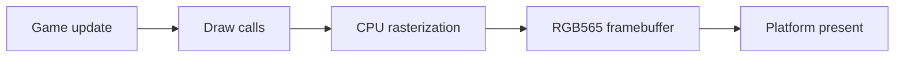

import Architecture from '@site/src/components/Architecture';

# Architecture

게임 코드가 공통 모듈과 렌더러를 사용하고, 플랫폼 계층이 완성된 프레임을 표시합니다. 노드를 클릭하면 역할을 확인할 수 있습니다. 드래그와 확대도 지원합니다.

<Architecture />

## 프레임 흐름

## 소스 탐색

- `src/core`, `src/renderer`: 컨텍스트와 3D 렌더링
- `modules/renderer2d`: 별도 2D 렌더러
- `src/game`: 저장, 수명주기와 게임 보조 기능
- `platforms`: 플랫폼 구현

이 그림은 탐색용 요약입니다. 함수별 수명 및 메모리 계약은 공개 헤더와 원문 문서를 확인하세요.
