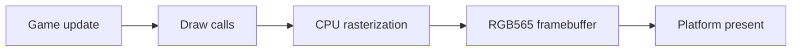

import Architecture from '@site/src/components/Architecture';

# Architecture

게임 코드가 공통 모듈과 렌더러를 사용하고, 플랫폼 계층이 완성된 프레임을 표시합니다. 노드를 클릭하면 역할을 확인할 수 있습니다. 드래그와 확대도 지원합니다.

<Architecture />

## 프레임 흐름

## 소스 탐색

- `src/core`, `src/renderer`: 컨텍스트와 3D 렌더링
- `modules/renderer2d`: 별도 2D 렌더러
- `src/game`: 저장, 수명주기와 게임 보조 기능
- `platforms`: 플랫폼 구현

이 그림은 탐색용 요약입니다. 함수별 수명 및 메모리 계약은 공개 헤더와 원문 문서를 확인하세요.

## 공통 기능과 렌더러의 경계

`Pixelica::common`은 수명주기·저장소·클립 등 게임 기능을 공유합니다. 3D 코어와 2D 렌더러는 별도 타깃이며 두 렌더러를 함께 켜면 2.5D 하이브리드를 사용할 수 있습니다. 플랫폼은 입력·시간·화면 출력을 담당하고, 게임은 플랫폼 이벤트를 수명주기에 전달합니다.

`src/light`는 마스크·블룸 도구, `src/renderer/light_draw.c`는 3D 빛 패치·접촉 그림자 출력을 담당합니다. `modules/water`는 선택 수면·부력 코어와 3D 어댑터로 나뉩니다. 물 코어는 렌더러에 의존하지 않습니다.

[게임 기능 연결](../guides/game-features.mdx)과 [물 애드온](../guides/water.mdx)에서 사용 흐름을 확인하세요. 전체 모듈과 SDK 경계는 [구조 원문](../engine/architecture.md)에 정리되어 있습니다.
